<!--cover-->
<div class="cover">

<p class="kicker">Research &amp; Development</p>
<h1 class="doc-title">Crazyflie Vision-Based Control Learning Environment</h1>
<p class="doc-sub">Setup and Operation Guide</p>
<p class="doc-sub2">Camera position measurement with ArUco markers, and drone control from the PC over the Crazyradio</p>
<table class="cover-meta">
<tr><td>Author</td><td>Lahiru Dhananjaya, Software Architect<br>All research and development</td></tr>
<tr><td>Company</td><td>Tegara Corporation</td></tr>
<tr><td>Version</td><td>1.0, November 2026</td></tr>
<tr><td>Licence</td><td>GNU General Public License, version 3 or later</td></tr>
<tr><td>Scope</td><td>Phase 1 (camera position into the drone) and Phase 2 (controller on the PC)</td></tr>
<tr><td>Hardware</td><td>Crazyflie 2.1+, Flow Deck v2, Crazyradio, USB camera</td></tr>
</table>
</div>
<!--/cover-->

## Contents

1. What the system does
2. What you need, and who supplies it
3. Prepare the computer
4. Connect to the Crazyflie and make the first flight
5. Set up the camera
6. Print and mount the ArUco marker
7. Calibrate the camera lens
8. Lay out the floor and create the floor map (homography)
9. Check the position measurement
10. Phase 1: fly with the camera position fed into the drone (Method 2)
11. Phase 2: fly with a controller on the PC (Method 1)
12. Troubleshooting
13. Choosing a camera for a different room
14. Record sheet
15. Files in this package
16. Test status and known limits
17. Using the Bitcraze cfclient with the Crazyflie
18. Summary of Phase 2
19. Command reference

---

## Summary

This package lets a team build and study a vision-based control loop around one Crazyflie 2.1+ nano drone. An overhead USB camera sees an ArUco marker on the drone. The PC turns the marker's position in the picture into metres on the floor, shows it, logs it, and sends commands to the drone over the Crazyradio: take off, move to a position, hold it, and land, with an emergency stop at any moment.

Tegara offers the Crazyflie drone set. The Python source code, this guide in English and Japanese, and the printable marker and calibration sheets are free and open source. The camera, its mount, the computer and the flight space are supplied by you. Section 2 lists exactly what is needed.

Two ways of flying are provided. In **Phase 1** the PC sends the camera position to the drone, and the drone's own firmware flies and holds the position. In **Phase 2** the control law runs on the PC, in one short function that you can read and rewrite. Both phases were flown on the lab hardware on 13 October 2026. The drone held its target within about 1 cm in Phase 1 and within about 2 cm (4 cm at worst) in Phase 2, against an aim of 10 cm.

Three things are still open and are stated in section 16: the emergency stop (SPACE) has not yet been tried in a real flight, the marker was lost once at the far side of the flight area in a light level that was lower than recommended, and the scripts have only been run on Windows. The first-time reader should read sections 2 and 3, then follow sections 4 to 10 in order. Section 19 collects every command on one page.

---

## Status at a glance

| Part | Status |
|---|---|
| Radio connection, battery and Flow Deck check (`connect_test.py`) | Tested on the hardware |
| First hover with the Flow Deck only (`flow_hover_test.py`) | Tested on the hardware, flew correctly over the black floor paper |
| Camera setup window (`camera_setup.py`) | Used on the hardware |
| Camera calibration and floor map (`vision_pipeline_tool.py`) | Done on the hardware at 640x480 (15 of 15 images, error 0.631). Also done earlier at 1920x1080 (18 of 18 images, error 0.331) |
| Live position display and CSV log (`live_tracker.py`) | Tested on the hardware |
| Phase 1 check mode (`phase1_flight.py --check`) | Tested on the hardware: 29.7 fps, drone estimate follows the camera to about 1 cm |
| Phase 1 flight (`phase1_flight.py`) | Full flight done on 13 October: take off, hover, move to the target, hold 5 s, return, land. The hold was within 1 cm of the target |
| Phase 2 flight (`phase2_flight.py`) | Full flight done on 13 October: take off, move, hold 5 s (mean 2.1 cm, worst 4.1 cm from the target), return, land. Sliders, click-to-target and the settings file were tested. A marker loss during a second flight made the drone land by itself as designed |
| Emergency stop with SPACE in flight | Built into both scripts, not yet tried in a real flight |
| Linux | The commands are given, but the scripts have only been run on Windows |

---

## The whole Phase 1 procedure on one page

The setup in the first row is done once, and again only when the camera, the picture size or the flight area changes. The second and third rows are what you do each time you fly. Every box names the section that explains it.

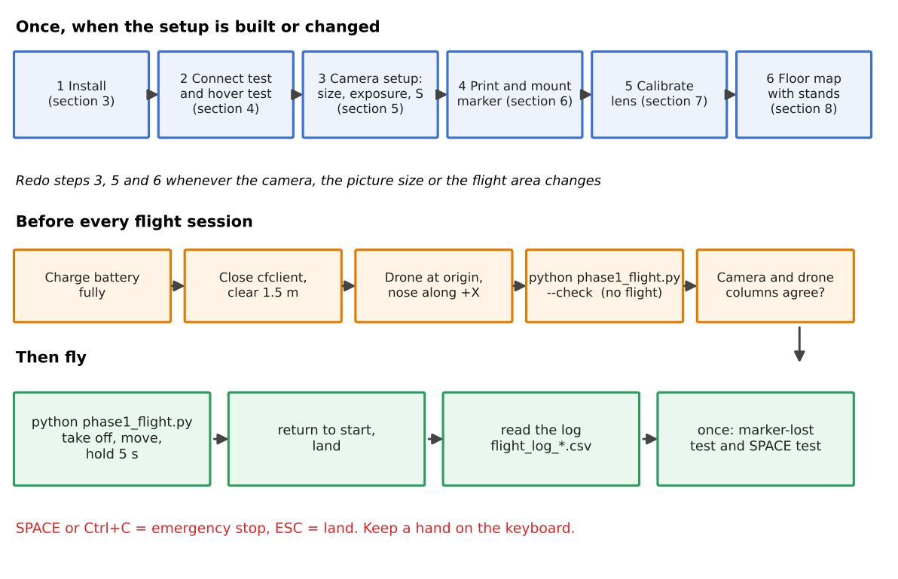

The commands, in order, from the project folder (Linux: use `python3` instead of `python`):

| Step | Command | Result to look for |
|---|---|---|
| Install | `pip install -r requirements.txt` | no errors |
| Connect test | `python connect_test.py` | battery voltage, "Flow Deck detected" |
| Hover test | `python flow_hover_test.py` | take off to 0.3 m, hover 3 s, land |
| Camera setup | `python camera_setup.py 1` | marker found, 20 fps or more, press S |
| Calibrate lens | `python vision_pipeline_tool.py`, options 1 then 2 | error under about 0.7 |
| Floor map | `python vision_pipeline_tool.py`, option 5 | origin sanity check (0.000, 0.000) |
| Check, no flight | `python phase1_flight.py --check` | about 30 fps, drone follows the camera |
| Fly | `python phase1_flight.py` | lands at the start, log file written |
| Phase 2 dry run | `python phase2_flight.py --dry` | the command points towards the target |
| Phase 2 fly | `python phase2_flight.py` | lands at the start, log file written |

---

## 1. What the system does

An overhead USB camera looks straight down at a flight area on the floor. A small ArUco marker on top of a Crazyflie 2.1+ is found in every camera picture. The marker's pixel position is turned into metres on the floor. The PC shows that position, writes it to a log file, and uses it to command the drone over the Crazyradio: take off, move to a position, hold, land, and an emergency stop.

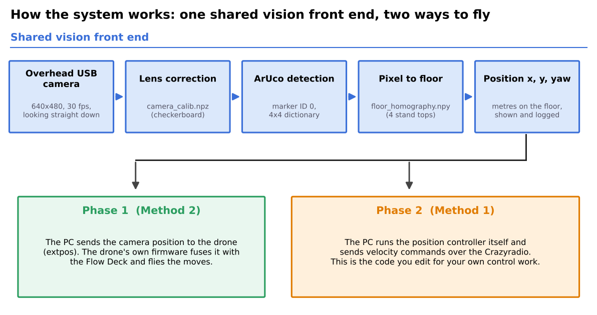

The front half (camera, lens correction, marker detection, pixel to floor) is shared. What happens after it differs between two phases.

In **Phase 1 (Method 2)** the PC sends the camera position to the drone as an external position update. The drone's own firmware fuses it with the Flow Deck and flies the moves with Bitcraze's tested controller. You never write a position controller. This gives a working, demonstrable system quickly.

In **Phase 2 (Method 1)** the PC computes the position error itself and sends velocity commands. This is the part you edit for your own control work. It is more sensitive to delay, because the camera, the detection and the radio link are now inside the loop.

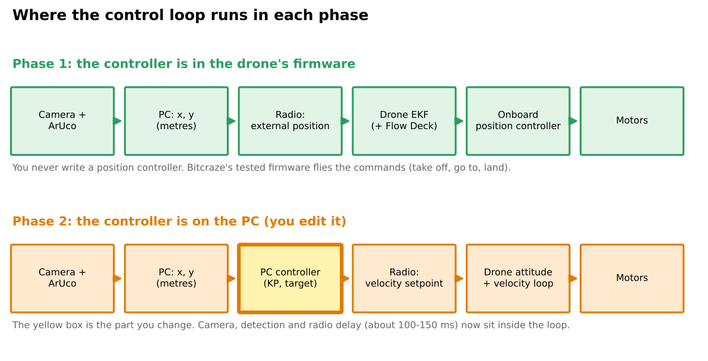

Only ArUco markers are used for tracking.

---

## 2. What you need, and who supplies it

The package is the drone set plus free software and documents. The camera, the computer and the flight space come from you. The two lists below are the complete shopping and preparation list.

### 2.1 What the drone set and this repository provide

| Item | Notes |
|---|---|
| Crazyflie 2.1+ with battery and USB charging cable | From the Bitcraze STEM bundle |
| Flow Deck v2 | Gives the drone its height and its motion over the floor. It needs a textured floor |
| Crazyradio dongle | The lab used a Crazyradio 2.0 on the address `radio://0/80/2M` |
| Spare propellers and a screwdriver | From the bundle |
| This package | Python source code (section 15), this guide in English and Japanese, and the printable sheets in the `print` folder: the ArUco marker sheet and the calibration checkerboard |

We recommend that you also buy at least two spare batteries, a few spare propellers, and a charger that can charge more than one battery. A flight session with many short flights uses the batteries quickly. The scripts refuse to take off below 4.0 V, and a battery that starts near 3.8 V may not finish a flight (section 11.8).

### 2.2 What you supply

| Item | What is needed | What the lab used |
|---|---|---|
| USB camera | A UVC (plug and play) webcam with a sharp picture. It must give at least 640x480 at 30 frames per second, and the PC must be able to set its focus and exposure by hand (section 5.2 shows how). Automatic exposure slowed the lab camera to about 5 frames per second | A camera that Windows reports as "FHD Camera" (USB ID VID_1BCF&PID_28C4). 640x480 at 30 fps with manual exposure. The exact model is still to be confirmed (section 5.3). This is the only camera tested |
| Camera mount | A rigid stand, arm or frame that holds the camera pointing straight down and does not move after calibration | Camera about 1.2 m above the floor, estimated and still to be measured (section 5.3) |
| Computer | Windows 10 or 11, or Linux. Python 3.10 or newer. Two free USB ports (camera and Crazyradio) and a screen. No graphics card is needed | Windows with Python 3.14 and cflib 0.1.34. The detection runs at the camera's full 30 fps |
| Flight area | A textured floor or mat (the Flow Deck cannot track a plain, shiny or white surface), about 1 m by 0.6 m or more, with 1.5 m free around it. Even light | A black paper floor, 0.93 m by 0.59 m used for flying (section 8) |
| Lighting | Even, bright light with no glare on the marker. The picture brightness shown by the scripts should be about 60 to 180 (of 255) | The last lab test was darker (41 to 54), see section 11.9 |
| Safety | A net or enclosure around the area is your responsibility. Eye protection is advisable | None used |
| Printer and small items | A printer for A4 at 100% scale, a stiff card, masking tape, a tape measure, and four stands of exactly equal height (the lab used 0.3 m, the hover height) | As listed |

The solution is not tied to one camera model. It was tested with the camera in the table. If you buy a different camera, section 5.2 shows how to check the frame rate and exposure, section 13 shows how to check that the marker is large enough in the picture, and the camera model should be written into the record sheet in section 14.

### 2.3 Printed sheets

In the `print` folder. Print at 100% / actual size with no "fit to page":

- `aruco_id0_with_margin_A4.pdf`: ArUco ID 0 in five sizes, each with a 5 mm white margin and a cut line.
- `checkerboard_10x7_25mm_A4.pdf`: the calibration checkerboard, 10 x 7 squares of 25 mm.

Check each print with a ruler. The marker sheet has a 100 mm scale bar. The checkerboard has a scale line. If a line is not the right length the printer scaled the page, so print again.

### 2.4 Software

Python 3.10 or newer (this is the minimum for the Crazyflie library) and the packages listed in `requirements.txt`. Section 3 gives the steps. A connection to the internet is needed once, to install the packages.

### 2.5 Safety

Keep hands and face away from the propellers. Clear about 1.5 m around the drone. Close cfclient before running any script (only one program can use the Crazyradio at a time). Press Ctrl+C in the script window, or SPACE in the camera window, to cut the motors at once. The drone then drops, so keep the first flights low. Fly only with a fully charged battery (about 4.1 V at rest). The voltage drops by about 0.4 V the moment the motors start: in the lab flights it fell from 3.82 V to 3.44 V. Both flight scripts land by themselves at 3.4 V and, as delivered, refuse to take off below 4.0 V. Do not lower the limits to make a flight start.

---

## 3. Prepare the computer

Open a terminal in the project folder.

**Windows (PowerShell):**

```
python -m venv venv
venv\Scripts\Activate.ps1
pip install -r requirements.txt
```

If PowerShell refuses to run the activation script, run `Set-ExecutionPolicy -Scope Process -ExecutionPolicy Bypass` first and try again.

**Linux:**

```
python3 -m venv venv
source venv/bin/activate
pip install -r requirements.txt
```

Check that the virtual environment is really the one in use. This prints the path of the Python that runs your scripts. It should end inside the `venv` folder.

```
python -c "import sys; print(sys.executable)"          # Windows
python3 -c "import sys; print(sys.executable)"         # Linux
```

On the lab PC an earlier install went into the system Python by mistake. If a package seems missing although you installed it, this is the first thing to check.

**OpenCV must be the contrib build.** `cv2.aruco` only ships in `opencv-contrib-python`. The "headless" build has no windows, and plain `opencv-python` conflicts with the contrib build. If a script stops with `cv2.error: The function is not implemented` on `imshow`, you have the wrong build. Fix it with:

```
pip uninstall -y opencv-python opencv-python-headless opencv-contrib-python
pip install opencv-contrib-python==5.0.0.93
```

**Crazyradio driver.**

On **Windows**, Bitcraze's library documentation describes installing the Crazyradio driver with Zadig (WinUSB). If cfclient or the scripts cannot find the radio on a new PC, follow the Zadig instructions linked from https://www.bitcraze.io/documentation/repository/crazyflie-lib-python/master/installation/install/. That page does not mention the Crazyradio 2.0 by name. On the lab PC the dongle was recognised and connected successfully, but the exact driver steps used there were not recorded.

On **Linux**, give your user access to the USB devices. This is Bitcraze's own rule set:

```bash
sudo groupadd plugdev
sudo usermod -a -G plugdev $USER
cat <<EOF | sudo tee /etc/udev/rules.d/99-bitcraze.rules > /dev/null
SUBSYSTEM=="usb", ATTRS{idVendor}=="1915", ATTRS{idProduct}=="7777", MODE="0664", GROUP="plugdev"
SUBSYSTEM=="usb", ATTRS{idVendor}=="1915", ATTRS{idProduct}=="0101", MODE="0664", GROUP="plugdev"
SUBSYSTEM=="usb", ATTRS{idVendor}=="0483", ATTRS{idProduct}=="5740", MODE="0664", GROUP="plugdev"
EOF
sudo udevadm control --reload-rules
sudo udevadm trigger
```

Log out and in again so the group change applies. Bitcraze's page does not mention the Crazyradio 2.0 by name, so if the dongle is not found on Linux, check `lsusb` for a device with vendor ID 1915 and tell us the product ID.

**cfclient (optional).** Bitcraze's graphical client is useful for a first look at the drone, for updating firmware and for reading settings. Section 17 explains how to install, start and use it. Close it before you run any script.

---

## 4. Connect to the Crazyflie and make the first flight

### 4.1 Connection test

Charge the battery first. A reading of 3.88 V is lowish and is better recharged before flying. About 4.1 V or more is full.

Switch the Crazyflie on and leave it still on a flat surface. Close cfclient. Then run:

```
python connect_test.py          # Windows
python3 connect_test.py         # Linux
```

The script scans for Crazyflies, connects to the first one it finds, prints the battery voltage, and says whether the Flow Deck v2 is detected. The motors stay off. If the Flow Deck is not detected, press it fully onto the underside pins, power-cycle the drone and run it again. If the connection fails, the likely causes are the radio driver (section 3), the drone being off, cfclient still open, or a drone on a non-default radio address.

### 4.2 First hover with the Flow Deck only

This tests the motors, the radio and the Flow Deck before the camera is involved. Place the drone flat on a textured floor with room around it.

```
python flow_hover_test.py       # Windows
python3 flow_hover_test.py      # Linux
```

The script refuses to fly if the battery is below 3.8 V or the Flow Deck is missing. After three seconds it takes off to 0.3 m, hovers for three seconds and lands. Ctrl+C cuts the motors immediately. The radio address is the `URI` line at the top of the script (`radio://0/80/2M`). If your drone uses a different channel or address, change it there.

This test flew correctly on the lab hardware. You may see warnings about "legacy hover" in the output when the installed cflib is newer than the drone's firmware. The flight worked with the warnings present. You can update the drone's firmware from cfclient if you want them gone. The Crazyflie 2.1+ uses the firmware platform `cf2`.

---

## 5. Set up the camera

### 5.1 Mount and view

Fix the camera rigidly above the flight area, looking straight down. Anything that makes the camera move after calibration (a loose arm, a bumped cable) makes the calibration and the floor map wrong, so tighten the mount first. The whole flight area, plus a margin, must be inside the picture.

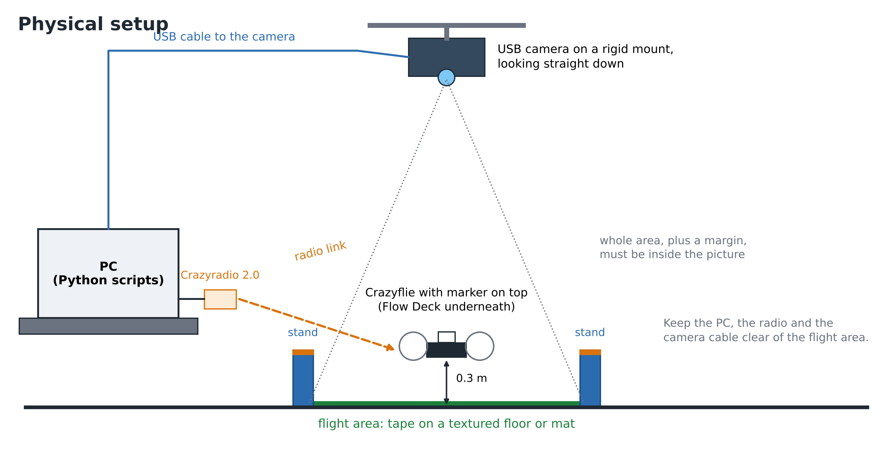

Use even light with no glare on the marker and no shadow of your hand or the drone across it. Do not change the camera's zoom or focus once you start calibrating.

### 5.2 Choose the resolution and exposure

The marker is only 30 mm wide, because it must fit between the four propellers. In the picture it can therefore be very small, and the detector needs it to be wide enough. As a rule, 20 pixels across or more is good, 12 to 20 is marginal, and under 12 is too small. The choice of picture size is a trade between how large the marker is and how many pictures per second the camera delivers.

On the lab camera the same 30 mm marker at the same camera position measured 32 to 36 pixels wide at 1920x1080 and 14 pixels wide at 640x480. The frame rate, however, behaved differently from what the specification suggests. At 1920x1080 the camera delivered only about 5 frames per second, whatever the exposure we tried (automatic, -6 and -13). At 1280x720 it delivered about 10 frames per second with automatic exposure. At 640x480 it delivered 5 frames per second with automatic exposure, but a full 30 frames per second with manual exposure (AutoExposure 0, Exposure 8). We did not find the exact cause. A camera in automatic exposure will often lower its own frame rate in dim light, which fits this, but it was not proven. The 1280x720 and 1920x1080 sizes were not tried again with manual exposure 8.

Phase 1 needs the camera position many times per second, because the drone moves and the position is fed into its estimator continuously. The flight script measures the camera rate and refuses to take off below 10 frames per second. At 5 frames per second the camera position visibly lags a hand-moved drone and jumps in steps. We therefore fly at 640x480 with manual exposure. Detecting a marker only 14 pixels wide works because the detector reads each cell of the marker at a finer step (`perspectiveRemovePixelPerCell = 8`, set in `live_tracker.py` and `camera_setup.py`). Without that setting the detector rejected a 30 pixel marker at 1920x1080 in the picture that the flight script saved. If you have a camera that gives 20 frames per second or more at 1920x1080 (for example a USB 3 camera on a USB 3 port), use that size instead: the marker is easier to detect and positions are more accurate. Then redo sections 7 and 8 at that size.

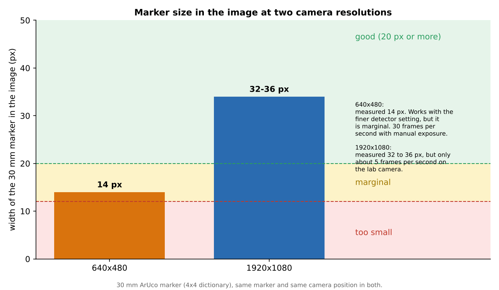

Run the camera setup window (the number is the camera index: 0 is usually a laptop's own camera, 1 the mounted one):

```
python camera_setup.py 1        # Windows
python3 camera_setup.py 1       # Linux
```

If you do not know the index, this prints which indexes open:

```
python -c "import cv2; [print(i, cv2.VideoCapture(i, cv2.CAP_DSHOW).isOpened()) for i in range(6)]"    # Windows
python3 -c "import cv2; [print(i, cv2.VideoCapture(i).isOpened()) for i in range(6)]"                 # Linux
```

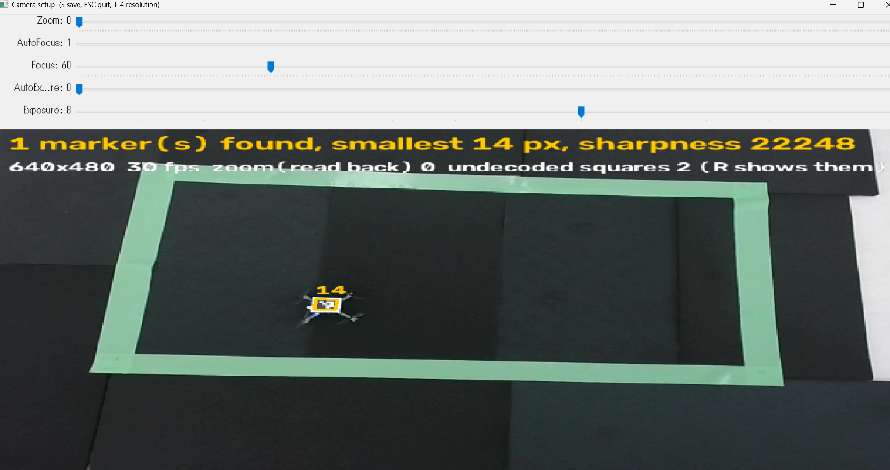

The window starts at 1920x1080 (the picture above was taken after pressing 1 for 640x480). The top line shows how many markers were found, the width of the smallest in pixels (green is good) and a sharpness number. The second line shows the picture size and the frame rate. Keys: 1 to 4 switch resolution (640x480, 1280x720, 1920x1080, 3840x2160), R shows squares the detector found but could not decode, P saves a full-resolution picture, S saves the settings, ESC quits.

Press 1 for 640x480, put the marker on the drone in the middle of the area and read the top lines. If the marker blinks between "found" and "no marker", it is too small, blurred or badly lit. Use the sliders one at a time. Set AutoExposure to 0 first, then raise Exposure.

The Exposure slider matters most. On Windows the slider value n is sent to the camera as -n, so a larger value means a shorter exposure. A long exposure washes the picture out and smears a moving marker. In automatic exposure the picture brightness drifts and the marker can flicker about once a second. The lab values that worked at 640x480 were AutoExposure 0 and Exposure 8, which gave 30 frames per second with the marker steady. They depend on your lighting. The colour camera may have a fixed focus, in which case the focus sliders do nothing. Leave Zoom alone.

When the marker is steady and the frame rate is 20 or more, press **S**. This writes `camera_settings.json` next to the scripts. From then on, `vision_pipeline_tool.py`, `live_tracker.py` and `phase1_flight.py` open the camera at that size with those settings and print them, for example:

```
Camera settings loaded from ...\camera_settings.json
  autofocus 1, focus 90, auto_exposure 0, exposure -8
Camera resolution: 640x480
```

The file `camera_settings.example.json` shows the format. Delete `camera_settings.json` to return to the camera's own defaults. Check that line each time you start a script: an old saved exposure of -13 made the picture almost black during testing, and the script then could not find the marker.

Which camera is it? In Device Manager the camera at index 1 reported the USB ID `VID_1BCF&PID_28C4` and the description "FHD Camera". That is not an Intel ID. The record sheet in section 14 lists it as to be confirmed. To check that the script uses the camera you think it uses, cover that camera's lens and see whether the picture in `camera_setup.py` goes dark.

On Linux the camera sliders go through a different driver. Resolution works the same, but exposure values mean something different there, and that has not been tested.

To measure the real frame rate for each size, compression and exposure mode, run `python camera_fps_test.py 1`. It takes about a minute and prints a table. `camera_modes.py` and `compare_saved_images.py` are older diagnostic tools that save one picture per resolution and report the marker width in each. None of these are required steps.

### 5.3 Camera specification: what matters and what we know

The camera is the part of the system that most often decides whether it works, so this section lists what the system needs from it, what we measured on the lab camera, and what we do not know yet.

**What the system needs from a camera.** The first three rows decide whether Phase 1 works. The others make it easier or more accurate.

| Property | What the system needs | Why |
|---|---|---|
| Frame rate at the chosen size | 20 frames per second or more. The flight script refuses to take off below 10 | The camera position is sent to the drone for every picture. At 5 frames per second it lags and jumps in steps |
| Marker width in the picture | 20 pixels or more is good, 12 to 20 is marginal | The detector must read the 4x4 cells of the marker. Formula in section 13 |
| Manual exposure control | AutoExposure can be switched off and the exposure fixed | Automatic exposure made the marker flicker about once a second, and on the lab camera it also held the frame rate down |
| Short exposure | A bright, even floor and a short exposure | A long exposure smears a moving marker. The marker was lost in 25 to 70 percent of the pictures while the drone was moving fast, even with manual exposure 8 |
| Focus | Fixed, or locked | The calibration is only valid for one focus setting |
| Shutter type | Global shutter is better for fast motion. Not required | A rolling shutter skews a fast-moving marker slightly |
| USB connection | USB 3 port and cable preferred | More bandwidth for large pictures at a high frame rate |
| Mount | Rigid, looking straight down | Any movement after calibration makes the floor map wrong |

**Measured on the lab camera** (this is the camera at index 1, which `camera_setup.py` and all scripts open). At 640x480 with manual exposure it delivers 30 frames per second, and the 30 mm marker is 14 pixels wide. At 1920x1080 it delivers only about 5 frames per second, and the marker is 32 to 36 pixels wide.

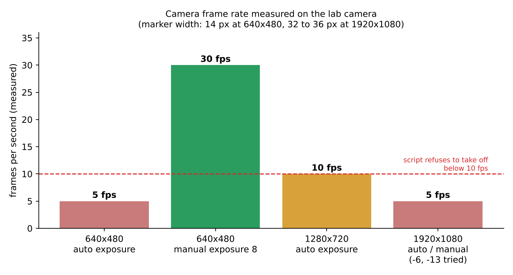

**What we know about the lab camera's identity.** Windows reports it as "FHD Camera" with the USB ID `VID_1BCF&PID_28C4`. Intel's RealSense cameras use the vendor ID 8086, so this ID does not belong to a RealSense. Searching for this vendor and product ID returns driver listings for Sunplus Innovation webcams, a maker of generic 1080p webcams, for example [this listing](https://treexy.com/products/driver-fusion/database/imaging-and-cameras/sunplus/1080p-fhd-camera/). We have not found the exact model. The earlier project notes called the camera a RealSense D435, so either the notes or the camera index is wrong, or the machine has both cameras. We have not yet checked which. The following are therefore not known: the exact model, the sensor, the lens field of view, the shutter type, and the camera height above the floor.

**How to find out.** Cover the lens of the RealSense and look at the picture in `camera_setup.py`. If it does not go dark, the script is using the other camera. Then list the cameras and their IDs.

Windows (PowerShell):

```
Get-PnpDevice -Class Camera | Format-List FriendlyName, InstanceId, Manufacturer
Get-PnpDevice -PresentOnly | Where-Object { $_.InstanceId -match 'VID_8086|VID_1BCF' } | Format-List FriendlyName, InstanceId
```

Linux (install `v4l-utils` first with `sudo apt install v4l-utils`):

```
v4l2-ctl --list-devices
lsusb
v4l2-ctl -d /dev/video0 --list-formats-ext
```

The last line lists every picture size, compression and frame rate the camera says it supports. Then run `python camera_fps_test.py 1` to measure what it really delivers on this PC. The RealSense is index 0 or 1 or 2 depending on the PC; use `camera_setup.py 0`, `camera_setup.py 2` and so on to find it.

**If the camera is a RealSense D435.** Intel's [D435 product brief](https://simplecore.intel.com/realsensehub/wp-content/uploads/sites/63/D435_Series_ProductBrief_010718.pdf) lists a colour resolution of up to 1920 x 1080, a field of view of 69.4 x 42.5 x 77 degrees (each plus or minus 3 degrees), and a USB 3 Type-C connection. The brief does not give the colour camera's frame rate or shutter type, so we do not claim them. If the D435 is on a USB 2 port, its colour stream is limited, which would explain the low frame rate at 1920x1080.

**A cross-check of the camera height.** In the 640x480 floor map, the 0.93 m edge of the flight area spans 484 pixels, so the whole 640 pixel width is about 1.23 m of floor at the hover height. With a horizontal field of view of 69.4 degrees, that width is seen from a distance of about 0.89 m, so the camera would be about 1.2 m above the floor (0.89 m plus the 0.3 m hover height). This is an estimate, and it holds only if the lens really has that field of view. Measure the real camera height with a tape and write it in the record sheet. If it is far from 1.2 m, the lens is not a 69 degree one, and the camera is not the model we assumed.

**If you use a different camera.** The minimum we recommend is a camera that gives 30 frames per second at 1280x720 or more, has manual exposure control, can be locked in focus, is on a USB 3 port, and sees the flight area so that the 30 mm marker is at least 20 pixels wide (section 13). These are our own recommendations, not tested on other hardware. If you try another camera, please share the model and your results in an issue on the project page.

---

## 6. Print and mount the ArUco marker

Use ArUco ID 0 from the 4x4 dictionary (`DICT_4X4_50`). The sheet `print/aruco_id0_with_margin_A4.pdf` has it in 30, 40, 50, 60 and 80 mm, each on its own white square with a 5 mm margin and a dashed cut line. The 30 mm marker appears four times, so you have spares. Only the 30 mm one fits on the drone. The larger sizes are for testing the camera at long range.

Cut along the dashed line and do not trim into the white margin. The detector needs a clean white border all round the black frame of the marker. That border is one marker cell wide, which is 5 mm for a 30 mm marker.

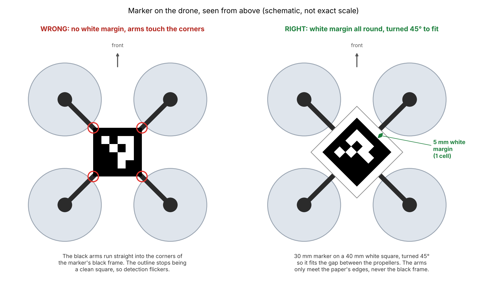

Mount it like this:

1. Glue or tape the 40 mm white square flat on top of the drone, centred between the four propellers.
2. Turn the square about 45 degrees, so that its corners point towards the front, back, left and right of the drone, and its edges run parallel to the arms. In this position the paper fits the gap between the propellers. The drawing is schematic, so hold the paper against your real drone before you fix it, and check that no propeller can touch it.
3. Do not let any black part of the drone (an arm, a deck, a cable) touch the marker's black frame. The white margin must stay clear of black all round.
4. Keep it flat and stiff. A curled or glossy paper gives glare and a distorted outline. Ordinary printer paper adds only a fraction of a gram.

Because the marker is turned, the yaw angle the tracker reports is offset from the drone's nose direction by a fixed amount. You measure that offset once: put the drone at the start position with its nose along +X (section 8), read the yaw in `live_tracker.py` (section 9), and write it down in the record sheet. The flight scripts will subtract it.

---

## 7. Calibrate the camera lens

Every lens bends straight lines a little. Calibration measures this so that the pictures can be corrected before positions are computed. It is done with the checkerboard and is valid only for one camera, one resolution and one lens setting. Repeat it whenever you change the resolution, the zoom or the focus.

Print `print/checkerboard_10x7_25mm_A4.pdf` at 100%, check the scale line, and stick it flat onto a stiff card. The board has 10 x 7 squares of 25 mm, which is 9 x 6 inner corners, as the tool expects. If you use another board, edit `CHECKERBOARD_CORNERS` and `SQUARE_SIZE_M` near the top of `vision_pipeline_tool.py`.

Run the tool and choose option 1:

```
python vision_pipeline_tool.py        # Windows
python3 vision_pipeline_tool.py       # Linux
```

If a folder `cf_vision_data/checkerboard_images` from an earlier run at another resolution exists, rename it first so old pictures are not mixed in:

```
Rename-Item cf_vision_data\checkerboard_images checkerboard_images_old       # Windows (PowerShell)
mv cf_vision_data/checkerboard_images cf_vision_data/checkerboard_images_old # Linux
```

Option 1 shows the live picture with a yellow target box. Hold the board about 30 to 50 cm in front of the camera so that it fills the box. Press SPACE for each shot. The box moves to a new position after every three shots, and you follow it. Take about 15 shots, tilting the board a little between the three shots at each position. Press ESC to finish.

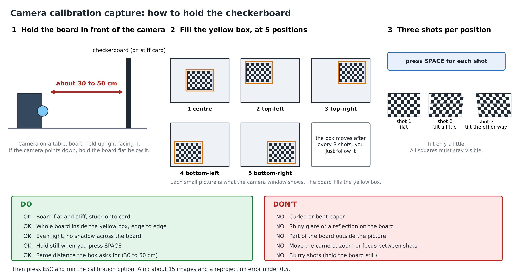

Then choose option 2. The tool prints how many images were usable and the reprojection error. Aim for about 15 usable images and an error under 0.5 (up to about 0.7 is acceptable at 640x480). Sample output from the lab at 640x480:

```
--- Camera calibration ---

Calibrated using 15/15 images.
Reprojection error: 0.6311  (good is under ~0.5; recapture more varied angles if higher)
Saved: ...\cf_vision_data\camera_calib.npz
```

At 1920x1080 on the same camera the result was 18 of 18 images and an error of 0.331.

At 640x480 the first attempt gave an error of 6.6 although all 15 images were found. The cause was that one printed square is only about 12 pixels wide in that picture, and the corner refinement used a fixed window of 23 pixels, wider than a square. The corners were pulled to wrong positions. `vision_pipeline_tool.py` now sizes the window from the measured square size, which brought the error to 0.631 with the same pictures. In all 15 shots the board lay flat. With tilted shots the focal length would be determined more reliably, so if the floor map check later shows errors growing towards the edges, retake some shots with the board tilted.

If the error is high, run `python inspect_corners.py`, which draws the detected corners on every picture with a sharpness score so you can find and delete the bad shots, then run option 2 again. The usual causes are a bent board, blurred shots, and a board too small in the picture.

Option 2 saves `cf_vision_data/camera_calib.npz` and also stores the picture size. Any tool that opens the camera at a different size prints a warning telling you to calibrate again. The calibration and the floor map only work at the size they were made at. To keep an earlier set when you change size, rename the whole folder first, for example `Rename-Item cf_vision_data cf_vision_data_1080p` on Windows or `mv cf_vision_data cf_vision_data_1080p` on Linux. The lab keeps its 1920x1080 data that way.

---

## 8. Lay out the floor and create the floor map (homography)

The floor map (a homography) turns a pixel in the picture into a position in metres on the floor. You create it by clicking four known points.

### 8.1 Why the reference points must be at hover height

The drone flies about 0.3 m above the floor, which is closer to the camera than the floor is. It therefore appears shifted outward compared with the floor point under it. If you click four points on the floor, the map is correct for the floor, and the flying drone is read with an error that grows towards the edge of the picture. If you click the tops of four stands of the same height as the hover height, the map is correct for the plane the drone flies in.

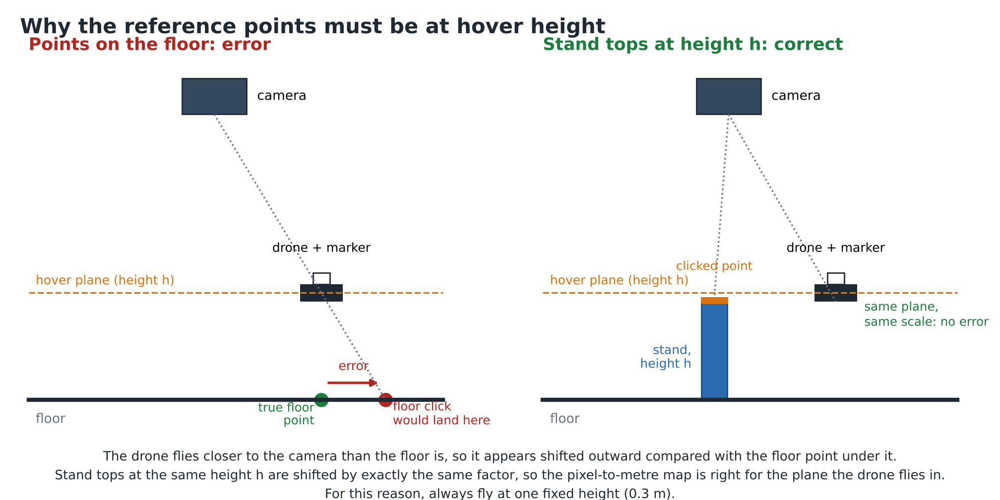

So: use four stands of exactly equal height, fly at that one fixed height, and never change the height after creating the map. Our height is 0.3 m.

### 8.2 Layout

1. Choose the origin and the +X direction before you start. The origin is a corner of the area. +X runs along the edge the drone's nose points along when you place it at the start. +Y points to the drone's left, as seen from above (a right-handed frame). A mismatch between this frame and the drone's real nose direction is the classic first-flight bug: the drone flies confidently in the wrong direction.
2. Tape out a rectangle on the floor. Mark the origin and the +X edge.
3. Stand one stand at each corner, centred over the corner mark. Put a small coloured dot on the top of each stand, to click on.
4. Measure centre to centre with the tape measure: the X size (stand 1 to stand 2) and the Y size (stand 1 to stand 4). Do not measure outer or inner edges.
5. Check the corners are square by measuring the diagonal from stand 1 to stand 3. It must equal the square root of X squared plus Y squared. For 0.93 m and 0.59 m that is 1.101 m, and we measured 1.1 m. If it differs by more than a centimetre or two, move a stand until it matches.

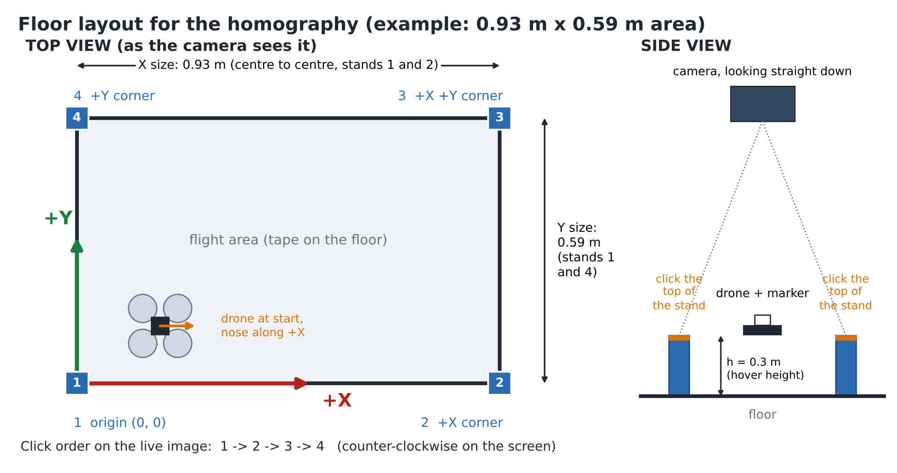

### 8.3 Create the map

Do not move the camera or the stands from here until the map is saved. Run the tool, choose option 5, enter the measured X size and then the Y size in metres, and click the four stand tops in this order: 1 origin, 2 the +X corner, 3 the far corner, 4 the +Y corner. On the screen the order must go counter-clockwise (for example bottom-left, bottom-right, top-right, top-left). A clockwise order would mirror the Y axis, and the tool prints a WARNING if it detects this.

The tool prints each click, saves `cf_vision_data/floor_homography.npy`, and ends with a sanity check: the origin point must map back to about (0, 0). Sample output from the lab at 640x480:

```
Camera resolution: 640x480
  Point 1 (origin (0,0)): pixel (78, 331)
  Point 2 (+X corner): pixel (562, 357)
  Point 3 (+X+Y corner): pixel (541, 81)
  Point 4 (+Y corner): pixel (112, 58)

Saved: ...\cf_vision_data\floor_homography.npy
Sanity check - origin point maps back to: (0.000, 0.000)  (should be ~0, 0)
```

The stands are only needed for this step. Take them away afterwards and keep them out of the flight area. Repeat this step whenever the camera, the flight area or the picture size changes. The map must be created after the calibration at the same picture size.

---

## 9. Check the position measurement

Run the live tracker:

```
python live_tracker.py        # Windows
python3 live_tracker.py       # Linux
```

It undoes the lens distortion, finds marker ID 0, and shows its floor position in metres and its yaw in degrees (0 is along +X, counter-clockwise is positive). It writes a log file `tracker_log_<date>_<time>.csv` next to the script with the columns `t_seconds, visible, x_m, y_m, yaw_deg, pixel_x, pixel_y`. The log is on from the start. Press L to switch logging on and off, and ESC to quit.

Put the marker flat on top of each stand, then in the middle, always upright with the same edge facing +X, and read x and y.

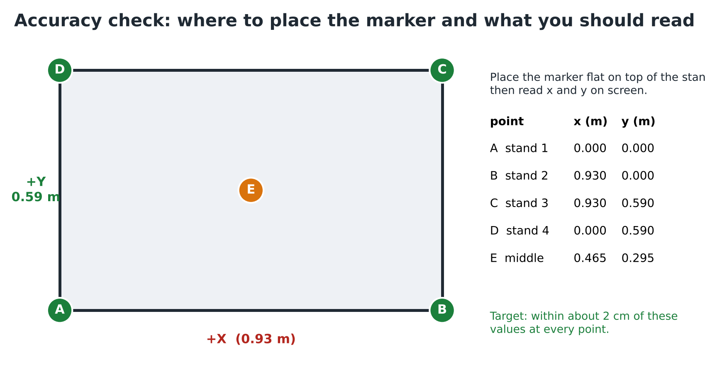

For our example area the expected values are:

| Point | x (m) | y (m) |
|---|---|---|
| A, stand 1 (origin) | 0.000 | 0.000 |
| B, stand 2 | 0.930 | 0.000 |
| C, stand 3 | 0.930 | 0.590 |
| D, stand 4 | 0.000 | 0.590 |
| E, middle | 0.465 | 0.295 |

The target is within about 2 cm at every point. For another area, use your own measured sizes.

If a value is off: a consistent shift in one direction means the camera or a stand moved after the map was made, so repeat section 8. A growing error towards the edges means the points were clicked on the floor instead of on the stand tops, or the stands differ in height. If x and y are swapped or mirrored, the click order or the +X definition is wrong. If the marker flickers, go back to section 5.

The formal check of the five points A to E with the tape measure has been done at 1920x1080 (the middle point read within about 1.5 to 2.2 cm). It has not yet been repeated at 640x480. A quicker check at the new size is the `--check` run in section 10, which compares the camera with the drone's own estimate.

Also read the yaw with the drone placed at the start position, nose along +X. Write that number in the record sheet. It is the fixed yaw offset from section 6.

---

## 10. Phase 1: fly with the camera position fed into the drone (Method 2)

The script `phase1_flight.py` does this. The drone's onboard estimator (an extended Kalman filter, EKF) combines the Flow Deck with an external position. The script sends it the camera's x and y for every camera picture (about 30 per second at 640x480). The camera's absolute position corrects the Flow Deck's slow drift, and the Flow Deck's fast updates cover missed frames. The drone's own high-level commander then flies the moves, using this corrected position. You do not write a position controller in this phase.

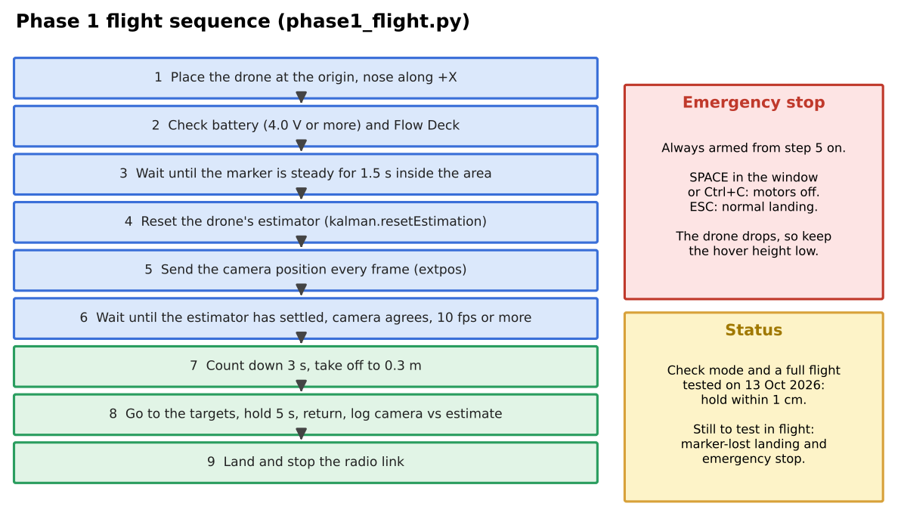

### 10.1 Where the drone goes

The drone does not move at random and you do not click on the screen. It flies to the points in the `TARGETS` list at the top of `phase1_flight.py`. The default value is one point, `(0.465, 0.295)`, which is the middle of the 0.93 m by 0.59 m area. The flight is: take off to 0.3 m, go to each target in order (3 seconds per move), hold there for 5 seconds, return to the start position, and land. The drone keeps its heading the whole time, with the nose along +X, so it never turns. To change where it goes, edit `TARGETS`, for example `TARGETS = [(0.2, 0.2), (0.7, 0.2), (0.7, 0.4)]`, and keep every point inside the flight area. Choosing a target by clicking on the camera picture is not part of this script. It is built into the Phase 2 script (section 11.5).

### 10.2 What the script does, in order

The order matters, and it is the same for every flight. The script connects to the drone and checks the battery (at least 4.0 V) and the Flow Deck. It waits until the marker has been seen steadily for 1.5 seconds inside the area. It sets the drone to use the Kalman estimator and the high-level commander, resets the estimator, and starts sending the camera position continuously. It waits until the estimator's position spread has settled, and checks that the drone's estimate and the camera agree within 5 cm. It checks the camera rate (at least 10 frames per second). Only then does it count down three seconds and take off. The camera height value that is sent is the drone's own height estimate, so the camera only corrects x and y. Every frame, the script also writes a line to `flight_log_<date>_<time>.csv` with the time, phase, camera position, the drone's own estimate, the height and the battery voltage.

The settings are at the top of the file: `URI` (radio address), `HOVER_HEIGHT` (must equal the stand height used for the floor map), `TARGETS`, `AREA_X` and `AREA_Y`, the move, hold, take-off and landing times, the battery limits, `LOST_SECONDS`, `AREA_MARGIN`, and `EXT_POS_STD`. `EXT_POS_STD` is how much the drone trusts the camera. Its value of 0.03 m is a starting guess. Tuning it from the logs is one of the next steps.

### 10.3 Safety

Click on the camera window first, then: **ESC** lands the drone normally, **SPACE** is an emergency stop (the motors stop at once and the drone drops), and **Ctrl+C** in the terminal does the same emergency stop. The script also lands by itself in three cases: the marker has not been seen for 3 seconds (`LOST_SECONDS`), the marker is more than 0.25 m outside the flight area (`AREA_MARGIN`), or the battery falls below 3.4 V. While the marker is lost the drone keeps flying on its Flow Deck alone. If the first low flights are done over a soft surface with a fully charged battery and one hand near the keyboard, a failure costs little.

### 10.4 Run the check first (no flight)

Put the drone with the marker in the flight area, nose along +X, and run:

```
python phase1_flight.py --check        # Windows
python3 phase1_flight.py --check       # Linux
```

This does everything up to the take-off countdown, then streams the camera position to the drone for 20 seconds while you slide the drone by hand. It prints the camera position and the drone's own estimate side by side. Props off, or the drone held clear. Sample output from the lab at 640x480:

```
Camera settings loaded from ...\camera_settings.json
  autofocus 1, focus 90, auto_exposure 0, exposure -8
Camera resolution: 640x480
Connecting to radio://0/80/2M ...
Battery: 3.81 V
Flow Deck detected (deck.bcFlow2).
Put the marker (drone) in the flight area, nose along +X. Waiting for the marker ...
Waiting for the drone's estimate to settle on the camera position ...
Settled. Drone estimate minus camera: dx +0.000 m, dy -0.000 m
Camera rate: 29.7 frames per second
CHECK MODE: for 20 s slide the drone by hand. No flight.
  camera (+0.173, +0.169)   drone (+0.174, +0.169)
  camera (+0.356, +0.356)   drone (+0.319, +0.331)
  camera (+0.442, +0.367)   drone (+0.443, +0.368)
  camera (+0.495, +0.377)   drone (+0.492, +0.391)
  camera (+0.485, +0.294)   drone (+0.484, +0.297)
  camera (+0.512, +0.300)   drone (+0.508, +0.293)
  camera (+0.465, +0.315)   drone (+0.465, +0.318)
  camera (+0.494, +0.234)   drone (+0.487, +0.236)
Check finished. Compare the two columns in the log file.
```

What to look for: the frame rate line says 20 or more (30 here), the settled difference is within a few millimetres, the marker stays detected while you slide the drone, and the two columns follow each other within about 1 to 2 cm once the drone stops. A lag of several centimetres during fast hand movement is normal.

The same check at 1920x1080 and 5 frames per second showed the camera and the drone differing by up to about 9 cm during movement, and the script printed that the camera gave fewer than 10 frames per second. That is why the flight uses the faster, smaller picture.

### 10.5 Fly

Charge the battery fully. Put the props on and clear about 1.5 m around the drone. Place the drone at the origin with its nose along +X and the stands out of the area, then run:

```
python phase1_flight.py        # Windows
python3 phase1_flight.py       # Linux
```

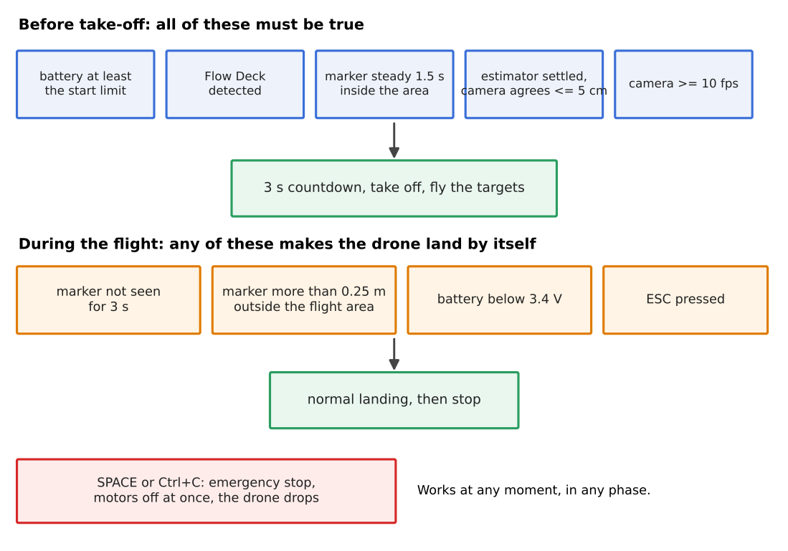

Click on the camera window so that the keys work. The script waits for the marker, resets the estimator, waits for it to settle, counts down three seconds, takes off, flies to the target, holds, returns to the start and lands. Sample output from the full flight on 13 October 2026 (the battery was at 3.97 V):

```
Camera settings loaded from ...\camera_settings.json
  autofocus 1, focus 90, auto_exposure 0, exposure -8
Camera resolution: 640x480
Logging to ...\flight_log_20261013_130809.csv
Connecting to radio://0/80/2M ...
Battery: 3.97 V
Flow Deck detected (deck.bcFlow2).
Put the marker (drone) in the flight area, nose along +X. Waiting for the marker ...
Waiting for the drone's estimate to settle on the camera position ...
Settled. Drone estimate minus camera: dx +0.000 m, dy -0.000 m
Camera rate: 29.7 frames per second
Taking off in 3 seconds. SPACE = emergency stop, ESC = land.
Target 1: (0.465, 0.295)
Returning to the start point.
Landing.
Landed.
```

If the battery is below the start limit, the script stops before take-off with a message such as `Battery missing or below 4.0 V. Not flying.` The default limit is 4.0 V, because the voltage drops by about 0.4 V when the motors start. In the lab the limit in `MIN_VBAT_START` was lowered to 3.8 V to fly with a 3.97 V battery. That flight worked, but the battery fell to 3.46 V for about half a second at take-off, only 0.06 V above the 3.4 V landing limit. A fully charged battery (about 4.1 V or more) is safer.

### 10.6 Results of the full flight, and the tests still to do

The log file of that flight is `flight_log_20261013_130809.csv`. The path of the flight as seen from above:

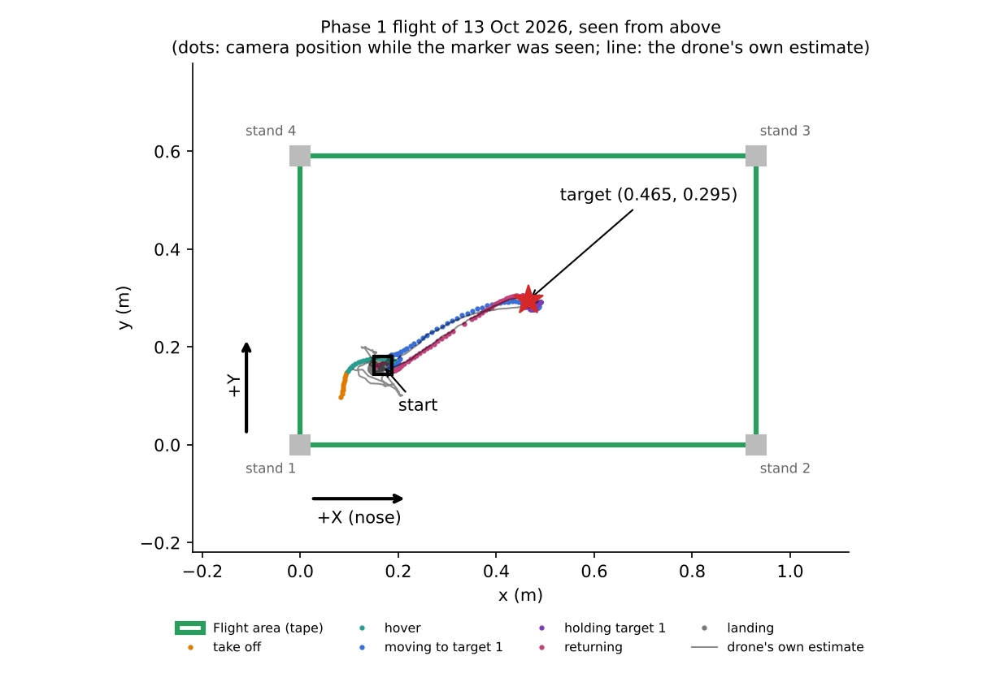

The same flight against time: position, height and battery, with the phases shaded.

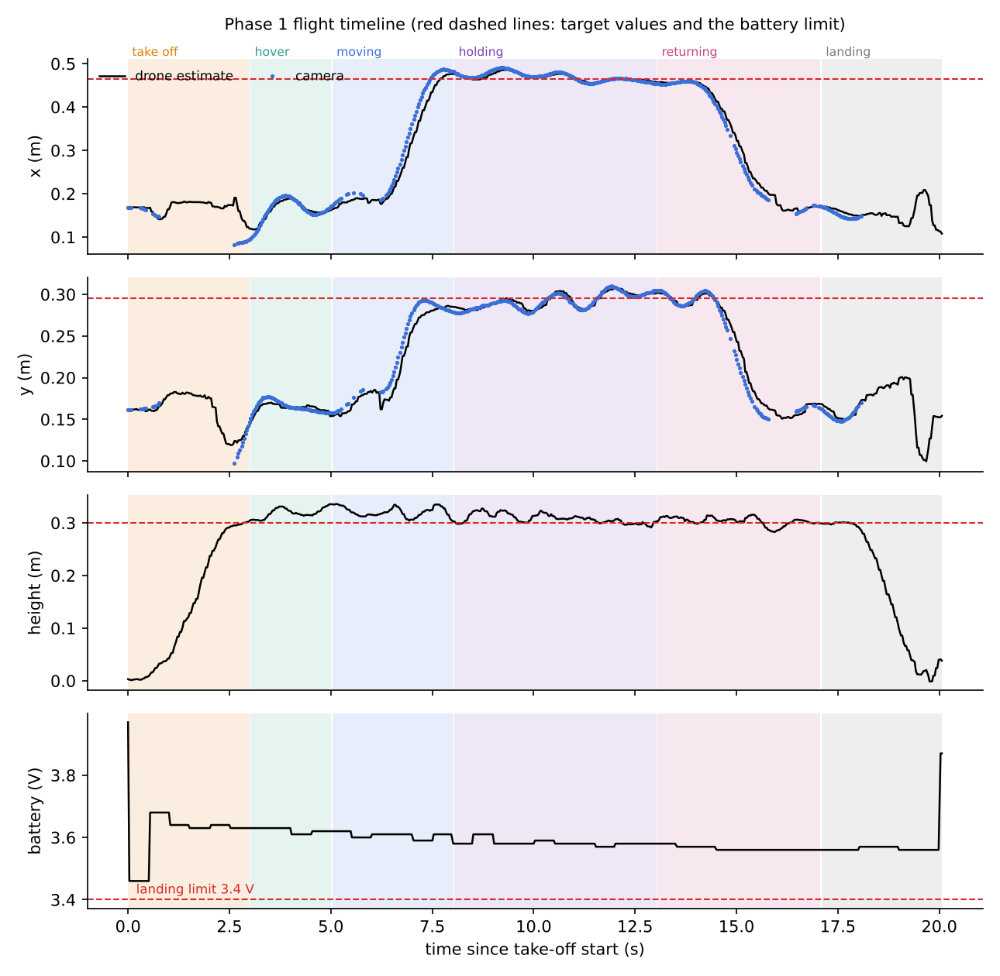

| What was measured | Result |
|---|---|
| Position at the target during the 5 s hold | Mean (0.470, 0.292) m, target (0.465, 0.295) m. Within 1 cm, with a wobble of about 1 cm |
| Aim to be discussed | A hold within 10 cm. Met with a large margin |
| Height | 0.29 to 0.34 m against 0.30 m |
| Return | Back to about (0.15 to 0.17, 0.15 to 0.17) m, within about 3 cm of the start (0.168, 0.162) m |
| Landing | Landed, the drone's own estimate ended about 5 cm short of the start in x |
| Camera rate | 29.7 frames per second |
| Marker seen, per phase | take-off 27%, hover 100%, moving to the target 73%, holding 100%, returning 75%, landing 33% |
| Battery | 3.97 V at start, 3.46 V at the take-off dip, then 3.56 to 3.63 V for the rest of the flight. It rises to 3.87 V once the motors stop |

The drone's own estimate and the camera stayed together through the flight, so the Flow Deck covered the pictures in which the marker was not found. During take-off and landing the marker was missing in most pictures, and while moving fast in a quarter of them. The script only lands on a loss longer than 3 seconds, so this did not matter here, but it is the weak point of this setup. A larger marker in the picture, a shorter exposure with more light, or a camera that holds 30 frames per second at 1280x720 would each help.

The first flight, earlier the same day, started with a 3.80 V battery. The voltage fell to 3.45 V at take-off and to 3.40 V while moving, and the script landed by itself. That showed the automatic landing works, and it is why the battery limit for take-off was raised.

The marker-lost landing rule has since run for real in the Phase 2 script (section 11.9), but the Phase 1 script itself has not been tried this way. Two safety tests are still to be done in flight:

1. **Marker-lost landing.** With the drone hovering a few centimetres above the floor, cover the marker with your hand. After 3 seconds the drone should land by itself. Do this low, with your other hand on the keyboard.
2. **Emergency stop.** In a low hover, press SPACE once in the camera window. The motors should stop at once and the drone will drop, so keep it a few centimetres above a soft surface.

After both tests have passed, Phase 1 is complete.

### 10.7 What the check and the flight do not yet show

The best value of `EXT_POS_STD` (it is still the starting guess of 0.03 m), the behaviour of the hold over a longer time than 5 seconds, a hold at several targets, and the behaviour with a marker that is detected in more of the pictures during fast motion are still to be measured. A jump-rejection filter (ignore a detection that moves more than a set distance between frames) is planned to protect against bad detections at the edge of the picture. It is not built.

---

## 11. Phase 2: fly with a controller on the PC (Method 1)

The script `phase2_flight.py` does this. It was flown on the lab hardware on 13 October 2026.

### 11.1 What it does, and how it differs from Phase 1

In Phase 1 the drone's own firmware flies to the position and holds it, and the PC only reports where the camera sees the drone. In Phase 2 the PC closes the loop. For every camera picture the PC finds the marker, works out how far the drone is from the target, decides a speed, and sends that speed to the drone over the Crazyradio. The drone itself only keeps its height and carries out the speed with its Flow Deck. It does not know where the target is.


The loop that runs for every camera picture is shown here. The orange box is the part that you edit.

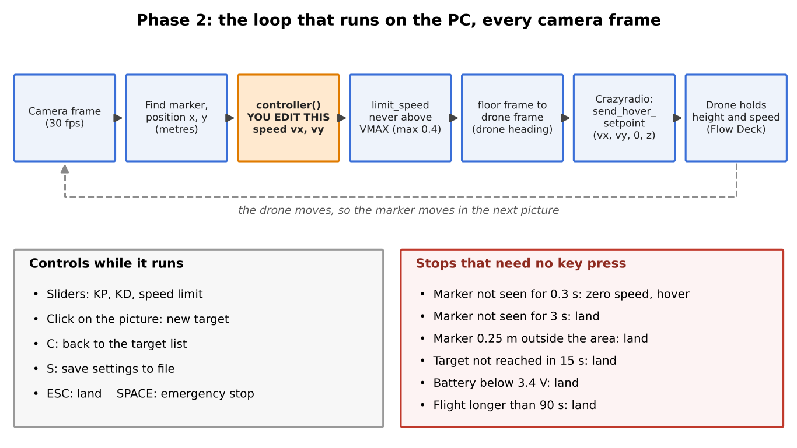

The drone is flown the same way as cflib's own `MotionCommander` does it: the script sends `send_hover_setpoint(vx, vy, 0, z)` to the drone, which means a speed in x and y in the drone's own frame, no turning, and a height above the floor. Take-off and landing are done by raising and lowering that height target at 0.15 m/s. The drone's high-level commander is switched off (`commander.enHighLevel` set to 0) so that it cannot compete with the PC. The camera position is not sent to the drone's estimator unless you set `SEND_EXTPOS = True`; the Flow Deck alone gives the drone its speed and height, and the PC loop is the only user of the camera position. This keeps the loop easy to understand.

The speed from the controller is given in the floor frame. The script turns it into the drone's own frame using the drone's heading, so the drone must start with its nose along +X, the same rule as in Phase 1. If the drone starts in another direction, set `YAW_OFFSET_DEG`.

### 11.2 The controller: the function you edit

At the top of `phase2_flight.py`:

```python
def controller(ctx, tx, ty):
    x, y = ctx.cam                         # measured position, metres
    vx = KP * (tx - x) - KD * ctx.cam_vel[0]
    vy = KP * (ty - y) - KD * ctx.cam_vel[1]
    return limit_speed(vx, vy, VMAX)       # speed in m/s in the floor frame
```

`ctx.cam` is the measured marker position, `ctx.cam_vel` the speed measured from the camera (smoothed a little), `tx, ty` the target. `KP` is the gain in (m/s) per metre of error, and `KD` damps the motion with the measured speed. The result is a speed, and the script cuts it to `VMAX` once more after your function, so even a mistake in your own controller cannot ask for more than the hard limit of 0.4 m/s.

The default values are `KP = 1.0`, `KD = 0.0` and `VMAX = 0.20`. In the flight of 13 October the speed that the camera measured followed the command with a delay of roughly 0.25 to 0.3 seconds (the peak of the correlation between the two curves, from one move, so only a rough figure; it includes the drone's own speed response, not just the camera and radio). A simulation with that kind of delay stayed well damped at `KP = 1.0` and began to overshoot above about `KP = 1.5`. That was a simulation, not a measurement on the drone, so raise the gain in small steps and watch the picture.

### 11.3 Settings

All settings are at the top of the file. They can also be changed without editing Python in `phase2_settings.json` (see 11.5).

| Setting | Default value | Meaning |
|---|---|---|
| `KP` | 1.0 (limit 3.0) | Gain, (m/s) per metre of error |
| `KD` | 0.0 (limit 1.0) | Damping with the measured speed |
| `VMAX` | 0.20 m/s (limit 0.40) | Largest speed ever commanded |
| `TARGETS` | `[(0.465, 0.295, 5.0)]` | Points to visit, each as `(x, y, hold_seconds)`. The drone returns to the start point at the end |
| `HOVER_HEIGHT` | 0.3 m | Must equal the stand height used for the floor map |
| `ARRIVE_TOL` | 0.05 m | Closer than this counts as arrived |
| `WAYPOINT_TIMEOUT` | 15 s | Lands if a target is not reached in this time |
| `MAX_FLIGHT_SECONDS` | 90 s | Lands if the flight takes longer |
| `TAKEOFF_RATE`, `LAND_RATE` | 0.15 m/s | Climb and descent speed |
| `STALE_SECONDS` | 0.3 s | Marker older than this: command zero speed (the drone hovers) |
| `LOST_SECONDS` | 3.0 s | Marker not seen for this long: land |
| `AREA_MARGIN` | 0.25 m | Marker this far outside the area: land |
| `MIN_VBAT_START`, `MIN_VBAT_FLIGHT` | 4.0 V, 3.4 V | Will not take off below the first, lands below the second |
| `MIN_CAMERA_HZ` | 15 fps | Will not take off if the camera is slower |
| `YAW_OFFSET_DEG` | 0 | Heading difference between the floor frame and the drone, degrees |
| `SEND_EXTPOS` | False | Also send the camera position to the drone's estimator |

### 11.4 Run it

Do the one-time setup first (sections 3 to 9). Then, from the project folder (Linux: use `python3`):

**Step 1: the dry run. There is no radio and no flight.**

```
python phase2_flight.py --dry
```

Slide the marker by hand over the floor and watch the printed command. It must always point towards the target. This checks the directions and the setup in the safest way. Shortened output from the lab runs (the target was (0.465, 0.295), and the line with "new target from click" is a click on the picture):

```
DRY RUN for 60 s. Slide the marker by hand. No radio, no flight.
The target is the first entry of TARGETS. Check that the command points TOWARDS it.
  marker (+0.308, +0.245)  error (+0.157, +0.050)  command (+0.16, +0.05) m/s  -> +X +Y
  marker (+0.540, +0.589)  error (-0.075, -0.294)  command (-0.05, -0.19) m/s  -> -X -Y
  new target from click: (0.640, 0.281).  Press C to go back to the TARGETS list.
  marker (+0.292, +0.216)  error (+0.348, +0.065)  command (+0.20, +0.04) m/s  -> +X +Y
Dry run finished.
```

The command is limited to 0.20 m/s however large the error is. The dry run also writes a log file, and it only prints while the marker is seen, so a silent stretch means the marker was lost there.

**Step 2: the check at the places you will fly.** Hold the marker on a stand at the hover height (0.3 m) at the far corners and edges of the flight area during the dry run. If the marker is lost at a place, fix the light or the camera setting before you fly (section 11.9).

**Step 3: the flight.** A full battery (4.0 V or more), cfclient closed, the drone on the floor with its nose along +X inside the area:

```
python phase2_flight.py
```

Output of the lab flight of 13 October (this flight started at 3.82 V because the lab copy had its start limit lowered to 3.8 V; the default limit is 4.0 V):

```
Settings read from ...\phase2_settings.json
Camera settings loaded from ...\camera_settings.json
  autofocus 1, focus 90, auto_exposure 0, exposure -8
Camera resolution: 640x480
Logging to ...\flight2_log_20261013_141204.csv
Connecting to radio://0/80/2M ...
Battery: 3.82 V
Flow Deck detected (deck.bcFlow2).
Put the marker (drone) in the flight area, nose along +X. Waiting for the marker ...
Camera rate: 29.7 frames per second
Taking off in 3 seconds. SPACE = emergency stop, ESC = land.
Target 1: (0.465, 0.295), hold 5.0 s
  reached target 1 after 0.7 s
Returning to the start point.
  reached start point after 0.8 s
Landing.
Landed.
Log saved: ...\flight2_log_20261013_141204.csv
```

The script follows the same order as Phase 1: battery and Flow Deck check, wait for the marker, reset the drone's estimate and let it warm up for 2 seconds, check the camera rate, count down three seconds, take off, hover for 2 seconds, visit each target, return to the start, land. Click on the camera window first. **ESC** lands normally, **SPACE** is the emergency stop, and **Ctrl+C** in the terminal does the same.

### 11.5 Live controls and the settings file

Besides the camera picture there is a second window, "Phase 2 controls", with three sliders: KP (in tenths), KD (in tenths) and the speed limit in cm/s. Moving a slider changes the value for the very next camera picture, also during the flight. The sliders cannot go above the hard limits.

Click on the camera picture to send the drone to that point on the floor. The point is kept at least 5 cm inside the flight area. While a clicked target is active, the target list waits and the picture shows "manual target". Press **C** to go back to the list. A click made before the drone has taken off is saved, and the drone goes there after the take-off and hover. Press **S** to write the present KP, KD, VMAX, maximum flight time and target list to `phase2_settings.json`. On the next start the script reads that file. Values outside the hard limits are cut back. A broken file is ignored and the values in the script are used. `phase2_settings.example.json` shows the format:

```
{
  "KP": 1.0,
  "KD": 0.0,
  "VMAX": 0.2,
  "MAX_FLIGHT_SECONDS": 90,
  "TARGETS": [[0.465, 0.295, 5.0]]
}
```

The click was tested in a real flight: the drone flew from about (0.06, 0.10) towards a click at (0.727, 0.387) and reached (0.68, 0.38) before the marker was lost (section 11.9).

### 11.6 Safety in Phase 2

All the stops of Phase 1 apply, and a few more are added because the PC now controls the speed.

| Situation | What happens |
|---|---|
| ESC pressed | Lands normally |
| SPACE pressed, or Ctrl+C | Motors off at once, the drone drops. Not yet tried in a real flight |
| Marker not seen for 0.3 s | Speed command is set to zero. The drone hovers on its Flow Deck |
| Marker not seen for 3 s | Lands |
| Marker more than 0.25 m outside the flight area | Lands |
| A target is not reached within 15 s | Lands |
| The flight is longer than 90 s | Lands |
| Battery below 3.4 V | Lands |
| The controller asks for a speed above the limit | Cut to `VMAX`, and never above 0.4 m/s |
| The drone's heading does not match the floor frame | The drone moves away from the target and the marker leaves the area, so it lands by the area rule (seen in the offline test with a wrong heading) |

During a landing started by one of these rules, the drone keeps holding its x and y with the camera while the marker is seen.

### 11.7 Results of the flight on 13 October 2026

The log of the flight is `flight2_log_20261013_141204.csv`.

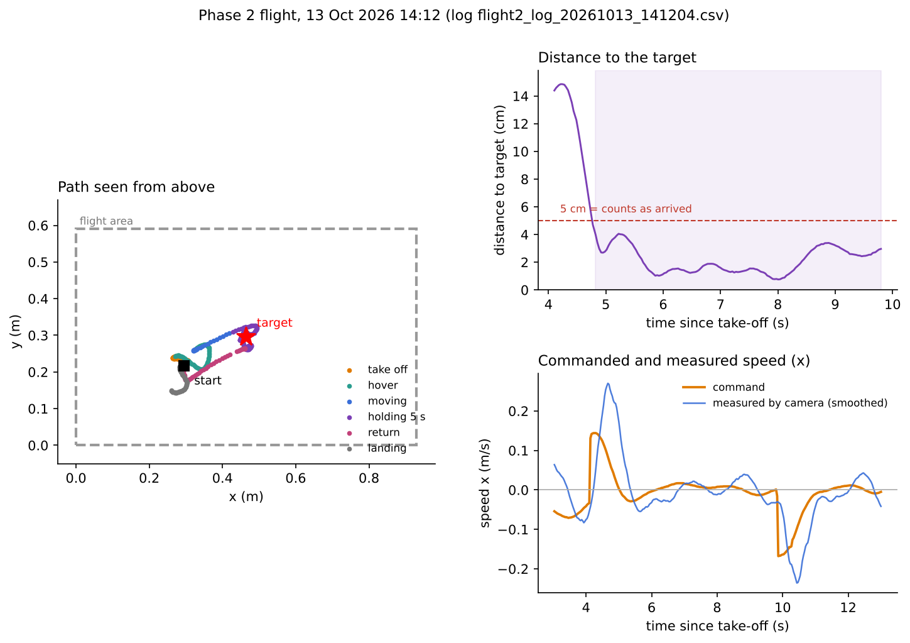

| What was measured | Result |
|---|---|
| Distance to the target during the 5 s hold | Mean 2.1 cm, worst 4.1 cm. Wobble about 1.3 cm in x and 1.9 cm in y |
| Aim to be discussed | A hold within 10 cm. Met with a large margin. Phase 1 held within about 1 cm, so the PC loop is somewhat looser |
| Marker seen in flight | 99% of the pictures. The longest gap was 0.09 s |
| Commanded speed | At most 0.18 m/s. The camera measured up to 0.31 m/s in short moments |
| Height | 0.30 to 0.35 m against 0.30 m |
| Heading | Between −3 and +8 degrees |
| Landing | The drone drifted about 6 cm in y while descending. The Flow Deck is less accurate very close to the floor. Not yet investigated |
| Delay between command and measured speed | About 0.25 to 0.3 s (rough, one move) |
| Battery | 3.82 V at the start, 3.44 V at the end |

### 11.8 Battery: what the logs show

On the flight of 13 October the battery started at 3.82 V and ended at 3.44 V, only 0.04 V above the landing limit. A flight a few minutes later started at 3.80 V, the voltage fell to 3.40 V while the drone was on its way, and the script landed it by itself, as designed. With a start at 3.96 V the voltage was 3.60 V right after take-off. A voltage this close to the limit means the flight can be cut short. Start every flight with a battery that reads 4.0 V or more, let a just-charged battery rest for a few minutes (it reads high at first), and keep the delivered start limit of 4.0 V.

### 11.9 The marker lost at the far side of the area

In a later flight the marker was seen in practically every picture during the take-off and climb. The drone then flew towards the clicked target and was almost stopped at about x = 0.68 m, y = 0.38 m, when the marker disappeared and was not seen again. The drone was hovering at 0.31 m at that moment, so this was not motion blur from moving. For the next 3.6 seconds the script commanded zero speed, the drone held its height (0.31 m) and its heading (within 3 degrees) on the Flow Deck, and after 3 seconds the script landed it. That was also the first real test of the marker-lost landing.

The cause is not established. A test at the desk afterwards showed a dark picture: the brightness was 41 to 54 out of 255, below the healthy 60 to 180 that the scripts report, while the sharpness was normally steady (median 365). A dark picture lowers the contrast of the marker, and the marker may drop out first at the darker places on the floor. Autofocus may also have been hunting, and glare or a shadow at that place is possible. We have not tested these.

The following steps are cheap and should be done before relying on the far side of the area. First, add light from the side so that the whole area is evenly lit. Second, in `camera_setup.py` try the exposure one step brighter (−7 instead of −8) and check that the frame-rate readout still says about 30; if it drops, go back to −8 and use light instead. Third, repeat the dry run with the marker on a stand at the hover height at the place where it was lost. The script now helps with the diagnosis. Each frame's brightness and sharpness are written to the log (the last two columns), and when the marker is not seen for 0.5 s during a flight, the script prints both values and saves the picture as `phase2_lost_<time>.png`.

### 11.10 Changing the controller for your own work

Everything you need to change is in `phase2_flight.py`. To change what the controller does, rewrite `controller()`: add an integral term for a steady offset, use a different gain per axis, or compute the target from the time to fly a circle or another path. `ctx.cam`, `ctx.cam_vel`, `ctx.target` and `ctx.phase` are available inside it. To change where the drone goes without touching the controller, edit `TARGETS` or `phase2_settings.json`. Keep every target inside the flight area. Keep the hard limits and the safety rules of section 11.6 while you experiment, and keep a copy of the original file so that you can go back to it. The log (`flight2_log_*.csv`) holds the camera position, the target, the command, the drone's own estimate, the battery, and the picture brightness and sharpness for every picture, so a step response can be plotted afterwards.

---

## 12. Troubleshooting

| What you see | Likely cause | What to do |
|---|---|---|
| `cv2.error: The function is not implemented` on `imshow` | The headless or plain OpenCV build is installed | Reinstall `opencv-contrib-python==5.0.0.93` as in section 3 |
| A package is installed but the script cannot import it | The script runs under another Python than the one you installed into | Print `sys.executable` (section 3) and activate the venv |
| "No calibration found" | The tool looks in `cf_vision_data` next to the script, and you ran it from another folder | Run it from the project folder |
| "could not open camera index N" | Wrong index, or another program is using the camera | Find the index (section 5.2), close other camera programs, change `CAMERA_INDEX` in `vision_pipeline_tool.py` |
| The marker blinks between found and not found | Marker too small in the picture, blur, or glare | More pixels (1920x1080), shorter exposure, white margin, even light |
| The flight script says "Marker not seen steadily" although `camera_setup.py` sees it | Different camera settings in the saved `camera_settings.json`, or the detector missing a small marker | Read the settings line printed at start-up. The script also prints the picture brightness (healthy is about 60 to 180) and saves `phase1_no_marker.png`, which shows what the camera sees |
| The marker is missing in many pictures while the drone moves fast (the log shows `cam_visible` 0) | Motion blur, a small marker, or the propellers covering it | Raise Exposure (shorter), add light, check the marker is flat and unobstructed. The flight continues on the Flow Deck and lands only after 3 s of loss |
| The camera gives only about 5 frames per second | Automatic exposure, or a size the camera delivers slowly | Section 5.2: AutoExposure 0, raise Exposure, press S. Run `camera_fps_test.py` for a table |
| Calibration error is several pixels although all images are found | Printed squares only about 10 px wide at a small picture size, with a too large corner window | Fixed in `vision_pipeline_tool.py`. If it persists, hold the board closer so it fills the box |
| The picture looks washed out or too white | Exposure too long, or auto-exposure still settling after a size change | Raise the Exposure slider, wait a few seconds |
| "The saved calibration was made at about WxH" warning | The camera size changed since calibration | Repeat sections 7 and 8 |
| WARNING that Y will be mirrored | The four clicks went clockwise | Run option 5 again and click counter-clockwise |
| Positions off by several cm at the edges | Reference points clicked on the floor, or stands of different height | Use equal-height stands and click their tops |
| Radio not found or connection fails | Driver (Windows) or udev rules (Linux), drone off, cfclient still open | Section 3, close cfclient, check the drone is on |
| Flow Deck not detected | Deck not fully seated | Press it fully onto the pins and power-cycle the drone |
| The script refuses to fly (battery) | Below 4.0 V for `phase1_flight.py` and `phase2_flight.py` (3.8 V for `flow_hover_test.py`) | Charge the battery fully |
| The drone lands by itself with "battery low (3.40 V)" | The battery was not full, and its voltage drops about 0.4 V under load | Charge it. Do not lower the 3.4 V limit |
| Warnings about "legacy hover" | cflib newer than the drone's firmware | Harmless for the tests so far. Update the firmware from cfclient if you want to remove them |
| The drone drifts or will not hold over a plain floor | The Flow Deck needs a textured surface | Use a patterned mat or a printed sheet |
| The drone flies the wrong way (Phase 1) | The +X direction does not match the nose direction at the start | Check section 8.2 and place the drone nose along +X |
| The estimator never converges (Phase 1) | The position was sent before the reset, or the marker is not visible at the origin | Check the order in section 10 and the marker at the origin |
| Hold oscillates (Phase 2) | Gain too high for the loop delay | Lower KP with the slider, or raise KD to about 0.2 |
| Phase 2 lands with "marker lost for more than 3.0 s" | The marker could not be found at some place, often because the picture is dark or has glare | Section 11.9: check the brightness printed by the script and the saved `phase2_lost_*.png`, add light, try exposure -7 in `camera_setup.py`, and repeat the dry run at the hover height |
| A click on the picture does nothing (Phase 2) | The click was outside the camera window, or the drone is not yet in the air (the click is saved and used after the hover), or the point is outside the area (it is moved inside) | Click on the camera picture. C clears a clicked target |
| The drone moves away from the target (Phase 2) | The drone's nose was not along +X at power-on | Section 8.2. Power-cycle the drone with the nose along +X, or set `YAW_OFFSET_DEG` |
| `phase2_settings.json` is ignored | A typing error in the file. The script prints "Could not read" and uses the values in the script | Delete the file or copy `phase2_settings.example.json` again |

---

## 13. Choosing a camera for a different room

How wide the marker appears in the picture decides whether detection is reliable. A good estimate is:

marker width in pixels = picture width in pixels x marker width in metres / width of floor the camera sees at hover height, in metres.

With a 30 mm marker and the 1920 pixel wide mode, the lab measured 36 pixels. That corresponds to the camera seeing about 1.6 m of width at hover height. To keep at least 20 pixels, the width the camera sees must be at most picture width x 0.03 / 20. For a 1920 pixel wide picture this is about 2.9 m, and for a 3840 pixel wide picture about 5.8 m. These are estimates. The marker looks smaller towards the edges because of perspective and tilt, so keep some reserve, and confirm with `camera_setup.py` at the real mounting height. If the room needs a larger view, use a camera with more pixels, not a software zoom: a digital zoom adds no real detail.

Section 5.3 shows the same formula applied to the lab camera and a check of the camera height. Check the camera with its own software at the sizes you intend to use. Some cameras list a high resolution but deliver a softer picture, so measure the marker width and look at the sharpness number in `camera_setup.py` instead of trusting the specification sheet.

---

## 14. Record sheet

Fill this in once the system works. It is the evidence for the setup.

| Item | Value |
|---|---|
| Camera | Colour stream of a camera at index 1 reported as "FHD Camera", USB ID VID_1BCF&PID_28C4. The lab notes call it an Intel RealSense D435; this ID is not Intel's, so the model is to be confirmed |
| Resolution used for Phase 1 | 640x480, 30 fps with manual exposure (1920x1080 gives only about 5 fps on this setup) |
| Camera height above the floor | (to be measured). Estimated about 1.2 m from the picture, if the lens is 69.4 degrees wide (section 5.3) |
| Camera settings (AutoFocus / Focus / AutoExposure / Exposure) | 1 / 90 / 0 / 8 (written to the file as exposure -8) |
| Marker | ArUco ID 0, DICT_4X4_50, 30 mm, on a 40 mm white square, turned about 45 degrees |
| Marker width in the picture | 14 px at 640x480, 32 to 36 px at 1920x1080 |
| Calibration at 640x480 | 15 of 15 images, reprojection error 0.631 |
| Calibration at 1920x1080 | 18 of 18 images, reprojection error 0.331 (kept in `cf_vision_data_1080p`) |
| Flight area | 0.93 m x 0.59 m (centre to centre of the stands), diagonal 1.10 m |
| Reference stand height = hover height | 0.3 m |
| Homography sanity check (origin), 640x480 | (0.000, 0.000) |
| Position check A to E at 1920x1080 (largest error) | middle point within about 1.5 to 2.2 cm. Not yet repeated at 640x480 |
| Check run at 640x480 | 29.7 fps, drone estimate minus camera 0.000 m at settling, about 1 cm while moving |
| Yaw reading with nose along +X (fixed offset) | 144 degrees (read at 1920x1080). Phase 1 does not use the yaw |
| cflib version | 0.1.34 |
| Crazyflie firmware platform | cf2 |
| Python version | 3.14 (lab PC) |
| First flight (13 Oct 2026) | Started at 3.80 V. Hover at 0.31 to 0.33 m, moved towards the target, landed by itself at 3.40 V |
| Full flight (13 Oct 2026, 13:08) | Hold at the target within 1 cm (wobble about 1 cm), returned within about 3 cm of the start, battery 3.97 V at start and 3.46 V at the take-off dip, log `flight_log_20261013_130809.csv` |
| Marker-lost landing test | Happened in a real Phase 2 flight on 13 Oct 15:12: marker lost at (0.68, 0.38) while hovering, zero speed, landed after 3 s. Not yet done with the Phase 1 script |
| Emergency stop test | (to be done) |
| Phase 2 flight (13 Oct 2026, 14:12) | Hold at the target: mean 2.1 cm, worst 4.1 cm. Marker seen in 99% of pictures. Command to measured speed delay about 0.25 to 0.3 s. Battery 3.82 V to 3.44 V. Log `flight2_log_20261013_141204.csv` |
| Phase 2 settings used | KP 1.0, KD 0.0, VMAX 0.20 m/s, hover 0.3 m, target (0.465, 0.295) hold 5 s |
| Picture brightness in the lab (dry run, 13 Oct 15:16) | 41 to 54 of 255 (healthy is 60 to 180). Sharpness median 365. Marker seen in 78% of the dry-run frames, which included lifting it out of view |
| Lab light | Not recorded. Add the light that gives a stable marker at the far side of the area |


---

## 15. Files in this package

| File | Purpose | State |
|---|---|---|
| `connect_test.py` | Scan, connect, read battery, check the Flow Deck. No flight | Tested on hardware |
| `flow_hover_test.py` | Take off to 0.3 m, hover 3 s, land. Guards for battery and deck | Tested on hardware |
| `vision_pipeline_tool.py` | Menu: 1 capture checkerboard, 2 calibrate, 3 live marker detection, 4 generate marker, 5 floor map | Used on hardware at 640x480 and 1920x1080 |
| `camera_setup.py` | Setup window: resolution, focus, exposure, marker width readout, saves `camera_settings.json` | Used on hardware |
| `live_tracker.py` | Live x, y, yaw of marker ID 0 in metres, CSV log. Its marker detector is also used by the flight script | Tested on hardware |
| `phase1_flight.py` | Phase 1: camera position into the drone, take off, move, hold, land. `--check` mode with no flight. Writes `flight_log_*.csv` | Check mode and a full flight tested on hardware |
| `phase2_flight.py` | Phase 2: controller on the PC, speed commands over the radio. `--dry` mode with no radio. Sliders, click-to-target, settings file. Writes `flight2_log_*.csv` | Dry run and flights tested on hardware |
| `phase2_settings.example.json` | Example of the settings file for `phase2_flight.py` (copy it to `phase2_settings.json`, or press S in the flight window to write it) | Example |
| `camera_fps_test.py` | Measures the real frame rate per size, compression and exposure mode | Diagnostic |
| `inspect_corners.py` | Shows detected checkerboard corners per picture, to diagnose a high calibration error | Diagnostic |
| `camera_modes.py` | Saves one picture per resolution to compare modes | Diagnostic |
| `compare_saved_images.py` | Reports marker width and sharpness for the saved pictures | Diagnostic |
| `camera_settings.example.json` | Example of the settings file written by `camera_setup.py` (copy it to `camera_settings.json` to use it) | Example |
| `requirements.txt` | Python packages | |
| `print/aruco_id0_with_margin_A4.pdf` | Marker sheet, 30 to 80 mm with 5 mm margin | Print at 100% |
| `print/checkerboard_10x7_25mm_A4.pdf` | Calibration checkerboard | Print at 100% |
| `docs/` | This guide and its pictures | |

The tools write their data into a folder `cf_vision_data` next to the scripts: `checkerboard_images/`, `camera_calib.npz`, `floor_homography.npy`, `marker_id0.png`. You can move that one folder without losing your work.

---

## 16. Test status and known limits

The tables below list what the system does, what was tested, and the setup questions people ask most. "Done" means it was run on the lab hardware. Where something is built but not yet tried, it says so.

### 16.1 What the system does and what was tested

| Requirement | Status |
|---|---|
| Overhead USB camera films the Crazyflie | Done. 640x480 at 30 fps (section 5). 1920x1080 also works but gives only about 5 fps on the lab camera |
| Recognise the ArUco marker on the drone | Done. A 30 mm marker is found in 99% of the pictures during a flight. It is only 14 pixels wide at 640x480, so it needs even light (section 11.9) |
| Convert camera coordinates to a position in the flight area | Done. Lens calibration and floor map (sections 7 and 8). Checked with a tape measure to about 2 cm at 1920x1080. The tape-measure check at 640x480 is still to be repeated |
| Show and log the position on the PC | Done. `live_tracker.py` and the flight scripts show the position in a live window and write CSV logs |
| Send control input to the Crazyflie over the Crazyradio | Done in both phases: position updates and `go_to` commands (Phase 1), speed commands (Phase 2) |
| Move to a given position and hold it | Done. Hold within about 1 cm (Phase 1) and about 2 cm, worst 4 cm (Phase 2), against an aim of 10 cm |
| Take off and land | Done in both phases, also with automatic landing when the marker is lost (Phase 2, real event) or the battery is low (both phases, real events). Landing with ESC is built and was only tested offline |
| Emergency stop | Built into both scripts (SPACE and Ctrl+C). **Not yet tried in a real flight. Do this low, over a soft surface, before you rely on the system, or show it to others** |
| Python source code, set-up and run procedures published | Done. Section 15 lists the files, sections 3 to 11 give the steps, and section 19 the commands. Windows was used for all tests. The Linux commands are given but untested |
| You can change the control law and the target path afterwards | Done. `controller()` and `TARGETS` in `phase2_flight.py`, plus sliders, click-to-target and `phase2_settings.json` (section 11) |

### 16.2 Common setup questions

| Question | Answer in this package |
|---|---|
| OS and environment | Windows was used for all tests (Python 3.14, cflib 0.1.34, in a virtual environment). Linux commands are in section 3 and have not been run. The Windows Crazyradio driver step is described in section 3 |
| How well does it hold a position | Measured on the lab setup: within about 1 cm (Phase 1) and about 2 cm (Phase 2) over a 5 s hold at 0.3 m height. This is for a 0.93 m by 0.59 m area and a camera about 1.2 m high. Other setups need to be measured again (section 14) |
| Flight area, camera height, lighting, safety net | The lab area is 0.93 m by 0.59 m. The camera height is an estimate of about 1.2 m, still to be measured. Lighting matters (section 11.9). A safety net or enclosure is your responsibility (section 2.2) |
| Who supplies the camera and the computer | You do. Section 2.2 gives the requirements. The solution was tested with one camera, whose details are in section 5.3 |
| Spare parts and consumables | Section 2.1 recommends spare batteries, propellers and a multi-battery charger |
| What the tests cover | The tests described here cover the code as published. Changes you make are not covered by them, so keep a copy of the original files before changing anything |
| What the operator sees (GUI) | A live camera window with the marker, position, command and status text, a small slider window for the controller settings, click-to-target, and CSV logs. There is no packaged GUI application, and no live plot; the logs can be plotted afterwards |

### 16.3 Work that remains

In order: the emergency stop with SPACE in a real, low flight; the marker-lost landing test of the Phase 1 script (the same landing logic ran for real in Phase 2); the light and exposure improvements of section 11.9, followed by a flight to the far side of the area; confirming which camera is in use and measuring its height (section 5.3); the tape-measure check at 640x480; the best value of `EXT_POS_STD` (Phase 1); and a trial of the Linux commands.

---

## 17. Using the Bitcraze cfclient with the Crazyflie

Bitcraze's own program for the Crazyflie is the Crazyflie client, called `cfclient`. It is not part of our scripts, but it is the quickest way to look at the drone before a flight, and it can fly the drone by hand without any of our code. This section explains how to start it and how to read its main window. It follows Bitcraze's own pages: the [getting started tutorial](https://www.bitcraze.io/documentation/tutorials/getting-started-with-crazyflie-2-x/), the [client installation page](https://www.bitcraze.io/documentation/repository/crazyflie-clients-python/master/installation/install/) and the [client user guide](https://www.bitcraze.io/documentation/repository/crazyflie-clients-python/master/userguides/userguide_client/).

### 17.1 When to use it

Use cfclient to see that the radio link works, to read the battery voltage and the link quality, to fly a few seconds with its own buttons as a basic test of the motors and the Flow Deck, to update the firmware, and to use its emergency stop button. Use our scripts for everything that involves the camera.

Only one program can use the Crazyradio at a time. Disconnect and quit cfclient before you start any of our scripts, and quit our script before you start cfclient.

### 17.2 Install and start

Bitcraze's page asks for Python 3.10 or newer. Install it into the same virtual environment as the project (section 3), or into its own, and never with `sudo`.

```
pip install cfclient          # Windows and Linux
cfclient                      # start the client
python -m cfclient.gui        # another way to start it
```

On Linux, Bitcraze lists these packages as prerequisites, in addition to the udev rules from section 3:

```
sudo apt install git python3-pip libxcb-xinerama0 libxcb-cursor0
```

On Windows the Crazyradio driver must be installed (section 3). Bitcraze also notes that with Python 3.13 the installation needs Visual Studio with the "Desktop development with C++" workload. We have not installed cfclient on the lab PC with Python 3.14, so if the installation fails there, create a second virtual environment with an older Python 3.12 for cfclient only.

### 17.3 Connect

Put the drone on a flat surface and switch it on. Start cfclient. The address field shows `0xE7E7E7E7E7`, the default address, which is also what the lab drone uses. Click **Scan**, pick the Crazyflie from the drop-down list (the lab drone is `radio://0/80/2M`, the same address as `URI` in our scripts), and click **Connect**. When it is connected the title bar reads "Connected on radio://0/80/2M", and the battery voltage and link quality appear at the top right.

The numbers in the picture below are explained in the list that follows it.

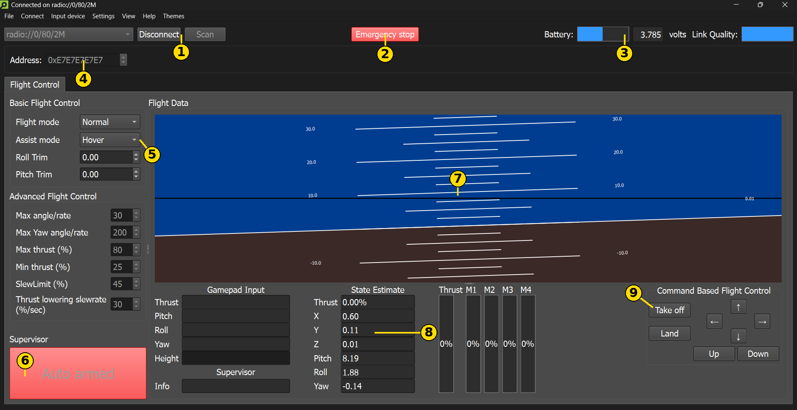

1. The connection controls: the address list, **Disconnect** and **Scan**.
2. **Emergency stop.** Clicking it stops the motors at once. The drone drops.
3. The battery voltage (3.785 V in this picture) and the link quality bar.
4. The radio address of the drone.
5. **Flight mode** and **Assist mode**. In the picture they read Normal and Hover.
6. The Supervisor box, which reads "Auto armed" in the picture.
7. The flight data display: an artificial horizon that shows the drone's attitude.
8. The state estimate: the drone's own x, y, z position and its pitch, roll and yaw.
9. **Command Based Flight Control:** the buttons Take off, Land, the arrows, Up and Down.

Bitcraze's pages that we could read describe the connection controls, the flight data box, the input devices and the emergency stop. They do not describe items 5, 6, 8 and 9. Our descriptions of those come from the names shown on the screen, so check them in the client's own help for your version before relying on them.

### 17.4 Read the drone before you fly it

The picture shows a battery of 3.785 V. That is too low for a Phase 1 flight: our script refuses to take off below its start limit, and the battery would fall to about 3.4 V within seconds of take-off. Charge it first. Check also that the link quality bar is full, and that the drone's estimated position (item 8) is close to zero and steady while the drone sits still.

### 17.5 Fly with cfclient's own controls

There are two ways, and both are Bitcraze's functions, not ours.

The first is the buttons in the Command Based Flight Control box (item 9). With the Flow Deck attached and the assist mode set to Hover, **Take off** lifts the drone and **Land** brings it down. The arrows move it. This is a good quick test of the motors and the Flow Deck over the floor you will use. Keep the first tries low and with your hand near the Emergency stop button.

The second is a gamepad or another input device with at least four analog axes, set up under the **Input device** menu. Bitcraze ships default mappings for Xbox and PlayStation controllers, and you can create your own with "Configure device mapping". The mapping must at least cover roll, pitch, yaw and thrust. Before you connect, check that the thrust value in the flight data box reads zero. Thrust is the hardest control, so start gently. Keep the blue LEDs at the back of the drone pointing towards you.

Bitcraze's page also gives safety notes for the Crazyflie itself. A solid red LED at the front right means the battery is low: land and recharge. Five quick red pulses from that LED after switching on mean the self-test failed.

### 17.6 Using cfclient together with our scripts

First, disconnect and quit cfclient before a script, as in 17.1. Second, a parameter changed in cfclient is not a reliable way to configure our flights: our `phase1_flight.py` sets what it needs itself (the Kalman estimator, the high-level commander and the camera trust value) every time it runs. Third, cfclient can plot and log variables from the drone, such as the battery voltage and the estimator values. We have not used that part of the client in this project, so we do not describe it here. Our scripts write their own CSV logs.

### 17.7 Firmware

Bitcraze recommends updating the firmware to the newest version, and its user guide describes how to do it with a Crazyradio. Do not touch or restart the drone while the update is running, until the client reports that it is idle. Updating the firmware also removes the "legacy hover" warnings mentioned in section 4.2.

---

## 18. Summary of Phase 2

This section is for the reader who wants to know where things stand and what to do next. Section 11 has the details.

### 18.1 What is built

`phase2_flight.py` flies the drone with a controller that runs on the PC. For every camera picture, `controller()` turns the position error into a speed, which is limited and sent over the Crazyradio with `send_hover_setpoint`. The drone keeps its own height and speed with the Flow Deck. The script has a dry-run mode without radio, a slider window for KP, KD and the speed limit, a click on the picture to set a target, a settings file, a log with the picture brightness and sharpness, and the safety rules of section 11.6.

### 18.2 What was found

On 13 October 2026 the drone took off, flew to the target, held it for 5 seconds within 2.1 cm on average (4.1 cm at worst), returned, and landed. The marker was seen in 99% of the pictures. The measured speed lagged the command by roughly 0.25 to 0.3 s. A later flight showed that the safety design works: the marker disappeared at the far side of the area, the drone hovered on its Flow Deck, holding its height and heading, for about 3.6 s, and then landed by itself. In both flights the battery was the closest limit: the voltage sagged to 3.40 to 3.44 V against the 3.4 V landing limit.

### 18.3 Differences from the earlier plan

The earlier plan was to take off with the high-level commander and hand over to the PC with `send_notify_setpoint_stop()`. That hand-over was not needed or tested. The script uses the low-level hover setpoint for the whole flight, as cflib's `MotionCommander` does. The camera position is not fed into the drone's estimator by default (`SEND_EXTPOS = False`), so that only one loop reacts to the camera. Both were design choices; with `SEND_EXTPOS = True` you can compare.

### 18.4 What to do next

1. Fix the light (section 11.9) and fly to the far side of the area. The marker must stay visible there before any further tuning is meaningful.
2. Try the emergency stop with SPACE once, low, over a soft surface.
3. Tune. Raise `KP` in small steps from 1.0, with `KD` around 0.2 if it overshoots. Record a step response (move a clicked target by 0.2 m) and plot the camera position against time from the log.
4. Write your own controller in `controller()`: an integral term, a path that follows the time, or something for your research.
5. Measure the real delay. The figure of 0.25 to 0.3 s comes from one move. Several moves at different speeds give a better one.

### 18.5 What is not known yet

The cause of the marker loss at the far side of the area (section 11.9). How the drone behaves in a longer hold than 5 seconds and with several targets. The effect of `SEND_EXTPOS = True` on the hold. The landing drift of about 6 cm. And Linux.

---

## 19. Command reference

Open a terminal in the project folder. On Linux use `python3` in place of `python`. Activate the virtual environment first (section 3): `venv\Scripts\Activate.ps1` on Windows, `source venv/bin/activate` on Linux.

### 19.1 Set-up, once

| Purpose | Command | Result to look for |
|---|---|---|
| Create the environment (Windows) | `python -m venv venv` then `venv\Scripts\Activate.ps1` | `(venv)` in the prompt |
| Create the environment (Linux) | `python3 -m venv venv` then `source venv/bin/activate` | `(venv)` in the prompt |
| Install the packages | `pip install -r requirements.txt` | no errors |
| Radio, battery and Flow Deck check | `python connect_test.py` | battery voltage, "Flow Deck detected" |
| First hover with the Flow Deck only | `python flow_hover_test.py` | take off to 0.3 m, hover 3 s, land |
| Camera setup (camera index 1; use 0 for the first camera) | `python camera_setup.py 1` | marker found, 20 fps or more |
| Measure the real frame rate per picture size | `python camera_fps_test.py 1` | a table of fps values |
| Calibration, floor map and marker menu | `python vision_pipeline_tool.py` | menu: 1 capture checkerboard, 2 calibrate, 3 live detection, 4 make marker, 5 floor map |
| Show corners of the checkerboard pictures | `python inspect_corners.py` | corners and sharpness on each picture |

### 19.2 Before and during flying

| Purpose | Command | Result to look for |
|---|---|---|
| Live position display and log | `python live_tracker.py` | x, y and yaw of marker ID 0 and a CSV log |
| Phase 1 check, no flight | `python phase1_flight.py --check` | about 30 fps, camera and drone columns agree |
| Phase 1 flight | `python phase1_flight.py` | takes off, holds at the target, returns, lands, writes `flight_log_*.csv` |
| Phase 2 dry run, no radio, no flight | `python phase2_flight.py --dry` | command points towards the target |
| Phase 2 flight | `python phase2_flight.py` | takes off, holds at the target, returns, lands, writes `flight2_log_*.csv` |
| Bitcraze client (optional, close it before any script) | `cfclient`, or `python -m cfclient.gui` | the cfclient window (section 17) |

### 19.3 Keys

| Window | Key | What it does |
|---|---|---|
| `phase1_flight.py` and `phase2_flight.py` camera window | ESC | Lands normally |
| | SPACE | Emergency stop: motors off at once |
| | Ctrl+C in the terminal | Emergency stop |
| `phase2_flight.py` camera window | click on the picture | New target on the floor (kept 5 cm inside the area) |
| | C | Back to the target list |
| | S | Save KP, KD, VMAX, maximum flight time and targets to `phase2_settings.json` |
| `phase2_flight.py` "Phase 2 controls" window | three sliders | KP (tenths), KD (tenths), speed limit in cm/s |
| `camera_setup.py` | 1, 2, 3, 4 | Picture size 640x480, 1280x720, 1920x1080, 3840x2160 |
| | S | Save the camera settings to `camera_settings.json` |
| | P | Save a full-size picture |
| | R | Show or hide the rejected marker candidates |
| | ESC | Close |
| `live_tracker.py` | L | Log on or off |
| | ESC | Close |
| `vision_pipeline_tool.py` checkerboard capture | SPACE | Take a picture |
| | ESC | Finish |

### 19.4 Files that the scripts write

| File | Written by | Contents |
|---|---|---|
| `camera_settings.json` | `camera_setup.py` | Camera index, size, focus and exposure |
| `cf_vision_data/` | `vision_pipeline_tool.py` | Checkerboard pictures, `camera_calib.npz`, `floor_homography.npy`, `marker_id0.png` |
| `tracker_log_<date>_<time>.csv` | `live_tracker.py` | Time, visible, x, y, yaw, pixel position |
| `flight_log_<date>_<time>.csv` | `phase1_flight.py` | Time, phase, camera and drone positions, height, battery |
| `flight2_log_<date>_<time>.csv` | `phase2_flight.py` | The same plus target, command, drone heading, picture brightness and sharpness |
| `phase2_settings.json` | `phase2_flight.py` (key S) | KP, KD, VMAX, maximum flight time, targets |
| `phase2_lost_<time>.png`, `phase1_no_marker.png`, `phase2_no_marker.png` | the flight scripts | What the camera saw when the marker was lost |

