<!--cover-->
<div class="cover">

<p class="kicker">研究開発</p>
<h1 class="doc-title">Crazyflie 画像制御学習環境</h1>
<p class="doc-sub">セットアップと操作ガイド</p>
<p class="doc-sub2">ArUcoマーカーによるカメラでの位置測定と、Crazyradio経由のPCからのドローン制御</p>
<table class="cover-meta">
<tr><td>作成者</td><td>Lahiru Dhananjaya(ラヒル・ダナンジャヤ)、ソフトウェアアーキテクト<br>研究開発のすべてを担当</td></tr>
<tr><td>会社</td><td>Tegara Corporation</td></tr>
<tr><td>版</td><td>第1.0版、2026年11月</td></tr>
<tr><td>ライセンス</td><td>GNU General Public License バージョン3以降</td></tr>
<tr><td>範囲</td><td>Phase 1(カメラ位置をドローンへ)とPhase 2(PC上の制御器)</td></tr>
<tr><td>ハードウェア</td><td>Crazyflie 2.1+、Flow Deck v2、Crazyradio、USBカメラ</td></tr>
</table>
</div>
<!--/cover-->

## 目次

1. システムの概要
2. 必要なものと、誰が用意するか
3. コンピューターの準備
4. Crazyflieへの接続と最初の飛行
5. カメラの設定
6. ArUcoマーカーの印刷と取り付け
7. カメラレンズのキャリブレーション
8. 床の準備と床マップ(ホモグラフィー)の作成
9. 位置測定の確認
10. Phase 1: カメラ位置をドローンに渡して飛ばす(方式2)
11. Phase 2: PC上の制御器で飛ばす(方式1)
12. トラブルシューティング
13. 別の部屋向けのカメラの選び方
14. 記録シート
15. このパッケージのファイル
16. テストの状況と既知の制限
17. Bitcrazeのcfclientの使い方
18. Phase 2のまとめ
19. コマンド一覧

---

## 概要

このパッケージは、Crazyflie 2.1+のナノドローン1機を使って、画像による制御ループを構築し、学習・研究するためのものです。頭上のUSBカメラが、機体に付けたArUcoマーカーを見つけます。PCは、画像内のマーカー位置を床の上のメートル位置に変換し、表示し、記録し、Crazyradio経由で機体に指令を送ります。指令は、離陸、指定位置への移動、保持、着陸で、緊急停止はいつでも使えます。

TegaraはCrazyflieのドローンセットを提供します。Pythonのソースコード、日本語版と英語版のこのガイド、印刷用のマーカーとキャリブレーション用のシートは、無償のオープンソースです。カメラ、その取り付け具、コンピューター、飛行スペースは、ご自身でご用意ください。必要なものは2章にまとめてあります。

飛行の方式は2つ用意しています。**Phase 1**では、PCがカメラ位置をドローンに送り、位置の保持と移動はドローン自身のファームウェアが行います。**Phase 2**では、制御則がPC上で動きます。ご自身で読んで書き換えられる、短い関数1つです。どちらのPhaseも、2026年10月13日に実験室のハードウェアで飛行させました。ドローンは、目標から、Phase 1では約1 cm以内、Phase 2では約2 cm以内(最大でも4 cm)で保持しました。目安としていた値は10 cmです。

未完了の項目が3つあり、16章に書いてあります。SPACEによる緊急停止を実際の飛行ではまだ試していないこと、推奨より暗い明るさのもとで、飛行エリアの奥側でマーカーを一度見失ったこと、そしてスクリプトをWindowsでしか実行していないことです。初めての方は、2章と3章を読み、そのあと4章から10章を順に進めてください。すべてのコマンドは、19章に1か所にまとめてあります。

---

## 現在の状況

| 項目 | 状況 |
|---|---|
| 無線接続、バッテリーとFlow Deckの確認(`connect_test.py`) | 実機で確認済み |
| Flow Deckだけでの最初のホバリング(`flow_hover_test.py`) | 実機で確認済み。黒い床紙の上で正しく飛行しました |
| カメラ設定ウィンドウ(`camera_setup.py`) | 実機で使用済み |
| カメラキャリブレーションと床マップ(`vision_pipeline_tool.py`) | 実機で640x480にて実施済み(15枚中15枚、誤差0.631)。以前に1920x1080でも実施済み(18枚中18枚、誤差0.331) |
| 位置のライブ表示とCSVログ(`live_tracker.py`) | 実機で確認済み |
| Phase 1のチェックモード(`phase1_flight.py --check`) | 実機で確認済み: 29.7 fps、ドローンの推定位置はカメラに約1 cmで追従 |
| Phase 1の飛行(`phase1_flight.py`) | 10月13日に全飛行を実施: 離陸、ホバリング、目標へ移動、5秒保持、帰還、着陸。保持は目標から1 cm以内でした |
| Phase 2の飛行(`phase2_flight.py`) | 10月13日に全飛行を実施: 離陸、移動、5秒保持(目標から平均2.1 cm、最大4.1 cm)、帰還、着陸。スライダー、クリックでの目標指定、設定ファイルも確認しました。2回目の飛行ではマーカーを見失い、設計どおりに自動着陸しました |
| SPACEによる飛行中の緊急停止 | 両スクリプトに実装済み。実際の飛行ではまだ試していません |
| Linux | コマンドは記載していますが、スクリプトを実行したのはWindowsだけです |

---

## Phase 1の手順を1ページで

最初の段は、構成を作ったときと、カメラ、画像サイズ、飛行エリアのどれかを変えたときだけ行います。2段目と3段目は、飛ばすたびに行う手順です。各ボックスに、説明のある章を書いてあります。

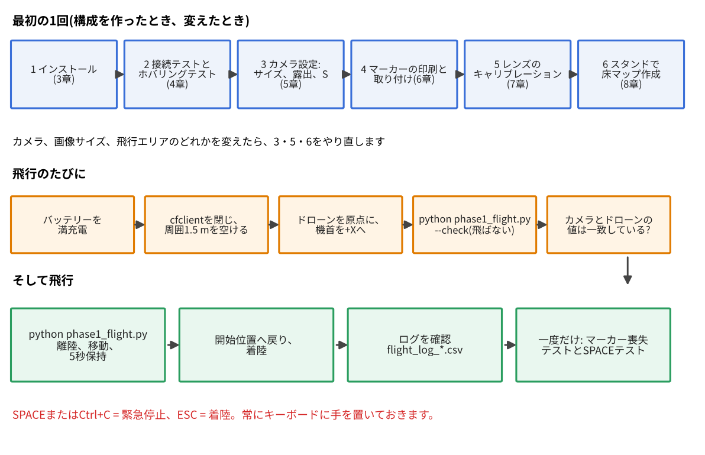

実行するコマンドを順に示します(プロジェクトのフォルダーで実行。Linuxでは`python`を`python3`に読み替えてください)。

| 手順 | コマンド | 確認すること |
|---|---|---|
| インストール | `pip install -r requirements.txt` | エラーが出ないこと |
| 接続テスト | `python connect_test.py` | バッテリー電圧と「Flow Deck detected」 |
| ホバリングテスト | `python flow_hover_test.py` | 0.3 mまで離陸、3秒ホバリング、着陸 |
| カメラ設定 | `python camera_setup.py 1` | マーカーが見つかり、20 fps以上、Sキーで保存 |
| レンズのキャリブレーション | `python vision_pipeline_tool.py` のオプション1、続けて2 | 誤差が約0.7未満 |
| 床マップ | `python vision_pipeline_tool.py` のオプション5 | 原点の確認が(0.000, 0.000) |
| チェック(飛ばない) | `python phase1_flight.py --check` | 約30 fps、ドローンがカメラに追従 |
| 飛行 | `python phase1_flight.py` | 開始位置に着陸、ログファイルが作られる |
| Phase 2のドライラン | `python phase2_flight.py --dry` | 指令が目標のほうを向く |
| Phase 2の飛行 | `python phase2_flight.py` | 開始位置に着陸、ログファイルが作られる |

---

## 1. システムの概要

頭上のUSBカメラが、床の飛行エリアを真下に向かって見ています。Crazyflie 2.1+の上に載せた小さなArUcoマーカーを、カメラの映像のたびに見つけます。マーカーの画素位置は床上のメートル値に変換されます。PCはこの位置を表示し、ログファイルに書き、Crazyradioを通してドローンに指令を送ります。指令は、離陸、位置への移動、保持、着陸、そして緊急停止です。

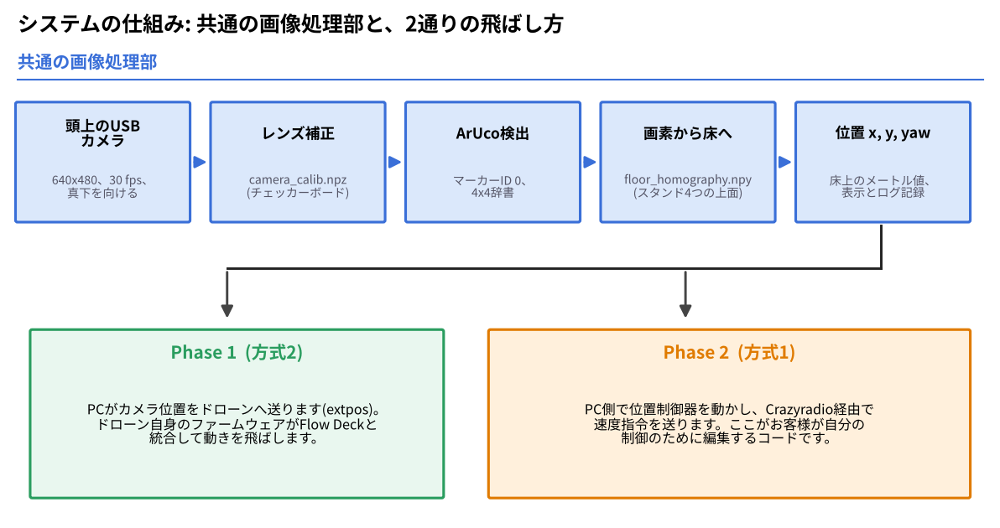

前半(カメラ、レンズ補正、マーカー検出、画素から床への変換)は共通です。その後の処理が、2つのPhaseで違います。

**Phase 1(方式2)** では、PCがカメラの位置を外部位置としてドローンに送ります。ドローン自身のファームウェアがそれをFlow Deckと統合し、Bitcrazeの検証済みの制御器で移動を飛ばします。位置制御器を自分で書く必要はなく、動くデモを早く作れます。

**Phase 2(方式1)** では、PCが位置の誤差を自分で計算し、速度指令を送ります。ここが、ご自身の制御のために編集する部分です。カメラ、検出、無線の遅れがループの内側に入るので、遅れの影響を受けやすくなります。

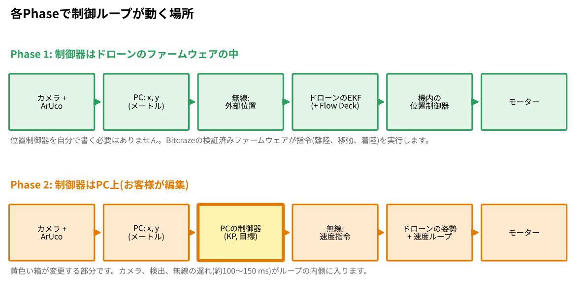

追跡に使うのはArUcoマーカーだけです。

---

## 2. 必要なものと、誰が用意するか

パッケージは、ドローンセットと、無償のソフトウェア、ドキュメントです。カメラ、コンピューター、飛行スペースはご自身でご用意ください。下の2つの表が、購入と準備のすべてのリストです。

### 2.1 ドローンセットとこのリポジトリが提供するもの

| 項目 | 備考 |
|---|---|
| バッテリーとUSB充電ケーブル付きのCrazyflie 2.1+ | BitcrazeのSTEMバンドルに含まれるもの |
| Flow Deck v2 | ドローンに、高度と床に対する動きを知らせる。テクスチャのある床が必要 |
| Crazyradioドングル | 実験室ではCrazyradio 2.0を使い、アドレスは`radio://0/80/2M` |
| 予備のプロペラとドライバー | バンドルに含まれるもの |
| このパッケージ | Pythonのソースコード(15章)、日本語版と英語版のこのガイド、`print`フォルダーの印刷用シート(ArUcoマーカーのシートとキャリブレーション用のチェッカーボード) |

予備のバッテリーを少なくとも2本、予備のプロペラを数枚、複数のバッテリーを充電できる充電器を、追加でご購入になることをお勧めします。短い飛行を何度も繰り返すと、バッテリーがすぐに減ります。スクリプトは4.0 V未満では離陸を拒否しますし、3.8 V付近から始めたバッテリーでは、飛行を最後までやり切れないことがあります(11.8節)。

### 2.2 ご自身でご用意するもの

| 項目 | 必要なこと | 実験室で使ったもの |
|---|---|---|
| USBカメラ | UVC(プラグアンドプレイ)対応で、画像が鮮明なウェブカメラ。640x480で毎秒30フレーム以上が出ること。PCからフォーカスと露出を手動で設定できること(5.2節に方法があります)。実験室のカメラは、自動露出だと毎秒約5フレームに落ちました | Windowsが「FHD Camera」と報告するカメラ(USB ID VID_1BCF&PID_28C4)。手動露出で640x480、30 fps。正確な機種はまだ確認中です(5.3節)。テストしたのはこのカメラだけです |
| カメラの取り付け具 | カメラを真下に向けて固定でき、キャリブレーションのあとで動かない、頑丈なスタンド、アーム、またはフレーム | 床から約1.2 m。これは見積もりで、まだ測定していません(5.3節) |
| コンピューター | Windows 10または11、またはLinux。Python 3.10以降。空きのUSBポート2つ(カメラとCrazyradio)と画面。グラフィックカードは不要 | Python 3.14とcflib 0.1.34のWindows。検出はカメラの30 fpsにそのまま追いつきます |
| 飛行エリア | テクスチャのある床かマット(Flow Deckは、無地の床、光沢のある床、白い床を追跡できません)。約1 m x 0.6 m以上で、周囲1.5 mを空けること。均一な光 | 黒い床紙。飛行に使ったのは0.93 m x 0.59 m(8章) |
| 照明 | 均一で明るく、マーカーに反射が出ない光。スクリプトが表示する画像の明るさが、(255のうち)約60〜180になること | 最後の実験室でのテストは、これより暗い値(41〜54)でした。11.9節を参照 |
| 安全 | エリアの周囲のネットや囲いは、ご自身でご用意ください。保護メガネの着用をお勧めします | 使用していません |
| プリンターと小物 | A4を100%の倍率で印刷できるプリンター、硬いカード、マスキングテープ、メジャー、まったく同じ高さのスタンド4つ(実験室では0.3 m、つまりホバリング高度) | 記載のとおり |

このソリューションは、特定のカメラの機種に縛られてはいません。テストしたのは、表のカメラです。別のカメラをご購入の場合は、5.2節でフレームレートと露出を確認し、13章で画像内のマーカーの大きさが足りているかを確認し、機種名を14章の記録シートに書き込んでください。

### 2.3 印刷するシート

`print`フォルダー内。「ページに合わせる」を使わず、100%(実寸)で印刷します。

- `aruco_id0_with_margin_A4.pdf`: ArUco ID 0を5種類のサイズで収録。それぞれ5 mmの白い余白と切り取り線付き。
- `checkerboard_10x7_25mm_A4.pdf`: キャリブレーション用のチェッカーボード。25 mmの正方形が10 x 7。

印刷したら、それぞれ定規で確かめてください。マーカーのシートには100 mmの目盛りバーがあり、チェッカーボードには目盛り線があります。線の長さが合っていなければ、プリンターがページを拡大縮小しているので、印刷し直します。

### 2.4 ソフトウェア

Python 3.10以降(Crazyflieライブラリの最低要件です)と、`requirements.txt`に書かれたパッケージ。手順は3章にあります。パッケージを入れるときに一度だけ、インターネットへの接続が必要です。

### 2.5 安全

手と顔をプロペラから離してください。ドローンの周囲を約1.5 m空けます。スクリプトを実行する前にcfclientを閉じます(Crazyradioを同時に使えるプログラムは1つだけです)。スクリプトのウィンドウでCtrl+Cを押すか、カメラのウィンドウでSPACEを押すと、モーターがすぐに止まります。止まるとドローンは落ちるので、最初の飛行は低くしてください。バッテリーは満充電(静止時で約4.1 V)で飛ばします。モーターが回り始めた瞬間に電圧が約0.4 V下がります。実験室の飛行では、3.82 Vから3.44 Vまで下がりました。2つの飛行スクリプトは、3.4 Vで自動的に着陸し、既定の設定では4.0 V未満で離陸を拒否します。飛行を始めたいからといって、この下限を下げないでください。

---


## 3. コンピューターの準備

プロジェクトのフォルダーでターミナルを開きます。

**Windows(PowerShell):**

```
python -m venv venv
venv\Scripts\Activate.ps1
pip install -r requirements.txt
```

PowerShellが有効化スクリプトの実行を拒否したら、先に`Set-ExecutionPolicy -Scope Process -ExecutionPolicy Bypass`を実行して、もう一度試してください。

**Linux:**

```
python3 -m venv venv
source venv/bin/activate
pip install -r requirements.txt
```

使っている仮想環境が本当にそれなのか確認します。次のコマンドは、スクリプトを動かすPythonの場所を表示します。`venv`フォルダーの中を指しているはずです。

```
python -c "import sys; print(sys.executable)"          # Windows
python3 -c "import sys; print(sys.executable)"         # Linux
```

実験室のPCでは、以前、システムのPythonに誤ってインストールしてしまったことがありました。インストールしたはずのパッケージが見つからないときは、まずこれを確認してください。

**OpenCVはcontrib版が必要です。** `cv2.aruco`は`opencv-contrib-python`にしか入っていません。「headless」版にはウィンドウ表示がなく、通常の`opencv-python`はcontrib版と衝突します。`imshow`で`cv2.error: The function is not implemented`と出て止まったら、版が違います。次のように直します。

```
pip uninstall -y opencv-python opencv-python-headless opencv-contrib-python
pip install opencv-contrib-python==5.0.0.93
```

**Crazyradioのドライバー。**

**Windows**では、Bitcrazeのライブラリの資料に、Zadig(WinUSB)でCrazyradioのドライバーを入れる方法が書かれています。新しいPCでcfclientやスクリプトが無線ドングルを見つけられないときは、https://www.bitcraze.io/documentation/repository/crazyflie-lib-python/master/installation/install/ からたどれるZadigの手順に従ってください。このページにはCrazyradio 2.0という名前は出てきません。実験室のPCではドングルが認識され、接続もできましたが、そこで使ったドライバーの正確な手順は記録していません。

**Linux**では、USBデバイスにユーザーがアクセスできるようにします。これはBitcrazeが示しているルール設定です。

```bash
sudo groupadd plugdev
sudo usermod -a -G plugdev $USER
cat <<EOF | sudo tee /etc/udev/rules.d/99-bitcraze.rules > /dev/null
SUBSYSTEM=="usb", ATTRS{idVendor}=="1915", ATTRS{idProduct}=="7777", MODE="0664", GROUP="plugdev"
SUBSYSTEM=="usb", ATTRS{idVendor}=="1915", ATTRS{idProduct}=="0101", MODE="0664", GROUP="plugdev"
SUBSYSTEM=="usb", ATTRS{idVendor}=="0483", ATTRS{idProduct}=="5740", MODE="0664", GROUP="plugdev"
EOF
sudo udevadm control --reload-rules
sudo udevadm trigger
```

グループの変更を反映させるため、一度ログアウトしてログインし直します。Bitcrazeのページにもこれらの設定にCrazyradio 2.0という名前は出てこないので、Linuxでドングルが見つからないときは、`lsusb`でベンダーID 1915のデバイスがあるか確認し、プロダクトIDを教えてください。

**cfclient(任意)。** Bitcrazeのグラフィカルなクライアントは、ドローンを最初に確認したり、ファームウェアを更新したり、設定を読んだりするのに便利です。インストール、起動、使い方は17章で説明します。スクリプトを実行する前に、必ず閉じてください。

---

## 4. Crazyflieへの接続と最初の飛行

### 4.1 接続テスト

まずバッテリーを充電します。3.88 Vは少し低めなので、飛ばす前に充電するほうが安心です。約4.1 V以上なら満充電です。

Crazyflieの電源を入れ、平らな場所に静止させます。cfclientを閉じてから、次を実行します。

```
python connect_test.py          # Windows
python3 connect_test.py         # Linux
```

スクリプトはCrazyflieを探し、最初に見つかった機体に接続して、バッテリー電圧を表示し、Flow Deck v2を検出したかどうかを伝えます。モーターは回りません。Flow Deckが検出されなければ、機体下側のピンにしっかり押し込み、ドローンの電源を入れ直してもう一度実行します。接続に失敗するときは、無線ドライバー(3章)、ドローンの電源が入っていない、cfclientがまだ開いている、または既定ではない無線アドレスを使っている、のどれかが原因として考えられます。

### 4.2 Flow Deckだけでの最初のホバリング

カメラを使わずに、モーター、無線、Flow Deckをテストします。ドローンをテクスチャのある床に平らに置き、周りに余裕を持たせます。

```
python flow_hover_test.py       # Windows
python3 flow_hover_test.py      # Linux
```

バッテリーが3.8 V未満、またはFlow Deckがないときは、スクリプトは飛びません。3秒後に0.3 mまで離陸し、3秒ホバリングして着陸します。Ctrl+Cでモーターがすぐに止まります。無線アドレスはスクリプト冒頭の`URI`の行(`radio://0/80/2M`)です。ドローンが別のチャンネルやアドレスを使っているなら、そこを変えます。

このテストは実験室のハードウェアで正しく飛びました。インストールしたcflibがドローンのファームウェアより新しいと、出力に「legacy hover」という警告が出ることがありますが、警告が出ても飛行は問題ありませんでした。警告を消したければ、cfclientからドローンのファームウェアを更新できます。Crazyflie 2.1+のファームウェアのプラットフォームは`cf2`です。

---

## 5. カメラの設定

### 5.1 取り付けと視野

カメラは飛行エリアの真上に、真下を向けてしっかり固定します。キャリブレーションのあとにカメラが少しでも動く(アームがゆるい、ケーブルに触れるなど)と、キャリブレーションと床マップが合わなくなります。最初に取り付けを締めておいてください。飛行エリア全体と、その周りの余白が、画面の中に収まる必要があります。

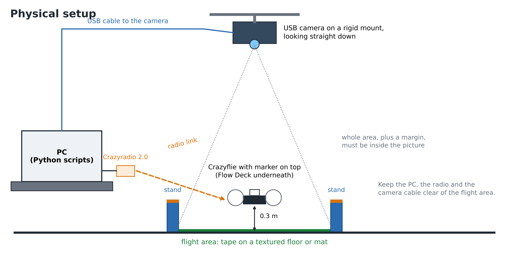

図の注記は英語のままです。図の内容は、カメラが飛行エリアの真上のリジッドな取り付け具に固定され、USBケーブルでPCにつながり、PCがCrazyradioで機体に指令を送る、という配置です。

光は均一にして、マーカーに反射が出ないようにし、手やドローンの影がマーカーにかからないようにします。キャリブレーションを始めたら、カメラのズームとフォーカスは変えないでください。

### 5.2 解像度と露出の選び方

マーカーは4つのプロペラの間に収めるため、幅がわずか30 mmです。そのため映像の中ではとても小さくなり、検出するには十分な幅が必要です。目安として、幅が20画素以上なら良好、12〜20画素はぎりぎり、12画素未満は小さすぎます。画像サイズの選び方は、マーカーの大きさと、カメラが毎秒何枚出せるかとのトレードオフになります。

実験室のカメラで、同じ30 mmのマーカーを同じカメラ位置で測ったところ、1920x1080では幅32〜36画素、640x480では14画素でした。一方、フレームレートは仕様から想像するものとは違いました。1920x1080では、試した露出(自動、-6、-13)に関係なく、毎秒約5フレームしか出ませんでした。1280x720では、自動露出で毎秒約10フレームでした。640x480では、自動露出だと毎秒5フレームでしたが、手動露出(AutoExposure 0、Exposure 8)にすると毎秒30フレームが出ました。正確な原因は突き止められていません。暗いときにカメラが自分でフレームレートを下げることはよくあり、それと矛盾しませんが、証明はできていません。1280x720と1920x1080を手動露出8で試し直すことは、していません。

Phase 1では、ドローンが動き、その位置がドローンの推定器に絶え間なく渡されるので、カメラ位置を毎秒何度も得る必要があります。飛行スクリプトはカメラのフレームレートを測り、毎秒10フレーム未満では離陸を拒否します。毎秒5フレームだと、手で動かしたドローンに対してカメラ位置が遅れ、階段状に跳びます。そこで、640x480と手動露出で飛ばしています。幅14画素のマーカーを検出できるのは、検出器がマーカーの各セルをより細かく読むからです(`perspectiveRemovePixelPerCell = 8`。`live_tracker.py`と`camera_setup.py`で設定)。この設定がないと、飛行スクリプトが保存した画像では、1920x1080で幅30画素のマーカーでも検出器が拒否しました。もしお手元に、1920x1080で毎秒20フレーム以上出るカメラ(たとえばUSB 3のポートにつないだUSB 3カメラ)があれば、そのサイズを使ってください。マーカーが検出しやすく、位置も正確になります。その場合は、そのサイズで7章と8章をやり直します。

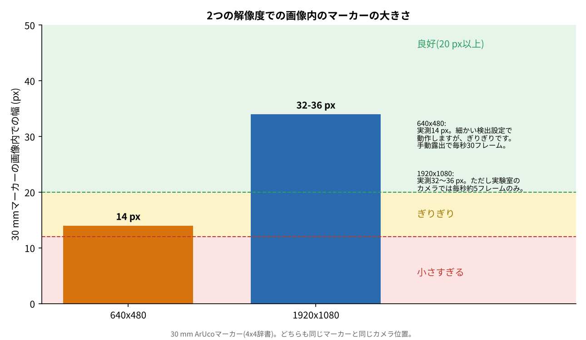

カメラ設定ウィンドウを起動します(数字はカメラの番号です。0はたいていノートPC内蔵のカメラ、1が取り付けたカメラです)。

```
python camera_setup.py 1        # Windows
python3 camera_setup.py 1       # Linux
```

番号がわからないときは、次のコマンドで、開ける番号が表示されます。

```
python -c "import cv2; [print(i, cv2.VideoCapture(i, cv2.CAP_DSHOW).isOpened()) for i in range(6)]"    # Windows
python3 -c "import cv2; [print(i, cv2.VideoCapture(i).isOpened()) for i in range(6)]"                 # Linux
```

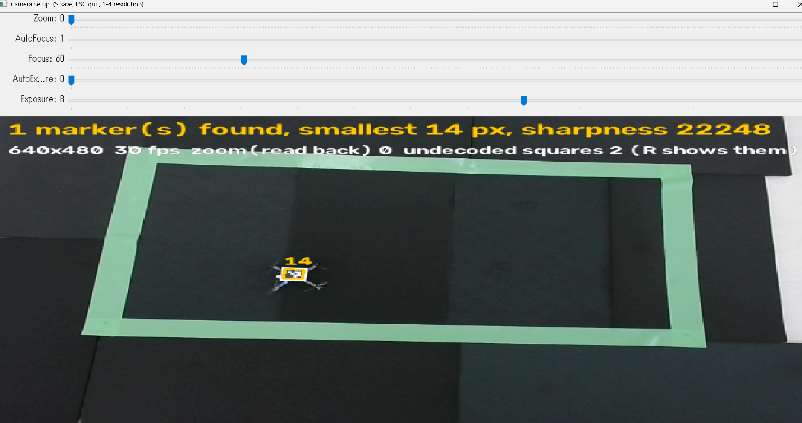

ウィンドウは1920x1080で始まります(上の画像は、1を押して640x480に切り替えたあとのものです)。1行目に、見つかったマーカーの数、いちばん小さいマーカーの幅(画素。緑なら良好)、鮮鋭度の数値が出ます。2行目には、画像サイズとフレームレートが出ます。キー操作は次のとおりです。1〜4で解像度を切り替え(640x480、1280x720、1920x1080、3840x2160)、Rで検出器が見つけたのにデコードできなかった四角を表示、Pで全解像度の画像を保存、Sで設定を保存、ESCで終了します。

1を押して640x480にし、ドローンに付けたマーカーをエリアの中央に置いて、上の行を読みます。マーカーが「found」と「no marker」の間で点滅するなら、マーカーが小さすぎる、ぼけている、または照明が悪いということです。スライダーは1つずつ動かします。最初にAutoExposureを0にして、それからExposureを上げます。

いちばん効くのはExposureスライダーです。Windowsでは、スライダーの値nがカメラに-nとして送られるので、値が大きいほど露出が短くなります。露出が長いと、画像が白飛びして、動くマーカーがにじみます。自動露出では映像の明るさがふらつき、マーカーが約1秒に1回のペースでちらつくことがありました。実験室のカメラでは、自動露出がフレームレートも押し下げていました。640x480で実験室でうまくいった値は、AutoExposure 0、Exposure 8で、マーカーが安定して毎秒30フレームが出ました。値は照明によって変わります。カラーカメラはフォーカス固定のものもあり、その場合フォーカスのスライダーは効きません。Zoomは触らないでください。

マーカーが安定して、フレームレートが20以上になったら、**S**を押します。`camera_settings.json`がスクリプトと同じ場所に書かれます。以後、`vision_pipeline_tool.py`、`live_tracker.py`、`phase1_flight.py`は、そのサイズとその設定でカメラを開き、たとえば次のように表示します。

```
Camera settings loaded from ...\camera_settings.json
  autofocus 1, focus 90, auto_exposure 0, exposure -8
Camera resolution: 640x480
```

`camera_settings.example.json`が形式の例です。`camera_settings.json`を削除すると、カメラの初期設定に戻ります。スクリプトを起動するたびに、この行を確認してください。テストのとき、保存された露出が-13のままで映像がほとんど真っ暗になり、スクリプトがマーカーを見つけられなかったことがありました。

Linuxでは、カメラのスライダーは別のドライバーを通ります。解像度は同じように使えますが、露出の値の意味が違い、その動作は確認していません。

画面サイズ、圧縮方式、露出モードごとの本当のフレームレートを測るには、`python camera_fps_test.py 1`を実行します。1分ほどかかり、表が表示されます。`camera_modes.py`と`compare_saved_images.py`は、解像度ごとに画像を1枚保存してマーカーの幅を比べる、古い診断ツールです。どれも必須の手順ではありません。

### 5.3 カメラの仕様: 何が重要で、何がわかっているか

カメラは、システムが動くかどうかを最も左右する部品です。この節では、システムがカメラに求めるもの、実験室のカメラで測定したこと、まだわかっていないことをまとめます。

**システムがカメラに求めるもの。** 最初の3行がPhase 1が動くかどうかを決めます。残りは、使いやすさや精度を上げるものです。

| 項目 | システムが必要とするもの | 理由 |
|---|---|---|
| 選んだサイズでのフレームレート | 毎秒20フレーム以上。飛行スクリプトは10未満で離陸を拒否します | カメラ位置は、映像1枚ごとにドローンへ送ります。毎秒5フレームだと遅れて階段状に跳びます |
| 画像内のマーカーの幅 | 20画素以上なら良好、12〜20はぎりぎり | 検出器がマーカーの4x4のセルを読み取る必要があります。式は13章にあります |
| 手動の露出制御 | AutoExposureを切って、露出を固定できること | 自動露出ではマーカーが約1秒に1回ちらつき、実験室のカメラではフレームレートも下がりました |
| 短い露出 | 明るく均一な床と、短い露出 | 露出が長いと、動くマーカーがにじみます。手動露出8でも、ドローンが速く動く間に、映像の25〜70%でマーカーを見失いました |
| フォーカス | 固定、またはロックできること | キャリブレーションは、1つのフォーカス設定でしか有効ではありません |
| シャッター方式 | 速い動きにはグローバルシャッターが有利。必須ではありません | ローリングシャッターだと、速く動くマーカーが少し歪みます |
| USB接続 | USB 3のポートとケーブルが望ましい | 大きな画像を高いフレームレートで送る帯域のためです |
| 取り付け | リジッドに、真下を向ける | キャリブレーションのあとで動くと、床マップが合わなくなります |

**実験室のカメラでの測定結果**(番号1のカメラ、つまり`camera_setup.py`とすべてのスクリプトが開くカメラです)。640x480で手動露出にすると毎秒30フレーム出て、30 mmのマーカーは幅14画素です。1920x1080では毎秒約5フレームしか出ず、マーカーの幅は32〜36画素です。

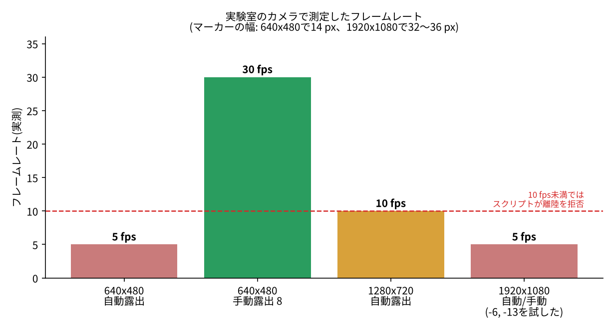

**実験室のカメラの素性についてわかっていること。** Windowsは、このカメラを「FHD Camera」、USB IDを`VID_1BCF&PID_28C4`と報告します。IntelのRealSenseカメラはベンダーID 8086を使うので、このIDはRealSenseのものではありません。このベンダーIDとプロダクトIDを検索すると、Sunplus Innovationのウェブカメラのドライバー一覧が出てきます。これは汎用の1080pウェブカメラを作っているメーカーで、たとえば[この一覧](https://treexy.com/products/driver-fusion/database/imaging-and-cameras/sunplus/1080p-fhd-camera/)があります。正確な機種はまだ見つかっていません。以前のプロジェクトのメモにはカメラがRealSense D435と書かれていたので、メモかカメラ番号のどちらかが間違っているか、PCに両方のカメラがつながっているかのどれかです。どれなのかは、まだ確かめていません。したがって、正確な機種、センサー、レンズの視野角、シャッター方式、カメラの床からの高さは、わかっていません。

**確かめ方。** RealSenseのレンズを手でふさいで、`camera_setup.py`の映像が暗くなるか見てください。暗くならなければ、スクリプトは別のカメラを使っています。次に、カメラとそのIDの一覧を出します。

Windows(PowerShell):

```
Get-PnpDevice -Class Camera | Format-List FriendlyName, InstanceId, Manufacturer
Get-PnpDevice -PresentOnly | Where-Object { $_.InstanceId -match 'VID_8086|VID_1BCF' } | Format-List FriendlyName, InstanceId
```

Linux(先に`sudo apt install v4l-utils`で`v4l-utils`を入れます):

```
v4l2-ctl --list-devices
lsusb
v4l2-ctl -d /dev/video0 --list-formats-ext
```

最後の行は、カメラが対応していると申告している画像サイズ、圧縮方式、フレームレートをすべて表示します。そのあと`python camera_fps_test.py 1`で、このPCで実際に出る値を測ります。RealSenseの番号はPCによって0、1、2のどれかなので、`camera_setup.py 0`、`camera_setup.py 2`のように試して探します。

**カメラがRealSense D435の場合。** Intelの[D435製品概要](https://simplecore.intel.com/realsensehub/wp-content/uploads/sites/63/D435_Series_ProductBrief_010718.pdf)には、カラーの解像度が最大1920 x 1080、視野角が69.4 x 42.5 x 77度(それぞれ±3度)、接続はUSB 3 Type-Cと書かれています。この概要には、カラーカメラのフレームレートとシャッター方式は書かれていないので、ここでも断定しません。D435がUSB 2のポートにつながっていると、カラーストリームの帯域が制限されます。それなら1920x1080でフレームレートが低いことの説明になります。

**カメラの高さの照合。** 640x480の床マップでは、飛行エリアの0.93 mの辺が484画素に対応するので、画像の横幅640画素全体が、ホバリング高度で約1.23 mの床に相当します。水平視野角が69.4度だとすると、その幅は約0.89 mの距離から見たものになり、カメラは床から約1.2 m(0.89 mにホバリング高度0.3 mを足した値)の高さになります。これは推定で、レンズが本当にその視野角のときだけ成り立ちます。メジャーで実際のカメラの高さを測り、記録シートに書いてください。1.2 mから大きく外れていれば、レンズは69度のものではなく、想定した機種のカメラではありません。

**別のカメラを使う場合。** 最低限として私たちが推奨するのは、1280x720以上で毎秒30フレーム出ること、手動の露出制御があること、フォーカスをロックできること、USB 3のポートにつなぐこと、そして30 mmのマーカーが少なくとも20画素の幅になるように飛行エリアが映ること(13章)です。これらは私たちの推奨で、他のハードウェアでは試していません。別のカメラを試した場合は、機種と結果を、プロジェクトのページのissueで共有してください。

---

## 6. ArUcoマーカーの印刷と取り付け

4x4辞書(`DICT_4X4_50`)のArUco ID 0を使います。シート`print/aruco_id0_with_margin_A4.pdf`には、30、40、50、60、80 mmの5種類が入っていて、それぞれが5 mmの余白付きの白い正方形と、破線の切り取り線の上にあります。30 mmのマーカーは4つあり、予備があります。ドローンに載るのは30 mmだけです。大きいサイズは、遠い距離でカメラを試すためのものです。

破線に沿って切り、白い余白には切り込まないでください。検出器は、マーカーの黒い枠の外側に、きれいな白い縁を必要とします。その縁はマーカーのセル1つ分の幅で、30 mmのマーカーなら5 mmです。

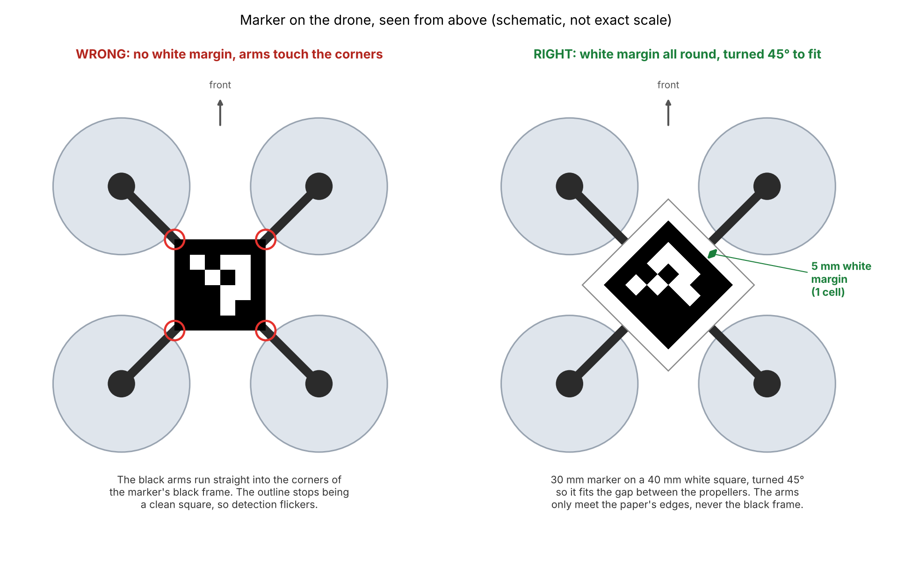

図の注記は英語のままです。左の図(WRONG)は、白い余白がなく、アームがマーカーの角に触れている悪い例で、右の図(RIGHT)は、白い余白が全周にあり、45度回して取り付けた良い例です。

取り付けは次の手順です。

1. 40 mmの白い正方形を、ドローンの上面の、4つのプロペラの中央に、平らに貼ります(接着剤またはテープ)。
2. 正方形を約45度回し、角がドローンの前後左右を向き、辺がアームと平行になるようにします。この向きなら、紙がプロペラの間に収まります。図は模式図なので、固定する前に、実機に紙を当てて、プロペラが紙に触れないことを確認してください。
3. ドローンの黒い部分(アーム、デッキ、ケーブル)を、マーカーの黒い枠に触れさせないでください。白い余白は、全周で黒いものから離れている必要があります。
4. 平らに、ぴんと貼ります。紙が反っていたり光沢があると、反射が出てマーカーの輪郭が歪みます。普通のプリンター用紙なら、重さは1グラムにもなりません。

マーカーを回して付けているので、トラッカーが出すヨー角は、ドローンの機首の向きから一定の量だけずれます。そのずれは1回だけ測ります。ドローンを開始位置に置き、機首を+Xに向けて(8章)、`live_tracker.py`でヨー角を読み(9章)、記録シートに書き留めます。飛行スクリプトはそれを差し引きます。

---

## 7. カメラレンズのキャリブレーション

どのレンズも、直線を少し曲げて写します。キャリブレーションでこの曲がり方を測っておくと、位置を計算する前に画像を補正できます。チェッカーボードを使って行い、有効なのは、1台のカメラ、1つの解像度、1つのレンズ設定に対してだけです。解像度、ズーム、フォーカスを変えたら、やり直してください。

`print/checkerboard_10x7_25mm_A4.pdf`を100%で印刷し、目盛り線で確認して、硬いカードに平らに貼ります。ボードは25 mmの正方形が10 x 7で、内側のコーナーが9 x 6になり、ツールの想定と合っています。別のボードを使うなら、`vision_pipeline_tool.py`の冒頭近くにある`CHECKERBOARD_CORNERS`と`SQUARE_SIZE_M`を書き換えてください。

ツールを起動して、オプション1を選びます。

```
python vision_pipeline_tool.py        # Windows
python3 vision_pipeline_tool.py       # Linux
```

別の解像度で撮った古い`cf_vision_data/checkerboard_images`フォルダーがあれば、古い画像が混ざらないように、先に名前を変えておきます。

```
Rename-Item cf_vision_data\checkerboard_images checkerboard_images_old       # Windows (PowerShell)
mv cf_vision_data/checkerboard_images cf_vision_data/checkerboard_images_old # Linux
```

オプション1は、黄色い目標の枠を重ねた映像を表示します。ボードをカメラの前、約30〜50 cmに持ち、枠いっぱいに収めます。撮るたびにSPACEを押します。3枚撮るごとに枠が新しい位置に移るので、それに合わせて動かします。同じ位置の3枚の間で、ボードを少し傾けながら、合計約15枚撮ります。ESCで終了します。

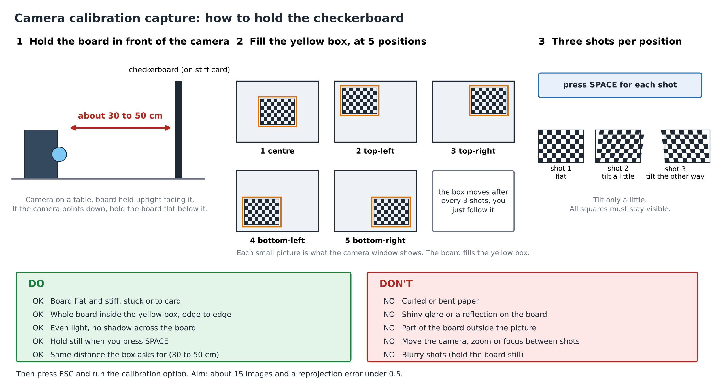

図の注記は英語のままです。ボードをカメラの前約30〜50 cmに立てて持ち、黄色い枠を5つの位置(中央、左上、右上、左下、右下)で順に埋め、各位置で3枚ずつ(平ら、少し傾ける、別の方向に傾ける)撮る、という意味です。DOの欄は「ボードは平らで硬い」「ボード全体が枠の中」「均一な光」「SPACEを押すとき静止」、DON'Tの欄は「反ったボード」「光沢の反射」「ボードが画面外にはみ出す」「撮影の間にカメラやズームやフォーカスを動かす」「ぼけたショット」です。

次にオプション2を選びます。使えた画像の枚数と、再投影誤差が表示されます。使える画像が約15枚、誤差が0.5未満を目指します(640x480では約0.7までなら許容範囲です)。実験室の640x480での出力例です。

```
--- Camera calibration ---

Calibrated using 15/15 images.
Reprojection error: 0.6311  (good is under ~0.5; recapture more varied angles if higher)
Saved: ...\cf_vision_data\camera_calib.npz
```

同じカメラの1920x1080では、18枚中18枚、誤差0.331でした。

640x480での最初の試行では、すべての画像でボードが見つかったのに、誤差が6.6になりました。原因は、この画像では印刷した正方形1つが約12画素しかないのに、コーナーの位置を精密化するコードが固定の23画素の窓を使っていて、正方形より大きかったことです。コーナーが間違った位置に引き寄せられていました。`vision_pipeline_tool.py`は、測った正方形の大きさから窓の大きさを決めるように変えてあり、同じ画像で誤差が0.631になりました。15枚とも、ボードは平らにして撮りました。ボードを傾けて撮ると焦点距離がより確実に決まるので、あとで床マップの確認で、端に近いほど誤差が大きくなるようなら、何枚かボードを傾けて撮り直してください。

誤差が大きいときは、`python inspect_corners.py`を実行します。すべての画像に、検出したコーナーと鮮鋭度のスコアを重ねて描くので、悪い画像を見つけて削除し、オプション2をもう一度実行します。よくある原因は、ボードの反り、ぼけた画像、画面内でボードが小さすぎることです。

オプション2は、`cf_vision_data/camera_calib.npz`を保存し、画像サイズも一緒に記録します。別のサイズでカメラを開くツールは、キャリブレーションをやり直すよう警告を出します。キャリブレーションと床マップは、作ったときの画像サイズでしか使えません。サイズを変えるとき、以前のデータを残しておくには、先にフォルダー全体の名前を変えます。たとえばWindowsなら`Rename-Item cf_vision_data cf_vision_data_1080p`、Linuxなら`mv cf_vision_data cf_vision_data_1080p`です。実験室では1920x1080のデータをこのようにして残しています。

---

## 8. 床の準備と床マップ(ホモグラフィー)の作成

床マップ(ホモグラフィー)は、画像内の画素を、床上のメートル位置に変換するものです。位置がわかっている4点をクリックして作ります。

### 8.1 基準点をホバリング高度に置く理由

ドローンは床から約0.3 m上を飛ぶので、床よりカメラに近くなります。そのため、真下の床の点より、外側にずれて写ります。床の上の4点をクリックして作った床マップは、床に対しては正しくても、飛んでいるドローンの読み取りには、画像の端に行くほど大きくなる誤差が出ます。ホバリング高度と同じ高さのスタンドの上面を4点クリックすれば、床マップはドローンが飛ぶ平面に対して正しくなります。

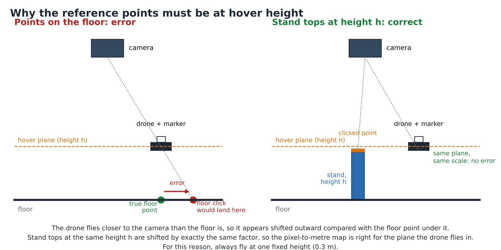

図の注記は英語のままです。左の図(Points on the floor: error)は、床の点をクリックすると、ドローンが飛ぶ平面でずれが出ること、右の図(Stand tops at height h: correct)は、同じ高さhのスタンド上面なら、同じ平面で同じ縮尺になるので誤差がないことを示しています。

そこで、まったく同じ高さのスタンドを4つ使い、その1つの高さだけで飛び、床マップを作ったあとは高さを変えないでください。私たちの高さは0.3 mです。

### 8.2 配置

1. 始める前に、原点と+Xの方向を決めます。原点は飛行エリアの角の1つです。+Xは、ドローンを開始位置に置いたとき、機首が向く辺に沿った方向です。+Yは、上から見てドローンの左側に向かう方向です(右手系)。この座標系とドローンが実際に向く機首の向きが食い違うのは、最初の飛行でよく起きる失敗で、ドローンが自信満々に間違った方向へ飛びます。
2. 床に長方形をテープで描きます。原点と+Xの辺に印を付けます。
3. 各角の印の真上に、スタンドを1つずつ立てます。各スタンドの上面には、クリックする目印の小さな色付きの点を付けます。
4. メジャーで、中心から中心までを測ります。Xの長さ(スタンド1から2まで)と、Yの長さ(スタンド1から4まで)です。外側や内側の縁ではなく、中心で測ってください。
5. スタンド1から3までの対角線を測って、角が直角になっているか確認します。対角線はXの2乗とYの2乗の和の平方根になるはずです。0.93 mと0.59 mなら1.101 mで、実測は1.1 mでした。1〜2 cm以上違うなら、合うまでスタンドを動かします。

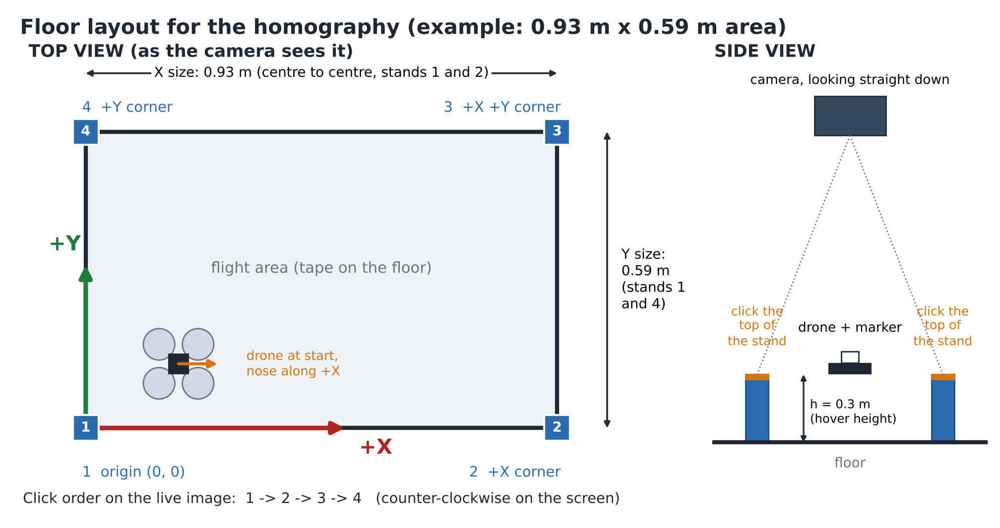

図の注記は英語のままです。上から見た図で、スタンドに1(原点)、2(+X側の角)、3(+X+Yの角)、4(+Y側の角)の番号を付けてあり、クリックはこの順番で、画面上は反時計回りです。右の図は横から見た様子で、スタンドの上面(高さh = 0.3 m)をクリックします。

### 8.3 床マップの作成

床マップを保存するまで、カメラとスタンドを動かさないでください。ツールを起動してオプション5を選び、測ったXの長さ、続けてYの長さをメートルで入力し、4つのスタンドの上面を次の順にクリックします。1 原点、2 +X側の角、3 遠い側の角、4 +Y側の角。画面上では、この順が反時計回りになっている必要があります(たとえば左下、右下、右上、左上)。時計回りだとY軸が鏡像になり、ツールがそれを検出すると「WARNING」を表示します。

ツールはクリックごとに表示を出し、`cf_vision_data/floor_homography.npy`を保存して、最後に確認を表示します。原点の点が、約(0, 0)に戻ってくる必要があります。実験室の640x480での出力例です。

```
Camera resolution: 640x480
  Point 1 (origin (0,0)): pixel (78, 331)
  Point 2 (+X corner): pixel (562, 357)
  Point 3 (+X+Y corner): pixel (541, 81)
  Point 4 (+Y corner): pixel (112, 58)

Saved: ...\cf_vision_data\floor_homography.npy
Sanity check - origin point maps back to: (0.000, 0.000)  (should be ~0, 0)
```

スタンドが必要なのはこの手順だけです。終わったら取り除き、飛行エリアの外に置いてください。カメラ、飛行エリア、画像サイズのどれかを変えたときは、この手順をやり直します。床マップは、同じ画像サイズでキャリブレーションをしたあとに作る必要があります。

---

## 9. 位置測定の確認

ライブトラッカーを起動します。

```
python live_tracker.py        # Windows
python3 live_tracker.py       # Linux
```

レンズの歪みを補正し、ID 0のマーカーを見つけて、床上の位置(メートル)とヨー角(度。0が+X方向、反時計回りが正)を表示します。スクリプトと同じ場所に、ログファイル`tracker_log_<日付>_<時刻>.csv`を書きます。列は`t_seconds, visible, x_m, y_m, yaw_deg, pixel_x, pixel_y`です。ログは起動時からオンです。Lでログのオンオフ、ESCで終了します。

マーカーを各スタンドの上に平らに置き、次に中央に置いて、毎回同じ辺を+Xに向けて直立させ、xとyを読みます。

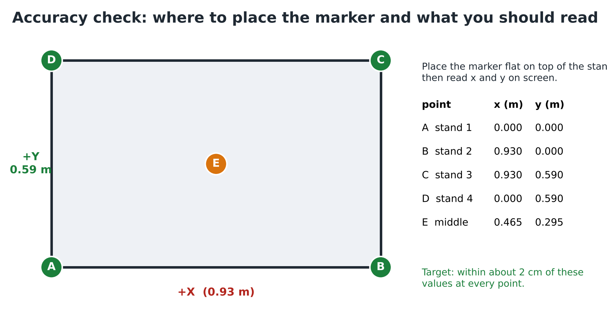

図の注記は英語のままです。四隅のA〜Dがスタンド1〜4で、Eが中央です。期待される値は次の表のとおりです。

私たちの飛行エリアでの期待値です。

| 点 | x (m) | y (m) |
|---|---|---|
| A、スタンド1(原点) | 0.000 | 0.000 |
| B、スタンド2 | 0.930 | 0.000 |
| C、スタンド3 | 0.930 | 0.590 |
| D、スタンド4 | 0.000 | 0.590 |
| E、中央 | 0.465 | 0.295 |

どの点でも約2 cm以内を目標にします。別のエリアなら、ご自身で測った長さを使ってください。

値がずれているとき: 一方向に一定のずれがあるなら、床マップを作ったあとでカメラかスタンドが動いたということなので、8章をやり直します。端に行くほど誤差が増えるなら、点を床でクリックしてしまったか、スタンドの高さが違っています。xとyが入れ替わっていたり、鏡像になっているなら、クリックの順番か+Xの定義が違います。マーカーがちらつくなら、5章に戻ってください。

5点A〜Eをメジャーで確認する正式なチェックは、1920x1080で実施しました(中央の点は約1.5〜2.2 cm以内でした)。640x480ではまだ繰り返していません。新しいサイズでの手早い確認としては、10章の`--check`が、カメラとドローン自身の推定位置を比べてくれます。

ドローンを開始位置に置き、機首を+Xに向けたときのヨー角も読んでください。その数字を記録シートに書きます。それが6章で述べた、固定のヨー角のずれです。

---

## 10. Phase 1: カメラ位置をドローンに渡して飛ばす(方式2)

この章の内容は、スクリプト`phase1_flight.py`が行います。ドローンの機内の推定器(拡張カルマンフィルター、EKF)は、Flow Deckと外部位置を組み合わせます。スクリプトは、カメラの映像1枚ごとに(640x480では毎秒約30回)、カメラのxとyをその推定器に送ります。カメラの絶対位置が、Flow Deckのゆっくりしたずれを補正し、Flow Deckの速い更新が、カメラが取りこぼしたフレームを補います。そのうえで、ドローンのハイレベルコマンダーが、この補正された位置を使って移動を飛ばします。このPhaseでは、位置制御器を自分で書く必要はありません。

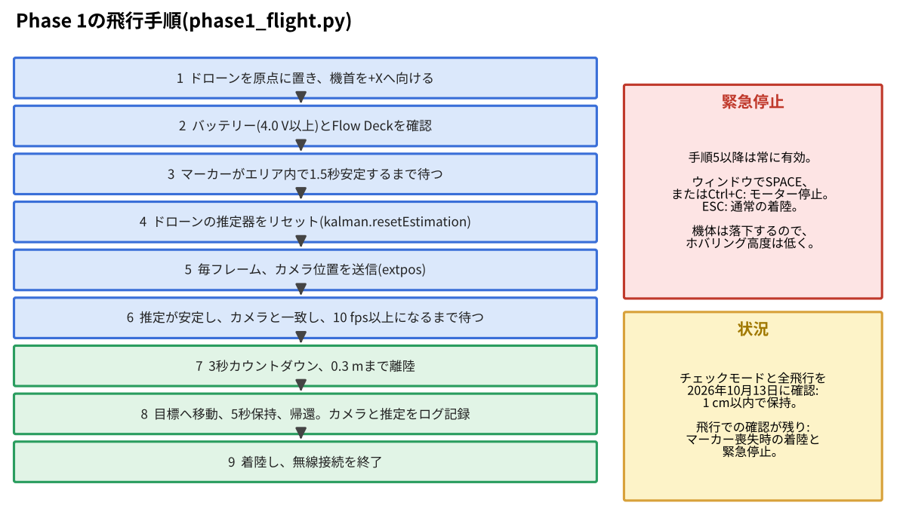

### 10.1 ドローンはどこへ行くのか

ドローンはランダムには動かず、画面をクリックして指定するわけでもありません。`phase1_flight.py`の冒頭にある`TARGETS`のリストの点へ飛びます。初期値は1点の`(0.465, 0.295)`で、0.93 m x 0.59 mのエリアの中央です。飛行の流れは、0.3 mまで離陸、リストの目標へ順に移動(1回の移動に3秒)、その場で5秒保持、開始位置へ戻って着陸です。機首の向きは終始変わらず、+Xに向いたままで、回転しません。行き先を変えるには、`TARGETS`を編集します。たとえば`TARGETS = [(0.2, 0.2), (0.7, 0.2), (0.7, 0.4)]`のようにして、すべての点を飛行エリアの内側にしてください。カメラ画面のクリックで目標を選ぶ機能は、このスクリプトにはありません。Phase 2のスクリプトには組み込んであります(11.5節)。

### 10.2 スクリプトが順に行うこと

順番が重要で、飛行のたびに同じです。スクリプトはドローンに接続して、バッテリー(4.0 V以上)とFlow Deckを確認します。マーカーがエリア内で1.5秒安定して見えるまで待ちます。ドローンにKalman推定器とハイレベルコマンダーを使うよう設定し、推定器をリセットして、カメラ位置の連続送信を始めます。推定器の位置のばらつきが落ち着くまで待ち、ドローンの推定位置とカメラが5 cm以内で一致していることを確認します。カメラのフレームレート(毎秒10フレーム以上)も確認します。そこまで終わって初めて、3秒のカウントダウンをして離陸します。送る高さの値は、ドローン自身の高さの推定値なので、カメラが補正するのはxとyだけです。スクリプトは、毎フレーム`flight_log_<日付>_<時刻>.csv`に1行書きます。時刻、段階、カメラ位置、ドローン自身の推定位置、高さ、バッテリー電圧が入ります。

設定はファイルの冒頭にあります。`URI`(無線アドレス)、`HOVER_HEIGHT`(床マップに使ったスタンドの高さと同じにします)、`TARGETS`、`AREA_X`と`AREA_Y`、移動、保持、離陸、着陸の時間、バッテリーの下限、`LOST_SECONDS`、`AREA_MARGIN`、`EXT_POS_STD`です。`EXT_POS_STD`は、ドローンがカメラをどれだけ信用するかを表します。0.03 mという値は出発点としての推測値で、ログから調整するのが次の課題の1つです。

### 10.3 安全

最初にカメラのウィンドウをクリックしてから、次のキーを使います。**ESC**は通常の着陸、**SPACE**は緊急停止(モーターが即座に止まり、ドローンは落ちます)、ターミナルでの**Ctrl+C**も同じ緊急停止です。スクリプトは、次の3つの場合にも自分で着陸します。マーカーが3秒間見えない(`LOST_SECONDS`)、マーカーが飛行エリアの0.25 m以上外に出る(`AREA_MARGIN`)、バッテリーが3.4 Vを下回る、です。マーカーを見失っている間も、ドローンはFlow Deckだけで飛び続けます。最初の低い飛行を、やわらかい面の上で、満充電のバッテリーで、キーボードのそばに手を置いて行えば、失敗しても被害は小さくなります。

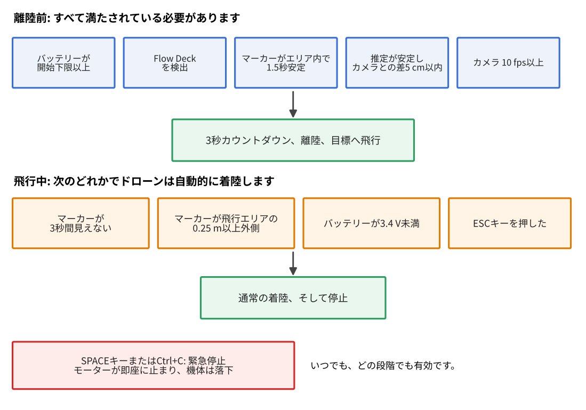

### 10.4 まずチェックを実行する(飛ばない)

ドローンをマーカー付きで飛行エリアに置き、機首を+Xに向けて、次を実行します。

```
python phase1_flight.py --check        # Windows
python3 phase1_flight.py --check       # Linux
```

離陸のカウントダウンの手前までをすべて行い、それから20秒間、ドローンを手で動かす間、カメラ位置を連続してドローンに送ります。カメラ位置とドローン自身の推定位置が並べて表示されます。プロペラは外すか、ドローンを手で持って離しておきます。実験室の640x480での出力例です。

```
Camera settings loaded from ...\camera_settings.json
  autofocus 1, focus 90, auto_exposure 0, exposure -8
Camera resolution: 640x480
Connecting to radio://0/80/2M ...
Battery: 3.81 V
Flow Deck detected (deck.bcFlow2).
Put the marker (drone) in the flight area, nose along +X. Waiting for the marker ...
Waiting for the drone's estimate to settle on the camera position ...
Settled. Drone estimate minus camera: dx +0.000 m, dy -0.000 m
Camera rate: 29.7 frames per second
CHECK MODE: for 20 s slide the drone by hand. No flight.
  camera (+0.173, +0.169)   drone (+0.174, +0.169)
  camera (+0.356, +0.356)   drone (+0.319, +0.331)
  camera (+0.442, +0.367)   drone (+0.443, +0.368)
  camera (+0.495, +0.377)   drone (+0.492, +0.391)
  camera (+0.485, +0.294)   drone (+0.484, +0.297)
  camera (+0.512, +0.300)   drone (+0.508, +0.293)
  camera (+0.465, +0.315)   drone (+0.465, +0.318)
  camera (+0.494, +0.234)   drone (+0.487, +0.236)
Check finished. Compare the two columns in the log file.
```

見るところ: フレームレートの行が20以上であること(ここでは約30)、落ち着いたときの差が数ミリ以内であること、ドローンを動かしている間もマーカーが検出され続けること、ドローンが止まったあとは2つの列が約1〜2 cm以内で追従すること。手を速く動かしている間に数センチ遅れるのは、正常です。

1920x1080で毎秒5フレームのときに同じチェックをすると、動いている間、カメラとドローンの値が最大約9 cm違い、スクリプトは「カメラのフレームレートが毎秒10未満」と表示しました。そのため、飛行には速くて小さい画像サイズを使っています。

### 10.5 飛行する

バッテリーを満充電します。プロペラを付け、ドローンの周囲を約1.5 m空けます。ドローンを原点に、機首を+Xに向けて置き、スタンドは飛行エリアの外に出して、次を実行します。

```
python phase1_flight.py        # Windows
python3 phase1_flight.py       # Linux
```

カメラウィンドウをクリックして、キー操作が効くようにします。スクリプトはマーカーを待ち、推定器をリセットし、推定が落ち着くのを待ち、3秒カウントダウンして離陸し、目標へ飛び、保持して、開始位置に戻って着陸します。2026年10月13日の全飛行での出力例です(バッテリーは3.97 Vでした)。

```
Camera settings loaded from ...\camera_settings.json
  autofocus 1, focus 90, auto_exposure 0, exposure -8
Camera resolution: 640x480
Logging to ...\flight_log_20261013_130809.csv
Connecting to radio://0/80/2M ...
Battery: 3.97 V
Flow Deck detected (deck.bcFlow2).
Put the marker (drone) in the flight area, nose along +X. Waiting for the marker ...
Waiting for the drone's estimate to settle on the camera position ...
Settled. Drone estimate minus camera: dx +0.000 m, dy -0.000 m
Camera rate: 29.7 frames per second
Taking off in 3 seconds. SPACE = emergency stop, ESC = land.
Target 1: (0.465, 0.295)
Returning to the start point.
Landing.
Landed.
```

バッテリーが離陸の下限を下回っていると、スクリプトは離陸の前に`Battery missing or below 4.0 V. Not flying.`のようなメッセージを出して止まります。配布時の下限は4.0 Vです。モーターが回り始めると電圧が約0.4 V下がるからです。実験室では、3.97 Vのバッテリーで飛ばすため、`MIN_VBAT_START`を3.8 Vに下げました。その飛行はうまくいきましたが、離陸の瞬間にバッテリーが約0.5秒、3.46 Vまで下がり、3.4 Vの着陸下限までわずか0.06 Vしかありませんでした。満充電(約4.1 V以上)のほうが安全です。

### 10.6 全飛行の結果と、残っているテスト

この飛行のログファイルは`flight_log_20261013_130809.csv`です。真上から見た飛行経路です。

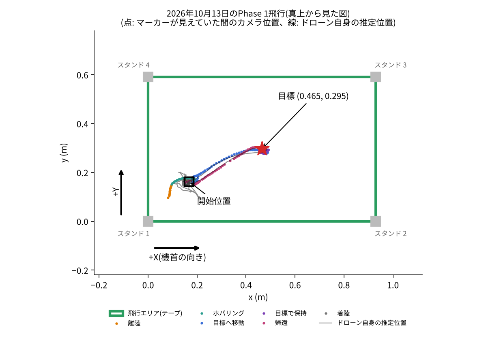

同じ飛行を時間に沿って見たものです。位置、高さ、バッテリーを、段階ごとに色分けして示します。

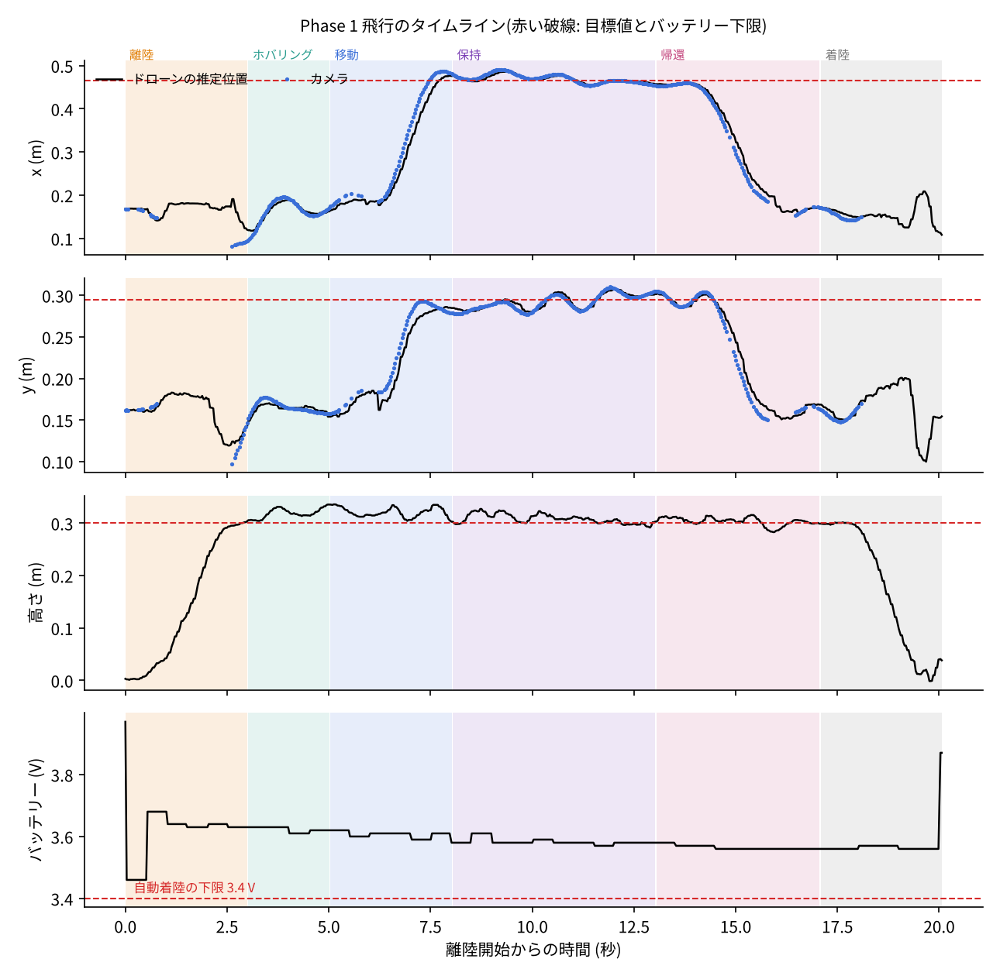

| 測定した内容 | 結果 |
|---|---|
| 5秒の保持中の目標での位置 | 平均(0.470, 0.292) m、目標(0.465, 0.295) m。1 cm以内で、ゆらぎは約1 cm |
| 目標としていた値 | 保持が10 cm以内。大きな余裕をもって達成 |
| 高さ | 目標0.30 mに対して0.29〜0.34 m |
| 帰還 | 約(0.15〜0.17、0.15〜0.17) mに戻り、開始位置(0.168、0.162) mから約3 cm以内 |
| 着陸 | 着陸。ドローン自身の推定位置では、開始位置よりxで約5 cm手前で止まった |
| カメラのフレームレート | 毎秒29.7フレーム |
| 段階ごとにマーカーが見えていた割合 | 離陸27%、ホバリング100%、目標へ移動73%、保持100%、帰還75%、着陸33% |
| バッテリー | 開始3.97 V、離陸の落ち込みで3.46 V、その後は飛行の残りの間3.56〜3.63 V。モーターが止まると3.87 Vに戻る |

ドローン自身の推定位置とカメラは、飛行中ずっと一緒に動きました。つまり、マーカーが見つからなかった映像の間は、Flow Deckが補っていました。離陸と着陸の間はほとんどの映像でマーカーが欠け、速く動くときも4分の1の映像で欠けました。スクリプトは3秒以上見失ったときだけ着陸するので、今回は問題になりませんでしたが、この構成の弱点です。映像内のマーカーを大きくする、より多くの光で露出を短くする、1280x720で毎秒30フレーム出せるカメラを使う、のどれもが助けになります。

同じ日の最初の飛行は、3.80 Vのバッテリーで始まりました。離陸の時点で電圧が3.45 Vまで下がり、移動中には3.40 Vになって、スクリプトは自分で着陸しました。これにより、自動着陸が動くことがわかり、離陸のバッテリー下限を引き上げた理由にもなりました。

マーカー喪失時の着陸の仕組みは、その後Phase 2のスクリプトで実際に動作しました(11.9節)が、Phase 1のスクリプト自体では、まだこの形で試していません。飛行での安全テストが、あと2つ残っています。

1. **マーカー喪失時の着陸。** ドローンが床から数センチの高さでホバリングしているときに、手でマーカーをふさぎます。3秒後に、ドローンが自分で着陸するはずです。低い高さで行い、もう一方の手をキーボードに置いてください。
2. **緊急停止。** 低いホバリング中に、カメラウィンドウでSPACEを1回押します。モーターが即座に止まり、ドローンは落ちるので、やわらかい面の数センチ上で行います。

2つのテストに合格すれば、Phase 1は完了です。

### 10.7 チェックと飛行でまだわかっていないこと

`EXT_POS_STD`の最適値(今は0.03 mという出発点の推測値です)、5秒より長く保持したときの挙動、複数の目標での保持、速く動いている間にマーカーがより多くの映像で検出されたときの挙動は、これから測定します。大きく飛んだ検出(フレーム間で一定の距離以上動いた検出)を無視するジャンプ除去フィルターを、画像の端での誤検出対策として計画していますが、まだ作っていません。

---

## 11. Phase 2: PC上の制御器で飛ばす(方式1)

スクリプト`phase2_flight.py`が、この処理を行います。2026年10月13日に、実験室のハードウェアで飛行させました。

### 11.1 何をするか、Phase 1との違い

Phase 1では、位置への移動と保持をドローン自身のファームウェアが行い、PCはカメラから見たドローンの位置を伝えるだけでした。Phase 2では、PCがループを閉じます。カメラ画像1枚ごとに、PCがマーカーを見つけ、ドローンが目標からどれだけ離れているかを計算し、速度を決めて、その速度をCrazyradio経由でドローンに送ります。ドローン自身は、高度を保ち、Flow Deckで速度を実行するだけです。目標がどこにあるかは知りません。


カメラ画像1枚ごとに回るループを下の図に示します。オレンジ色のボックスが、ご自身で編集する部分です。

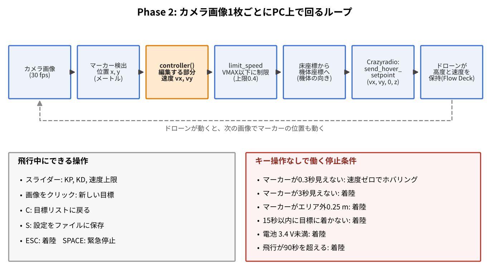

飛ばし方は、cflibの`MotionCommander`と同じです。スクリプトは、ドローンに`send_hover_setpoint(vx, vy, 0, z)`を送ります。これは、機体座標でのx方向とy方向の速度、回転なし、床からの高さを意味します。離陸と着陸は、この高さの目標値を毎秒0.15 mで上げ下げして行います。ハイレベルコマンダーは切ってあり(`commander.enHighLevel`を0に設定)、PCと競合しないようにしています。カメラ位置は、`SEND_EXTPOS = True`にしない限り、ドローンの推定器には送りません。ドローンの速度と高度はFlow Deckだけで得て、カメラ位置を使うのはPCのループだけです。こうすると、ループの動きが理解しやすくなります。

制御器が出す速度は、床の座標で表します。スクリプトが、ドローンの向きを使って、それを機体座標に変換します。そのため、ドローンはPhase 1と同じく、機首を+Xに向けて開始する必要があります。別の向きから始めるときは、`YAW_OFFSET_DEG`を設定します。

### 11.2 制御器: 編集する関数

`phase2_flight.py`の冒頭にあります。

```python
def controller(ctx, tx, ty):
    x, y = ctx.cam                         # measured position, metres
    vx = KP * (tx - x) - KD * ctx.cam_vel[0]
    vy = KP * (ty - y) - KD * ctx.cam_vel[1]
    return limit_speed(vx, vy, VMAX)       # speed in m/s in the floor frame
```

`ctx.cam`は測定したマーカー位置、`ctx.cam_vel`はカメラから測った速度(少し平滑化してあります)、`tx, ty`は目標です。`KP`は誤差1 mあたりの速度(m/s)で表したゲイン、`KD`は測定した速度で動きを減衰させる量です。結果は速度で、スクリプトはご自身の関数のあとでもう一度`VMAX`以下に切り詰めます。そのため、ご自身の制御器にミスがあっても、上限の0.4 m/sを超える指令は出ません。

既定値は、`KP = 1.0`、`KD = 0.0`、`VMAX = 0.20`です。10月13日の飛行では、カメラが測った速度は、指令に対しておよそ0.25〜0.3秒遅れて追従しました(2つの曲線の相関のピークで、1回の移動からの値なので、大まかな数字です。カメラと無線の遅れだけでなく、ドローン自身の速度応答の遅れも含みます)。この程度の遅れを入れたシミュレーションでは、`KP = 1.0`ではよく減衰し、`KP`が約1.5を超えるとオーバーシュートが出始めました。これはシミュレーションであり、ドローンでの測定ではありません。ゲインは少しずつ上げて、画面を見ながら進めてください。

### 11.3 設定

設定は、すべてファイルの冒頭にあります。Pythonを編集せずに、`phase2_settings.json`(11.5節)で変えることもできます。

| 設定 | 既定値 | 意味 |
|---|---|---|
| `KP` | 1.0(上限3.0) | ゲイン。誤差1 mあたりの速度(m/s) |
| `KD` | 0.0(上限1.0) | 測定した速度による減衰 |
| `VMAX` | 0.20 m/s(上限0.40) | 指令する速度の最大値 |
| `TARGETS` | `[(0.465, 0.295, 5.0)]` | 訪れる点。それぞれ`(x, y, 保持する秒数)`。最後に開始位置へ戻る |
| `HOVER_HEIGHT` | 0.3 m | 床マップに使ったスタンドの高さと同じにする |
| `ARRIVE_TOL` | 0.05 m | これより近づいたら到着とみなす |
| `WAYPOINT_TIMEOUT` | 15秒 | この時間内に目標に着かないと着陸 |
| `MAX_FLIGHT_SECONDS` | 90秒 | 飛行がこれより長くなると着陸 |
| `TAKEOFF_RATE`、`LAND_RATE` | 0.15 m/s | 上昇と下降の速さ |
| `STALE_SECONDS` | 0.3秒 | マーカーの情報がこれより古い: 速度指令をゼロにする(ドローンはホバリング) |
| `LOST_SECONDS` | 3.0秒 | マーカーをこの時間見失う: 着陸 |
| `AREA_MARGIN` | 0.25 m | マーカーがエリアからこれだけ外に出る: 着陸 |
| `MIN_VBAT_START`、`MIN_VBAT_FLIGHT` | 4.0 V、3.4 V | 前者未満では離陸しない、後者未満で着陸 |
| `MIN_CAMERA_HZ` | 15 fps | カメラがこれより遅いと離陸しない |
| `YAW_OFFSET_DEG` | 0 | 床座標とドローンの向きの差(度) |
| `SEND_EXTPOS` | False | カメラ位置をドローンの推定器にも送る |

### 11.4 実行する

1回だけの準備(3章から9章)を先に済ませます。そのあと、プロジェクトのフォルダーで実行します(Linuxでは`python3`を使います)。

**手順1: ドライラン。無線も飛行もありません。**

```
python phase2_flight.py --dry
```

マーカーを手で床の上で動かし、表示される指令を見ます。指令は、常に目標のほうを向いていなければなりません。これで、向きと構成を、いちばん安全な方法で確認できます。実験室での実行結果の抜粋です(目標は(0.465, 0.295)で、「new target from click」の行は、画像をクリックしたときのものです)。

```
DRY RUN for 60 s. Slide the marker by hand. No radio, no flight.
The target is the first entry of TARGETS. Check that the command points TOWARDS it.
  marker (+0.308, +0.245)  error (+0.157, +0.050)  command (+0.16, +0.05) m/s  -> +X +Y
  marker (+0.540, +0.589)  error (-0.075, -0.294)  command (-0.05, -0.19) m/s  -> -X -Y
  new target from click: (0.640, 0.281).  Press C to go back to the TARGETS list.
  marker (+0.292, +0.216)  error (+0.348, +0.065)  command (+0.20, +0.04) m/s  -> +X +Y
Dry run finished.
```

誤差がどれだけ大きくても、指令は0.20 m/sに制限されます。ドライランもログファイルを書きます。表示はマーカーが見えている間だけなので、表示が途切れた区間は、そこでマーカーを見失ったということです。

**手順2: 飛ばす場所での確認。** ドライランの間に、ホバリング高度(0.3 m)の台にマーカーを載せて、飛行エリアの四隅や端に持っていきます。ある場所でマーカーを見失うなら、飛ばす前に、光やカメラの設定を直してください(11.9節)。

**手順3: 飛行。** 満充電(4.0 V以上)のバッテリー、cfclientを閉じた状態で、ドローンを、機首を+Xに向けてエリア内の床に置きます。

```
python phase2_flight.py
```

10月13日の実験室での飛行の出力です(この飛行は3.82 Vで開始しました。実験室のコピーで、開始の下限を3.8 Vに下げていたためです。既定の下限は4.0 Vです)。

```
Settings read from ...\phase2_settings.json
Camera settings loaded from ...\camera_settings.json
  autofocus 1, focus 90, auto_exposure 0, exposure -8
Camera resolution: 640x480
Logging to ...\flight2_log_20261013_141204.csv
Connecting to radio://0/80/2M ...
Battery: 3.82 V
Flow Deck detected (deck.bcFlow2).
Put the marker (drone) in the flight area, nose along +X. Waiting for the marker ...
Camera rate: 29.7 frames per second
Taking off in 3 seconds. SPACE = emergency stop, ESC = land.
Target 1: (0.465, 0.295), hold 5.0 s
  reached target 1 after 0.7 s
Returning to the start point.
  reached start point after 0.8 s
Landing.
Landed.
Log saved: ...\flight2_log_20261013_141204.csv
```

スクリプトの順序はPhase 1と同じです。バッテリーとFlow Deckの確認、マーカーを待つ、ドローンの推定をリセットして2秒ウォームアップ、カメラの速度確認、3秒のカウントダウン、離陸、2秒のホバリング、各目標を訪問、開始位置へ帰還、着陸です。先にカメラのウィンドウをクリックしてください。**ESC**で通常の着陸、**SPACE**で緊急停止、ターミナルでの**Ctrl+C**も同じ緊急停止です。

### 11.5 飛行中の操作と設定ファイル

カメラの画像のほかに、「Phase 2 controls」という2つ目のウィンドウがあり、3本のスライダーがあります。KP(10倍の値)、KD(10倍の値)、速度上限(cm/s)です。スライダーを動かすと、飛行中でも、すぐ次のカメラ画像から値が変わります。スライダーは、上限を超えられません。

カメラの画像をクリックすると、その床の点にドローンを向かわせます。点は、飛行エリアの内側5 cm以上に収められます。クリックした目標が有効な間は、目標リストは待機し、画像に「manual target」と表示されます。**C**キーで、リストに戻ります。ドローンが離陸する前にしたクリックは保存され、離陸とホバリングのあとで、その点に向かいます。**S**キーを押すと、現在のKP、KD、VMAX、最大飛行時間、目標リストが`phase2_settings.json`に書き込まれます。次の起動時に、スクリプトがこのファイルを読みます。上限を超えた値は切り詰められます。壊れたファイルは無視され、スクリプトの中の値が使われます。`phase2_settings.example.json`が書式の例です。

```
{
  "KP": 1.0,
  "KD": 0.0,
  "VMAX": 0.2,
  "MAX_FLIGHT_SECONDS": 90,
  "TARGETS": [[0.465, 0.295, 5.0]]
}
```

クリックは、実際の飛行で確認しました。ドローンは約(0.06, 0.10)から、(0.727, 0.387)へのクリックに向かって飛び、マーカーを見失う前に(0.68, 0.38)に達しました(11.9節)。

### 11.6 Phase 2での安全

Phase 1の停止条件はすべて有効で、PCが速度を制御するため、いくつか追加してあります。

| 状況 | 何が起きるか |
|---|---|
| ESCを押す | 通常の着陸 |
| SPACEを押す、またはCtrl+C | モーターがすぐに止まり、ドローンは落ちる。実際の飛行ではまだ試していない |
| マーカーが0.3秒見えない | 速度指令をゼロにする。ドローンはFlow Deckでホバリング |
| マーカーが3秒見えない | 着陸 |
| マーカーが飛行エリアの0.25 m以上外にある | 着陸 |
| 15秒以内に目標に着かない | 着陸 |
| 飛行が90秒を超える | 着陸 |
| バッテリーが3.4 V未満 | 着陸 |
| 制御器が上限を超える速度を求める | `VMAX`に切り詰め。0.4 m/sを超えることはない |
| ドローンの向きが床座標と合っていない | ドローンが目標から離れ、マーカーがエリアの外に出るので、エリアの規則で着陸する(向きを間違えたオフラインのテストで確認) |

これらの規則で着陸が始まったあとも、マーカーが見えている間は、ドローンはカメラでx、yの位置を保ち続けます。

### 11.7 2026年10月13日の飛行結果

この飛行のログは`flight2_log_20261013_141204.csv`です。

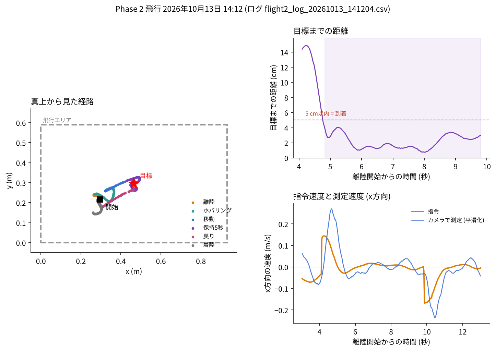

| 測定したもの | 結果 |
|---|---|
| 5秒の保持中の目標までの距離 | 平均2.1 cm、最大4.1 cm。ゆらぎはxで約1.3 cm、yで約1.9 cm |
| 議論する目安 | 10 cm以内の保持。大きな余裕をもって達成。Phase 1は約1 cm以内で保持したので、PCのループは少しゆるい |
| 飛行中にマーカーが見えた割合 | 画像の99%。最長の途切れは0.09秒 |
| 指令した速度 | 最大0.18 m/s。カメラは、短い間に最大0.31 m/sを測った |
| 高度 | 0.30 mに対して0.30〜0.35 m |
| 向き | −3度から+8度の間 |
| 着陸 | 降下中にyの向きに約6 cmずれた。Flow Deckは、床にごく近いと精度が下がる。まだ調べていない |
| 指令から測定速度までの遅れ | 約0.25〜0.3秒(大まかな値、1回の移動から) |
| バッテリー | 開始3.82 V、終了3.44 V |

### 11.8 バッテリー: ログからわかること

10月13日の飛行では、バッテリーは3.82 Vで始まり、3.44 Vで終わりました。着陸の下限より、わずか0.04 V上です。数分後の飛行は、3.80 Vで始まり、ドローンが移動している途中で電圧が3.40 Vまで下がり、スクリプトは設計どおりに自動で着陸させました。3.96 Vで始めたときは、離陸の直後に3.60 Vでした。電圧が下限にこれだけ近いと、飛行が途中で打ち切られることがあります。必ず、4.0 V以上と表示されるバッテリーで飛行を始めてください。充電直後のバッテリーは、最初は高めに読めるので、数分置いてから使ってください。既定の離陸下限4.0 Vは、そのままにしてください。

### 11.9 飛行エリアの奥側でマーカーを見失った

あとの飛行では、離陸と上昇の間、ほとんどすべての画像でマーカーが見えていました。そのあと、ドローンはクリックした目標に向かって飛び、約x = 0.68 m、y = 0.38 mでほぼ止まったところで、マーカーが消え、二度と見えませんでした。その瞬間、ドローンは0.31 mでホバリングしていたので、動きによるぼけではありません。そのあとの3.6秒間、スクリプトは速度ゼロを指令し、ドローンはFlow Deckだけで高度(0.31 m)と向き(3度以内)を保ち、3秒を過ぎたところでスクリプトが着陸させました。これは、マーカー喪失時の着陸の、最初の実際のテストにもなりました。

原因は特定できていません。そのあとで机の上で行ったテストでは、画像が暗いことがわかりました。明るさは255のうち41〜54で、スクリプトが示す適正値の60〜180より低く、一方で鮮鋭度は通常は安定していました(中央値365)。暗い画像ではマーカーのコントラストが下がり、床の暗いところで先にマーカーが検出されなくなる可能性があります。オートフォーカスが迷っていた可能性や、その場所での反射や影もありえます。これらはまだ試していません。

次の手順は、手間が少ないので、エリアの奥側を使う前に行ってください。まず、エリア全体が均一に照らされるよう、横から光を足します。次に、`camera_setup.py`で、露出を1段階明るく(−8の代わりに−7)して、フレームレートの表示が約30のままか確認します。下がるなら−8に戻して、光で補ってください。3つ目に、マーカーを見失った場所で、ホバリング高度の台にマーカーを載せて、ドライランをもう一度行います。スクリプトも、原因の切り分けに役立つようにしてあります。各画像の明るさと鮮鋭度が、ログ(最後の2列)に書かれます。飛行中にマーカーが0.5秒見えなくなると、スクリプトは両方の値を表示し、そのときの画像を`phase2_lost_<時刻>.png`に保存します。

### 11.10 ご自身の研究のために制御器を変える

変える必要のあるものは、すべて`phase2_flight.py`の中にあります。制御器の動きを変えるには、`controller()`を書き換えます。たとえば、一定のずれを消す積分項を足す、軸ごとに別のゲインを使う、時間から目標を計算して円や別の経路を飛ばす、などができます。関数の中では、`ctx.cam`、`ctx.cam_vel`、`ctx.target`、`ctx.phase`が使えます。制御器に手を付けずに、ドローンが行く場所だけを変えるには、`TARGETS`か`phase2_settings.json`を編集します。目標は、必ず飛行エリアの内側にしてください。実験の間も、上限値と11.6節の安全ルールは守ってください。元に戻せるよう、元のファイルのコピーを残しておきます。ログ(`flight2_log_*.csv`)には、画像ごとに、カメラ位置、目標、指令、ドローン自身の推定、バッテリー、画像の明るさと鮮鋭度が入っているので、あとでステップ応答をプロットできます。

---


## 12. トラブルシューティング

| 現象 | 考えられる原因 | 対処 |
|---|---|---|
| `imshow`で`cv2.error: The function is not implemented` | headless版または通常のOpenCVが入っている | 3章のとおり`opencv-contrib-python==5.0.0.93`を入れ直す |
| パッケージを入れたのに、スクリプトがimportできない | インストールしたPythonと、スクリプトを動かしているPythonが違う | `sys.executable`を表示して確認し(3章)、venvを有効にする |
| 「No calibration found」 | ツールはスクリプトの隣の`cf_vision_data`を探すが、別のフォルダーから実行した | プロジェクトのフォルダーから実行する |
| 「could not open camera index N」 | 番号が違う、または別のプログラムがカメラを使っている | 番号を調べ(5.2節)、他のカメラプログラムを閉じ、`vision_pipeline_tool.py`の`CAMERA_INDEX`を変える |
| マーカーが「found」と「not found」の間で点滅する | 画像内でマーカーが小さい、ぼけ、または反射 | 画素数を増やす(1920x1080)、露出を短く、白い余白、均一な光 |
| ドローンが速く動く間、マーカーを見失う映像が多い(ログの`cam_visible`が0) | 動きによるぼけ、小さなマーカー、またはプロペラが隠している | Exposureを上げる(短く)、光を足す、マーカーが平らで遮られていないか確認。飛行はFlow Deckで続き、3秒見失ったときだけ着陸する |
| カメラ設定ではマーカーが見えるのに、飛行スクリプトが「Marker not seen steadily」と言う | 保存された`camera_settings.json`の設定が違う、または検出器が小さなマーカーを見逃している | 起動時に表示される設定の行を読む。スクリプトは画像の明るさ(適正は約60〜180)も表示し、カメラが見ているものを`phase1_no_marker.png`に保存する |
| カメラが毎秒約5フレームしか出ない | 自動露出、またはカメラが遅くしか出せないサイズ | 5.2節: AutoExposureを0にしてExposureを上げ、Sを押す。表で確認するには`camera_fps_test.py`を実行 |
| キャリブレーションの誤差が数画素もあるのに、画像はすべて見つかっている | 小さい画像サイズで印刷した正方形が約10画素しかなく、コーナーの窓が大きすぎた | `vision_pipeline_tool.py`で修正済み。直らなければ、ボードを近づけて枠いっぱいにする |
| 画像が白っぽい、または白飛びしている | 露出が長い、またはサイズ変更後に自動露出がまだ落ち着いていない | Exposureスライダーを上げ、数秒待つ |
| 「The saved calibration was made at about WxH」という警告 | キャリブレーション後にカメラのサイズが変わった | 7章と8章をやり直す |
| 「Y will be mirrored」というWARNING | 4つのクリックが時計回りだった | オプション5をもう一度実行し、反時計回りにクリックする |
| 端のほうで位置が数cmずれる | 基準点を床でクリックした、またはスタンドの高さが違う | 同じ高さのスタンドを使い、上面をクリックする |
| 無線が見つからない、または接続に失敗する | ドライバー(Windows)またはudevルール(Linux)、ドローンの電源が切れている、cfclientがまだ開いている | 3章を確認、cfclientを閉じる、ドローンの電源を確認 |
| Flow Deckが検出されない | デッキが奥まで差し込まれていない | ピンにしっかり押し込み、ドローンの電源を入れ直す |
| スクリプトが飛行を拒否する(バッテリー) | `phase1_flight.py`と`phase2_flight.py`では4.0 V未満(`flow_hover_test.py`では3.8 V未満) | バッテリーを満充電する |
| ドローンが「battery low (3.40 V)」で自動着陸した | バッテリーが満充電ではなく、負荷がかかると電圧が約0.4 V下がる | 充電する。3.4 Vの下限は下げないこと |
| 「legacy hover」の警告 | cflibがドローンのファームウェアより新しい | これまでのテストでは無害。消したいなら、cfclientからファームウェアを更新 |
| 無地の床の上でドローンが流れる、または位置を保てない | Flow Deckにはテクスチャのある面が必要 | 模様のあるマットか、印刷したシートを使う |
| ドローンが間違った方向へ飛ぶ(Phase 1) | 開始時、+Xの方向と機首の向きが合っていない | 8.2節を確認し、機首を+Xに向けて置く |
| 推定器が収束しない(Phase 1) | リセットの前に位置を送った、または原点でマーカーが見えていない | 10章の順番と、原点でマーカーが見えることを確認 |
| 保持が振動する(Phase 2) | ループの遅れに対してゲインが高すぎる | スライダーでKPを下げる、またはKDを約0.2に上げる |
| Phase 2が「marker lost for more than 3.0 s」で着陸する | ある場所でマーカーを見つけられなかった。画像が暗い、または反射があることが多い | 11.9節: スクリプトが表示する明るさと、保存された`phase2_lost_*.png`を確認し、光を足し、`camera_setup.py`で露出−7を試し、ホバリング高度でドライランをやり直す |
| 画像をクリックしても何も起きない(Phase 2) | カメラのウィンドウの外をクリックした、またはドローンがまだ空中にない(クリックは保存され、ホバリングのあとで使われる)、または点がエリアの外(内側に移される) | カメラの画像をクリックする。Cキーでクリックした目標を消せる |
| ドローンが目標から離れていく(Phase 2) | 電源を入れたとき、機首が+Xを向いていなかった | 8.2節。機首を+Xに向けて電源を入れ直す、または`YAW_OFFSET_DEG`を設定する |
| `phase2_settings.json`が無視される | ファイルの書き間違い。スクリプトは「Could not read」と表示して、スクリプト内の値を使う | ファイルを削除するか、`phase2_settings.example.json`をもう一度コピーする |

---

## 13. 別の部屋向けのカメラの選び方

画像内でマーカーがどれだけの幅に写るかが、検出が確実かどうかを決めます。良い見積もりは次の式です。

画像内のマーカーの幅(画素) = 画像の幅(画素) x マーカーの幅(m) / ホバリング高度でカメラが見る床の幅(m)

30 mmのマーカーと幅1920画素のモードでは、実験室で36画素でした。これは、ホバリング高度でカメラが約1.6 mの幅を見ていることに当たります。20画素以上を保つには、カメラが見る幅は、画像の幅 x 0.03 / 20 以下でなければなりません。幅1920画素の画像なら約2.9 m、幅3840画素なら約5.8 mです。これらは見積もりです。端に行くほど、遠近や傾きのせいでマーカーは小さく見えるので、余裕を持たせ、実際の取り付け高さで`camera_setup.py`を使って確認してください。部屋が広く、もっと広い視野が必要なら、ソフトウェアのズームではなく、画素数の多いカメラを使います。デジタルズームでは、実際の細部は増えません。5.3節に、同じ式を実験室のカメラに当てはめた例と、カメラの高さの照合があります。

使う予定のサイズで、そのカメラ自身のソフトウェアで確認してください。高い解像度を一覧に載せていても、実際には甘い画像しか出さないカメラがあります。仕様書を信じず、`camera_setup.py`でマーカーの幅と鮮鋭度の数値を測ってください。

---

## 14. 記録シート

システムが動いたら、これを埋めてください。構成の記録になります。

| 項目 | 値 |
|---|---|
| カメラ | 番号1のカメラのカラーストリーム。「FHD Camera」と報告され、USB IDは VID_1BCF&PID_28C4。実験室のメモではIntel RealSense D435とされていたが、このIDはIntelのものではないため、機種は要確認 |
| Phase 1で使う解像度 | 640x480、手動露出で30 fps(この構成では1920x1080は約5 fpsしか出ない) |
| カメラの床からの高さ | (要測定)。レンズが69.4度なら、画像から約1.2 mと見積もられる(5.3節) |
| カメラ設定(AutoFocus / Focus / AutoExposure / Exposure) | 1 / 90 / 0 / 8(ファイルには露出-8として書かれる) |
| マーカー | ArUco ID 0、DICT_4X4_50、30 mm、40 mmの白い正方形の上、約45度回転 |
| 画像内のマーカーの幅 | 640x480で14 px、1920x1080で32〜36 px |
| 640x480でのキャリブレーション | 15枚中15枚、再投影誤差0.631 |
| 1920x1080でのキャリブレーション | 18枚中18枚、再投影誤差0.331(`cf_vision_data_1080p`に保存) |
| 飛行エリア | 0.93 m x 0.59 m(スタンドの中心から中心)、対角線1.10 m |
| 基準スタンドの高さ = ホバリング高度 | 0.3 m |
| 床マップの確認(原点)、640x480 | (0.000, 0.000) |
| 1920x1080での位置確認A〜E(最大誤差) | 中央の点は約1.5〜2.2 cm以内。640x480では未実施 |
| 640x480でのチェック実行 | 29.7 fps、落ち着いたときのドローン推定とカメラの差0.000 m、動いている間は約1 cm |
| 機首を+Xに向けたヨー角の読み(固定のずれ) | 144度(1920x1080で測定)。Phase 1ではヨー角は使わない |
| cflibのバージョン | 0.1.34 |
| Crazyflieのファームウェアのプラットフォーム | cf2 |
| Pythonのバージョン | 3.14(実験室のPC) |
| 最初の飛行(2026年10月13日) | 3.80 Vで開始。0.31〜0.33 mでホバリングし、目標へ向かって移動、3.40 Vで自動着陸 |
| 全飛行(2026年10月13日 13:08) | 目標で1 cm以内に保持(ゆらぎ約1 cm)、開始位置から約3 cm以内に帰還、バッテリーは開始3.97 V、離陸の落ち込みで3.46 V、ログ`flight_log_20261013_130809.csv` |
| マーカー喪失時の着陸テスト | 10月13日 15:12のPhase 2の実際の飛行で発生: (0.68, 0.38)でホバリング中にマーカーを見失い、速度ゼロ、3秒後に着陸。Phase 1のスクリプトでは未実施 |
| 緊急停止テスト | (未実施) |
| Phase 2の飛行(2026年10月13日 14:12) | 目標での保持: 平均2.1 cm、最大4.1 cm。飛行中にマーカーが見えた割合99%。指令から測定速度までの遅れは約0.25〜0.3秒。バッテリーは3.82 Vから3.44 V。ログ`flight2_log_20261013_141204.csv` |
| Phase 2の設定 | KP 1.0、KD 0.0、VMAX 0.20 m/s、ホバリング0.3 m、目標(0.465, 0.295)で5秒保持 |
| 実験室での画像の明るさ(ドライラン、10月13日 15:16) | 255のうち41〜54(適正は60〜180)。鮮鋭度の中央値365。ドライランの画像のうち、マーカーが見えたのは78%(視界から持ち上げて外した分を含む) |
| 実験室の照明 | 記録なし。エリアの奥側でもマーカーが安定して見える光を追記すること |

---

## 15. このパッケージのファイル

| ファイル | 目的 | 状況 |
|---|---|---|
| `connect_test.py` | 検索、接続、バッテリーの読み取り、Flow Deckの確認。飛ばない | 実機で確認済み |
| `flow_hover_test.py` | 0.3 mまで離陸、3秒ホバリング、着陸。バッテリーとデッキの確認付き | 実機で確認済み |
| `vision_pipeline_tool.py` | メニュー: 1 チェッカーボードの撮影、2 キャリブレーション、3 マーカー検出のライブ表示、4 マーカーの生成、5 床マップ | 実機で640x480と1920x1080で使用済み |
| `camera_setup.py` | 設定ウィンドウ: 解像度、フォーカス、露出、マーカー幅の表示、`camera_settings.json`の保存 | 実機で使用済み |
| `live_tracker.py` | マーカーID 0のx、y、ヨー角をメートルで表示、CSVログ。マーカー検出器は飛行スクリプトでも使う | 実機で確認済み |
| `phase1_flight.py` | Phase 1: カメラ位置をドローンへ、離陸、移動、保持、着陸。飛ばない`--check`モード付き。`flight_log_*.csv`を書く | チェックモードと全飛行を実機で確認済み |
| `phase2_flight.py` | Phase 2: PC上の制御器、無線で速度指令。無線を使わない`--dry`モード付き。スライダー、クリックでの目標指定、設定ファイル。`flight2_log_*.csv`を書く | ドライランと飛行を実機で確認済み |
| `phase2_settings.example.json` | `phase2_flight.py`の設定ファイルの例(`phase2_settings.json`にコピーする、または飛行ウィンドウでSキーを押して書き出す) | 例 |
| `camera_fps_test.py` | サイズ、圧縮方式、露出モードごとの本当のフレームレートを測る | 診断用 |
| `inspect_corners.py` | 画像ごとに検出したチェッカーボードのコーナーを表示し、キャリブレーション誤差が大きい原因を調べる | 診断用 |
| `camera_modes.py` | 解像度ごとに画像を1枚保存して比べる | 診断用 |
| `compare_saved_images.py` | 保存した画像のマーカー幅と鮮鋭度を報告する | 診断用 |
| `camera_settings.example.json` | `camera_setup.py`が書く設定ファイルの例(`camera_settings.json`にコピーすると使える) | 例 |
| `requirements.txt` | Pythonパッケージ | |
| `print/aruco_id0_with_margin_A4.pdf` | マーカーのシート、30〜80 mm、5 mmの余白付き | 100%で印刷 |
| `print/checkerboard_10x7_25mm_A4.pdf` | キャリブレーション用のチェッカーボード | 100%で印刷 |
| `docs/` | このガイド(英語版と日本語版)と図 | |

ツールは、データをスクリプトの隣の`cf_vision_data`フォルダーに書きます。`checkerboard_images/`、`camera_calib.npz`、`floor_homography.npy`、`marker_id0.png`です。このフォルダー1つを移動しても、作業は失われません。

---

## 16. テストの状況と既知の制限

下の表は、システムができること、テストした内容、よく挙がるセットアップの質問をまとめたものです。「達成」は、実験室のハードウェアで実行したことを意味します。作ってあっても、まだ試していないものは、そう書いてあります。

### 16.1 システムができることと、テストの内容

| 項目 | 状況 |
|---|---|
| 頭上のUSBカメラでCrazyflieを撮影する | 達成。640x480で30 fps(5章)。1920x1080でも動くが、実験室のカメラでは約5 fpsしか出ない |
| 機体のArUcoマーカーを認識する | 達成。飛行中、30 mmのマーカーは画像の99%で見つかった。640x480では幅が14画素しかないため、均一な光が必要(11.9節) |
| カメラ座標を飛行エリア内の位置座標に変換する | 達成。レンズのキャリブレーションと床マップ(7章と8章)。メジャーでの確認は、1920x1080で約2 cm。640x480でのメジャー確認は、まだ繰り返していない |
| PCで位置を表示し、記録する | 達成。`live_tracker.py`と飛行スクリプトが、位置をライブ表示し、CSVログを書く |
| Crazyradio経由でCrazyflieに制御入力を送る | 両Phaseで達成。位置の更新と`go_to`指令(Phase 1)、速度指令(Phase 2) |
| 指定位置へ移動し、保持する | 達成。約1 cm以内(Phase 1)、約2 cm以内で最大4 cm(Phase 2)。目安は10 cm |
| 離陸と着陸 | 両Phaseで達成。マーカーを見失ったとき(Phase 2、実際の出来事)やバッテリーが低いとき(両Phase、実際の出来事)の自動着陸も含む。ESCでの着陸は実装済みだが、オフラインでしかテストしていない |
| 緊急停止 | 両スクリプトに実装済み(SPACEとCtrl+C)。**実際の飛行ではまだ試していない。システムをお渡しする前に、低い高度で、柔らかい面の上で試すこと** |
| Pythonのソースコード、構築と実行の手順を公開する | 達成。15章にファイル、3章から11章に手順、19章にコマンドがある。テストはすべてWindowsで行った。Linuxのコマンドは記載したが、未テスト |
| 制御則や目標軌道を、あとから自分で変えられる | 達成。`phase2_flight.py`の`controller()`と`TARGETS`、およびスライダー、クリックでの目標指定、`phase2_settings.json`(11章) |

### 16.2 よくあるセットアップの質問

| 質問 | このパッケージでの答え |
|---|---|
| OSと環境 | テストはすべてWindows(Python 3.14、cflib 0.1.34、仮想環境)で行った。Linuxのコマンドは3章にあるが、実行していない。WindowsのCrazyradioドライバーの手順は3章に記載 |
| 位置をどれだけ保持できるか | 実験室の構成での実測値: 高度0.3 mでの5秒の保持で、約1 cm以内(Phase 1)、約2 cm以内(Phase 2)。これは0.93 m x 0.59 mのエリアと、約1.2 mの高さのカメラでの値。別の構成では、測り直しが必要(14章) |
| 飛行エリア、カメラの高さ、照明、安全ネット | 実験室のエリアは0.93 m x 0.59 m。カメラの高さは約1.2 mという見積もりで、まだ測定していない。照明は重要(11.9節)。安全ネットや囲いはご自身でご用意(2.2節) |
| カメラとコンピューターの用意 | ご自身でご用意。要件は2.2節にある。ソリューションを1機種のカメラでテストした。詳細は5.3節 |
| 予備品と消耗品 | 2.1節で、予備のバッテリー、プロペラ、複数本用の充電器をお勧めしている |
| テストの対象範囲 | ここに書いたテストは、公開しているコードそのものが対象。ご自身で変更した部分は対象外なので、変更する前に、元のファイルのコピーを残すこと |
| 操作する人に見えるもの(GUI) | マーカー、位置、指令、状態の文字を表示するカメラのライブウィンドウ、制御器の設定用の小さなスライダーウィンドウ、クリックでの目標指定、CSVログ。パッケージ化されたGUIアプリはなく、ライブのグラフもない。ログは、あとでプロットできる |

### 16.3 残りの作業

順に書きます。SPACEによる緊急停止の、実際の低い飛行での確認。Phase 1のスクリプトでのマーカー喪失時の着陸テスト(同じ着陸の仕組みは、Phase 2で実際に動作している)。11.9節の光と露出の改善、そのあとの、エリアの奥側への飛行。どのカメラが使われているかの確認と、その高さの測定(5.3節)。640x480でのメジャーによる確認。`EXT_POS_STD`の最適値(Phase 1)。そして、Linuxのコマンドの試行です。

---


## 17. Bitcrazeのcfclientの使い方

BitcrazeがCrazyflie用に用意している公式のプログラムが、Crazyflieクライアント(`cfclient`)です。私たちのスクリプトの一部ではありませんが、飛行の前にドローンの状態を見るのに最も手軽で、私たちのコードなしで手動でも飛ばせます。この章では、起動のしかたと、メインウィンドウの読み方を説明します。内容は、Bitcrazeの資料に基づいています。[Getting started チュートリアル](https://www.bitcraze.io/documentation/tutorials/getting-started-with-crazyflie-2-x/)、[クライアントのインストールのページ](https://www.bitcraze.io/documentation/repository/crazyflie-clients-python/master/installation/install/)、[クライアントのユーザーガイド](https://www.bitcraze.io/documentation/repository/crazyflie-clients-python/master/userguides/userguide_client/)です。

### 17.1 使う場面

無線接続が通っているかの確認、バッテリー電圧とリンク品質の確認、cfclient自身のボタンで数秒飛ばしてモーターとFlow Deckを基本的に試すこと、ファームウェアの更新、そして緊急停止ボタンを使うときに、cfclientを使います。カメラが関わることはすべて、私たちのスクリプトで行います。

Crazyradioを同時に使えるプログラムは1つだけです。私たちのスクリプトを始める前に、cfclientを切断して終了してください。cfclientを始める前にも、スクリプトを終了しておきます。

### 17.2 インストールと起動

Bitcrazeのページが求めるのは、Python 3.10以降です。プロジェクトと同じ仮想環境(3章)に入れても、別の仮想環境に入れてもかまいません。`sudo`は使わないでください。

```
pip install cfclient          # Windows and Linux
cfclient                      # start the client
python -m cfclient.gui        # another way to start it
```

Linuxでは、3章のudevルールに加えて、Bitcrazeが前提パッケージとして次のものを挙げています。

```
sudo apt install git python3-pip libxcb-xinerama0 libxcb-cursor0
```

Windowsでは、Crazyradioのドライバーが必要です(3章)。Bitcrazeはまた、Python 3.13では、インストールにVisual Studioの「C++によるデスクトップ開発」ワークロードが必要だと書いています。実験室のPCのPython 3.14にcfclientを入れたことはないので、そこでインストールに失敗したら、cfclient専用に、古い版(Python 3.12など)の仮想環境をもう1つ作ってください。

### 17.3 接続する

ドローンを平らな場所に置き、電源を入れます。cfclientを起動します。アドレスの欄には、既定のアドレス`0xE7E7E7E7E7`が表示されます。実験室のドローンも同じです。**Scan**をクリックし、ドロップダウンリストからCrazyflieを選びます(実験室のドローンは`radio://0/80/2M`で、私たちのスクリプトの`URI`と同じアドレスです)。そして**Connect**をクリックします。接続されると、タイトルバーに「Connected on radio://0/80/2M」と表示され、右上にバッテリー電圧とリンク品質が出ます。

下の画像の番号は、そのあとのリストで説明します。

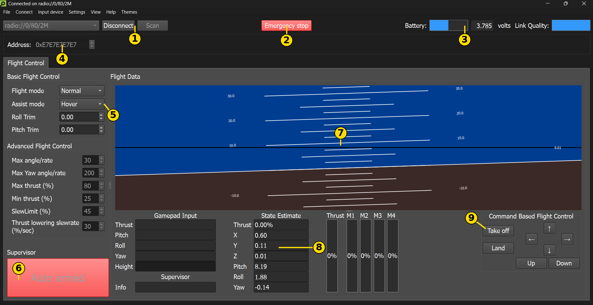

1. 接続の操作部: アドレスのリスト、**Disconnect**、**Scan**。
2. **Emergency stop**(緊急停止)。クリックするとモーターが即座に止まります。ドローンは落ちます。
3. バッテリー電圧(この画像では3.785 V)と、リンク品質のバー。
4. ドローンの無線アドレス。
5. **Flight mode**と**Assist mode**。画像ではNormalとHoverになっています。
6. Supervisorの枠。画像では「Auto armed」と表示されています。
7. フライトデータの表示。ドローンの姿勢を示す人工水平儀です。
8. 状態推定: ドローン自身のx、y、zの位置と、ピッチ、ロール、ヨー。
9. **Command Based Flight Control**: Take off、Land、矢印、Up、Downのボタン。

私たちが読めたBitcrazeのページには、接続の操作部、フライトデータの枠、入力デバイス、緊急停止が説明されています。5、6、8、9については説明がありませんでした。この4つの説明は、画面に表示されている名前から書いたものなので、お使いのバージョンでは、クライアント自身のヘルプで確認してから使ってください。

### 17.4 飛ばす前にドローンを読む

画像のバッテリーは3.785 Vです。これはPhase 1の飛行には低すぎます。私たちのスクリプトは離陸の下限を下回ると離陸を拒否しますし、離陸して数秒でバッテリーは約3.4 Vまで下がります。先に充電してください。リンク品質のバーが満タンかも確認します。また、ドローンが静止しているとき、推定位置(8番)が0に近く、安定していることも確認します。

### 17.5 cfclient自身の操作で飛ばす

方法は2つあり、どちらもBitcrazeの機能で、私たちのものではありません。

1つ目は、Command Based Flight Controlの枠(9番)のボタンです。Flow Deckを付けて、Assist modeをHoverにしておくと、**Take off**でドローンが離陸し、**Land**で着陸します。矢印で動かせます。これから使う床の上で、モーターとFlow Deckを手早く試すのに向いています。最初は低い高さで、手を緊急停止ボタンの近くに置いたまま行います。

2つ目は、少なくとも4つのアナログ軸を持つゲームパッドなどの入力デバイスで、**Input device**メニューから設定します。BitcrazeはXboxとPlayStationのコントローラー用の既定のマッピングを用意していて、「Configure device mapping」で自分のマッピングも作れます。マッピングには、少なくともロール、ピッチ、ヨー、スラストを割り当てる必要があります。接続する前に、フライトデータの枠のスラストの値が0になっていることを確認します。スラストは最も難しい操作なので、そっと始めてください。ドローンの後ろの青いLEDを、自分のほうへ向けておきます。

Bitcrazeのページには、Crazyflie本体の安全上の注意もあります。前方右側のLEDが赤く点灯したままのときは、バッテリーが少ないので、着陸して充電してください。電源を入れた直後に、そのLEDが赤く素早く5回点滅したら、セルフテストの失敗です。

### 17.6 cfclientと私たちのスクリプトを併用するとき

1つ目に、スクリプトの前には、17.1のとおり、cfclientを切断して終了してください。2つ目に、cfclientで変更したパラメーターは、私たちの飛行の設定方法としては当てになりません。`phase1_flight.py`は、必要な設定(Kalman推定器、ハイレベルコマンダー、カメラの信頼値)を、実行のたびに自分で設定します。3つ目に、cfclientは、バッテリー電圧や推定器の値など、ドローンの変数をプロットしたり記録したりできます。このプロジェクトでは、クライアントのその部分を使っていないので、ここでは説明しません。私たちのスクリプトは、自前のCSVログを書きます。

### 17.7 ファームウェア

Bitcrazeは、ファームウェアを最新版に更新することを勧めていて、ユーザーガイドにCrazyradioを使ったやり方が書かれています。更新の間は、クライアントが「idle」と報告するまで、ドローンに触れたり再起動したりしないでください。ファームウェアを更新すると、4.2節で触れた「legacy hover」の警告も消えます。

---

## 18. Phase 2のまとめ

この章は、現状と次にやることを知りたい方のためのものです。詳細は11章にあります。

### 18.1 作ったもの

`phase2_flight.py`は、PC上で動く制御器でドローンを飛ばします。カメラ画像1枚ごとに、`controller()`が位置の誤差を速度に変え、その速度が制限されて、`send_hover_setpoint`でCrazyradio経由に送られます。ドローンは、Flow Deckで、自分の高度と速度を保ちます。スクリプトには、無線を使わないドライランモード、KP、KD、速度上限のためのスライダーウィンドウ、画像をクリックして目標を指定する機能、設定ファイル、画像の明るさと鮮鋭度を含むログ、そして11.6節の安全ルールがあります。

### 18.2 わかったこと

2026年10月13日に、ドローンは離陸し、目標へ飛び、5秒間、平均2.1 cm(最大4.1 cm)以内で保持し、帰還して、着陸しました。マーカーは、画像の99%で見えていました。測った速度は、指令に対しておよそ0.25〜0.3秒遅れていました。あとの飛行では、安全設計が働くことが確認できました。飛行エリアの奥側でマーカーが消え、ドローンはFlow Deckで高度と向きを保ったまま約3.6秒ホバリングし、そのあと自動で着陸しました。どちらの飛行でも、いちばん下限に近かったのはバッテリーでした。電圧は、着陸の下限3.4 Vに対して、3.40〜3.44 Vまで下がりました。

### 18.3 以前の計画との違い

以前の計画は、ハイレベルコマンダーで離陸し、`send_notify_setpoint_stop()`でPCに引き継ぐことでした。この引き継ぎは、必要なくなり、テストもしていません。スクリプトは、cflibの`MotionCommander`と同じように、飛行全体を低レベルのホバーセットポイントで行います。カメラ位置は、既定ではドローンの推定器に送りません(`SEND_EXTPOS = False`)。カメラに反応するループを1つだけにするためです。どちらも設計上の選択で、`SEND_EXTPOS = True`にすれば比べられます。

### 18.4 次にやること

1. 光を直し(11.9節)、エリアの奥側へ飛ばします。そこでマーカーが見え続けない限り、これ以上のチューニングは意味がありません。
2. SPACEによる緊急停止を、一度、低く、柔らかい面の上で試します。
3. チューニングします。`KP`を1.0から少しずつ上げ、オーバーシュートするなら`KD`を0.2くらいにします。ステップ応答(クリックした目標を0.2 mずらす)を記録し、ログからカメラ位置を時間に対してプロットします。
4. `controller()`に、ご自身の制御器を書きます。積分項、時間に沿った経路、研究に合わせたものなどです。
5. 実際の遅れを測ります。0.25〜0.3秒という値は、1回の移動からのものです。速さを変えて何回か移動すれば、よりよい値が得られます。

### 18.5 まだわかっていないこと

エリアの奥側でマーカーを見失った原因(11.9節)。5秒より長い保持や、複数の目標でのドローンの挙動。`SEND_EXTPOS = True`が保持に及ぼす影響。約6 cmの着陸時のずれ。そして、Linuxです。

---

## 19. コマンド一覧

プロジェクトのフォルダーでターミナルを開きます。Linuxでは、`python`を`python3`に読み替えてください。先に仮想環境を有効にします(3章): Windowsでは`venv\Scripts\Activate.ps1`、Linuxでは`source venv/bin/activate`です。

### 19.1 準備(1回だけ)

| 目的 | コマンド | 確認すること |
|---|---|---|
| 環境を作る(Windows) | `python -m venv venv`、続けて`venv\Scripts\Activate.ps1` | プロンプトに`(venv)` |
| 環境を作る(Linux) | `python3 -m venv venv`、続けて`source venv/bin/activate` | プロンプトに`(venv)` |
| パッケージを入れる | `pip install -r requirements.txt` | エラーなし |
| 無線、バッテリー、Flow Deckの確認 | `python connect_test.py` | バッテリー電圧、「Flow Deck detected」 |
| Flow Deckだけでの最初のホバリング | `python flow_hover_test.py` | 0.3 mまで離陸、3秒ホバリング、着陸 |
| カメラ設定(カメラ番号1。最初のカメラなら0) | `python camera_setup.py 1` | マーカーが見つかり、20 fps以上 |
| 画像サイズごとの実際のフレームレートを測る | `python camera_fps_test.py 1` | fpsの表 |
| キャリブレーション、床マップ、マーカーのメニュー | `python vision_pipeline_tool.py` | メニュー: 1 チェッカーボード撮影、2 キャリブレーション、3 ライブ検出、4 マーカー生成、5 床マップ |
| チェッカーボード画像のコーナーを表示 | `python inspect_corners.py` | 各画像のコーナーと鮮鋭度 |

### 19.2 飛行の前と飛行中

| 目的 | コマンド | 確認すること |
|---|---|---|
| 位置のライブ表示とログ | `python live_tracker.py` | マーカーID 0のx、y、ヨー角とCSVログ |
| Phase 1のチェック(飛ばない) | `python phase1_flight.py --check` | 約30 fps、カメラとドローンの列が一致 |
| Phase 1の飛行 | `python phase1_flight.py` | 離陸、目標で保持、帰還、着陸、`flight_log_*.csv`を書く |
| Phase 2のドライラン(無線なし、飛ばない) | `python phase2_flight.py --dry` | 指令が目標のほうを向く |
| Phase 2の飛行 | `python phase2_flight.py` | 離陸、目標で保持、帰還、着陸、`flight2_log_*.csv`を書く |
| Bitcrazeのクライアント(任意。スクリプトの前に閉じる) | `cfclient`、または`python -m cfclient.gui` | cfclientのウィンドウ(17章) |

### 19.3 キー操作

| ウィンドウ | キー | 動作 |
|---|---|---|
| `phase1_flight.py`と`phase2_flight.py`のカメラウィンドウ | ESC | 通常の着陸 |
| | SPACE | 緊急停止: モーターがすぐに止まる |
| | ターミナルでCtrl+C | 緊急停止 |
| `phase2_flight.py`のカメラウィンドウ | 画像をクリック | 床の上の新しい目標(エリアの内側5 cmに収める) |
| | C | 目標リストに戻る |
| | S | KP、KD、VMAX、最大飛行時間、目標を`phase2_settings.json`に保存 |
| `phase2_flight.py`の「Phase 2 controls」ウィンドウ | 3本のスライダー | KP(10倍の値)、KD(10倍の値)、速度上限(cm/s) |
| `camera_setup.py` | 1、2、3、4 | 画像サイズ 640x480、1280x720、1920x1080、3840x2160 |
| | S | カメラ設定を`camera_settings.json`に保存 |
| | P | フルサイズの画像を保存 |
| | R | 却下されたマーカー候補の表示を切り替え |
| | ESC | 閉じる |
| `live_tracker.py` | L | ログのオンオフ |
| | ESC | 閉じる |
| `vision_pipeline_tool.py`のチェッカーボード撮影 | SPACE | 撮影 |
| | ESC | 終了 |

### 19.4 スクリプトが書き出すファイル

| ファイル | 書くもの | 内容 |
|---|---|---|
| `camera_settings.json` | `camera_setup.py` | カメラ番号、サイズ、フォーカス、露出 |
| `cf_vision_data/` | `vision_pipeline_tool.py` | チェッカーボード画像、`camera_calib.npz`、`floor_homography.npy`、`marker_id0.png` |
| `tracker_log_<日付>_<時刻>.csv` | `live_tracker.py` | 時刻、検出の有無、x、y、ヨー角、画素位置 |
| `flight_log_<日付>_<時刻>.csv` | `phase1_flight.py` | 時刻、フェーズ、カメラとドローンの位置、高度、バッテリー |
| `flight2_log_<日付>_<時刻>.csv` | `phase2_flight.py` | 同じ内容に加えて、目標、指令、ドローンの向き、画像の明るさと鮮鋭度 |
| `phase2_settings.json` | `phase2_flight.py`(Sキー) | KP、KD、VMAX、最大飛行時間、目標 |
| `phase2_lost_<時刻>.png`、`phase1_no_marker.png`、`phase2_no_marker.png` | 飛行スクリプト | マーカーを見失ったときに、カメラが見ていたもの |

